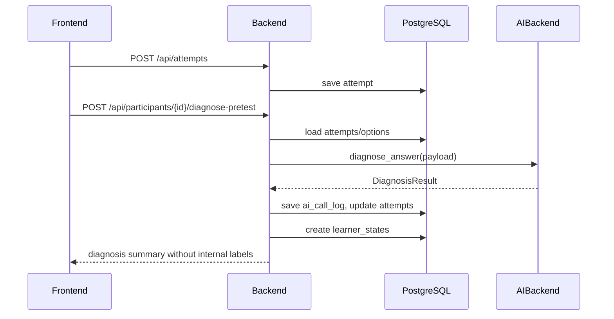
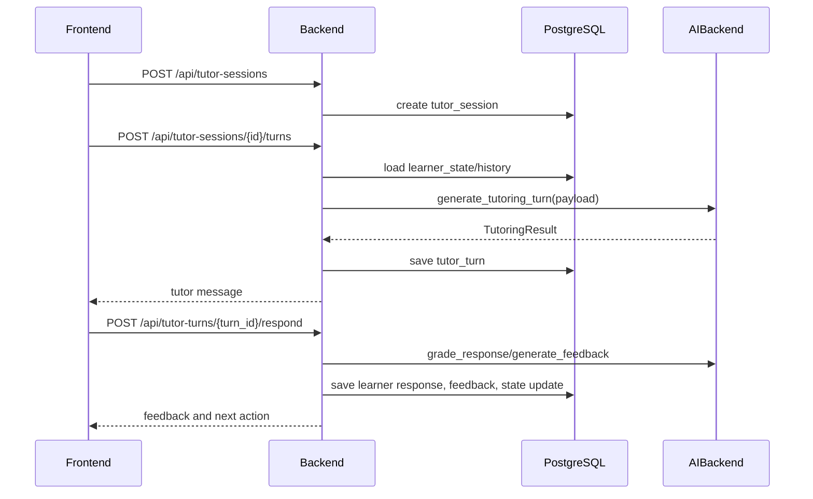

# 05. System Architecture

## 推奨アーキテクチャ

```text
Browser
  ↓
Next.js Frontend
  ↓ REST / optional SSE
FastAPI Backend
  ↓
Application Services
  ├─ ExperimentService
  ├─ QuestionService
  ├─ DiagnosisService
  ├─ LearnerStateService
  ├─ TutoringService
  ├─ ScaffoldingService
  ├─ EvaluationService
  ├─ ExportService
  └─ AiBackendService
  ↓
PostgreSQL
  ↓
AIBackend Interface
  ├─ CodexAppServerBackend（通常実行）
  └─ MockAIBackend（テスト・切り分け専用）
  ↓
Codex app-server
  ↓
ChatGPT/Codex Login
```

## 技術スタック

### frontend

- Next.js
- TypeScript
- React Hook Formまたは同等のフォーム管理
- Tailwind CSS
- chart libraryは軽量なものを利用

### backend

- FastAPI
- SQLAlchemy
- Alembic
- Pydantic
- async PostgreSQL driver
- websockets client for Codex app-server
- pandas互換CSV出力

### db

- PostgreSQL 16系
- Docker volumeで永続化

## モノレポ構成

将来実装時は以下の構成を推奨する。

```text
.
├── frontend/
│   ├── app/
│   ├── components/
│   ├── lib/
│   └── tests/
├── backend/
│   ├── app/
│   │   ├── api/
│   │   ├── core/
│   │   ├── db/
│   │   ├── models/
│   │   ├── schemas/
│   │   ├── services/
│   │   ├── ai/
│   │   ├── seed/
│   │   └── exports/
│   ├── alembic/
│   └── tests/
├── docs/
├── exports/
├── docker-compose.yml
├── Makefile
└── README.md
```

## サービス責務

| Service | 責務 |
|---|---|
| ExperimentService | 参加者作成、進捗管理、群割当、フェーズ遷移 |
| QuestionService | 問題取得、選択肢ランダム化、問題バリアント選定 |
| DiagnosisService | 選択肢・理由記述・AIによる診断の統合 |
| LearnerStateService | 用語別状態、誤概念、学習ステージ互換情報、再発情報の管理 |
| TutoringService | 学習セッションとチューターターン生成 |
| LearningStageService | 用語理解・概念理解の進行、方略変更、研究条件の決定論的制御 |
| EvaluationService | 評価指標、群別集計、用語別集計の計算 |
| ExportService | CSV作成、エクスポート履歴管理 |
| AiBackendService | AIBackend実装の選択、AI呼び出しログ保存 |

管理画面とCSVでは、`Attempt` と `TutorTurn` を物理的に統合しない。Experiment/Exportサービス層で `answer_history` を作り、テスト回答を `source_type=test_attempt`、学習ターン回答を `source_type=learning_turn` として同じ回答履歴に並べる。

## AIBackend抽象化

AI呼び出しは必ず抽象化する。

```python
class AIBackend(Protocol):
    async def diagnose_answer(self, payload: DiagnosisPayload) -> DiagnosisResult: ...
    async def generate_tutoring_turn(self, payload: TutoringPayload) -> TutoringResult: ...
    async def grade_response(self, payload: GradingPayload) -> GradingResult: ...
    async def generate_feedback(self, payload: FeedbackPayload) -> FeedbackResult: ...
    async def summarize_learner_state(self, payload: StateSummaryPayload) -> StateSummaryResult: ...
```

実装:

- `CodexAppServerBackend`: 通常実行用。Codex app-serverを使い、ChatGPT/CodexログインでAI応答を生成する。
- `MockAIBackend`: テスト・CI・障害切り分け用。決定論的に返す。

OpenAI APIキーを直接使う実装は作らない。

## データフロー

### 事前テスト診断



### 提案群学習セッション



## app-server起動方式

### 方式A: host Codex app-server

Macホスト上でCodexをログイン・起動する。現行Docker Composeではbackendを `network_mode: host` で動かし、backendから `ws://127.0.0.1:4500` へ接続する。MVPではこの方式を優先する。

### 方式B: codex sidecar container

Codex CLIを含むコンテナを起動し、device code flowでChatGPTログインする。認証・ブラウザ連携・トークン保存で詰まりやすいため後回し。

## 非同期処理

MVPではキューを導入しない。AI診断やCSV出力は同期APIでよい。ただし以下の処理は将来キュー化できるよう、サービス境界を分ける。

- 大量CSV出力
- 全参加者の評価再計算
- Codex app-server再試行
- 遅延再テスト通知

## 設定値

`.env` で管理する。

| Key | 例 | 説明 |
|---|---|---|
| `APP_ENV` | `development` | 実行環境 |
| `DATABASE_URL` | `sqlite:///./.local/app.db` | ローカル既定DB接続。Docker ComposeではPostgreSQLを指定する |
| `AI_BACKEND` | `codex_app_server` | 通常実行のAI実装。`mock` はテスト時のみ明示指定 |
| `CODEX_APP_SERVER_URL` | `ws://127.0.0.1:4500` | app-server接続先。現行Docker Composeはbackendをhost networkで動かす |
| `CODEX_WS_TOKEN_FILE` | `/run/secrets/codex_ws_token` | capability token |
| `CODEX_APP_SERVER_CWD` | `/tmp` | app-server threadの作業ディレクトリ |
| `CODEX_TURN_TIMEOUT_SEC` | `120` | AI応答タイムアウト |
| `CODEX_REASONING_EFFORT` | `low` | turn/startのreasoning effort |
| `MAX_LEARNING_TARGETS` | `5` | 学習対象数の上限。現行seedはTransformer 1用語 |
| `MAX_TURNS_PER_TERM` | `3` | 1用語あたり最大ターン数 |
| `RANDOM_SEED` | `20260525` | 再現性のあるランダム化 |

## 研究ロジックとAIの分離

AIは診断・説明案・フィードバック案を出すが、以下はbackendが決める。

- 群条件の適用
- 問題の出し分け
- 学習ステージ、構成用語インデックス、互換scaffolding_levelの最終更新
- recurrence_flag
- 評価指標
- CSV出力値

AIに任せすぎると実験条件が揺れるため、研究指標に関わるロジックは決定論的に実装する。
