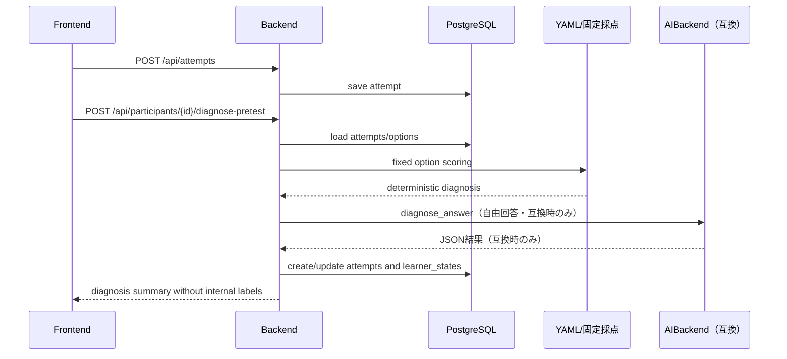
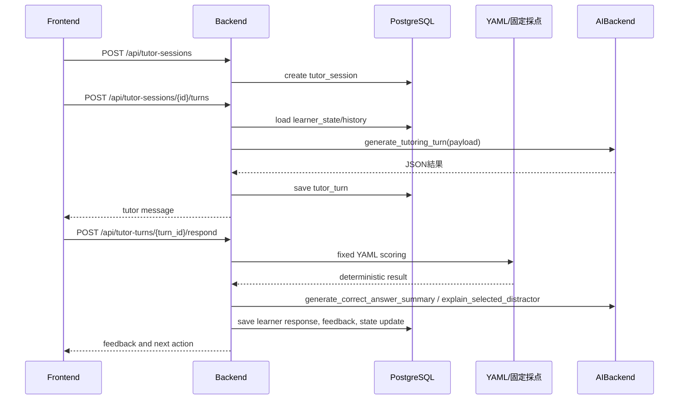
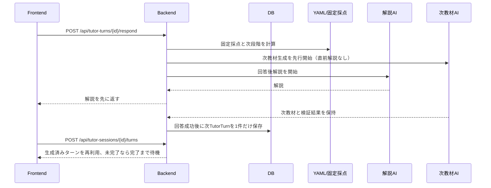

# 05. System Architecture

## 現行MVPの実装

現行コードは、FastAPIの単一backendサービスとNext.js frontendを中心に構成される。実験フロー、問題seed、学習セッション、評価再計算は主に `backend/app/services/experiment.py` に実装され、AI呼び出しは `AIBackend` 経由で `CodexAppServerBackend` または明示指定時の `MockAIBackend` が処理する。Docker Composeではbackend、frontend、PostgreSQLを起動し、ローカルの直接起動ではSQLiteを使用できる。

以下の分離サービス図は将来の責務分割案であり、現行コードに同名の独立サービスクラスがすべて存在することを意味しない。

## 将来の推奨アーキテクチャ

```text
Browser
  ↓
Next.js Frontend
  ↓ REST / optional SSE
FastAPI Backend
  ↓
Application Services
  ├─ ExperimentService
  ├─ QuestionService
  ├─ DiagnosisService
  ├─ LearnerStateService
  ├─ TutoringService
  ├─ ScaffoldingService
  ├─ EvaluationService
  ├─ ExportService
  └─ AiBackendService
  ↓
PostgreSQL
  ↓
AIBackend Interface
  ├─ CodexAppServerBackend（通常実行）
  └─ MockAIBackend（テスト・切り分け専用）
  ↓
Codex app-server
  ↓
ChatGPT/Codex Login
```

## 技術スタック

### frontend（現行）

- Next.js
- TypeScript
- Reactのローカルstateによるフォーム管理
- `frontend/app/globals.css` を中心としたCSS
- 管理画面は現行の一覧・サマリー表示を中心とし、詳細グラフは将来対応

### backend（現行）

- FastAPI
- SQLAlchemy
- Pydantic
- 同期SQLAlchemy engine（PostgreSQLはDocker、ローカルはSQLite）
- websockets client for Codex app-server
- 標準CSV出力

Alembicによるマイグレーション運用、非同期DBドライバ、専用グラフライブラリは将来対応である。

### db（現行）

- PostgreSQL 16系
- Docker volumeで永続化
- ローカル直接起動時はSQLite
- 起動時に `Base.metadata.create_all` と互換用の不足列追加を実行
- IDはアプリケーション上36文字の文字列、構造化列はSQLAlchemyのJSON型

## モノレポ構成

将来実装時は以下の構成を推奨する。

```text
.
├── frontend/
│   ├── app/
│   ├── components/
│   ├── lib/
│   └── tests/
├── backend/
│   ├── app/
│   │   ├── api/
│   │   ├── core/
│   │   ├── db/
│   │   ├── models/
│   │   ├── schemas/
│   │   ├── services/
│   │   ├── ai/
│   │   ├── seed/
│   │   └── exports/
│   ├── alembic/              # 将来のマイグレーション候補
│   └── tests/
├── docs/
├── exports/
├── docker-compose.yml
├── Makefile
└── README.md
```

## 現行コード上の責務境界

| Service | 責務 |
|---|---|
| `backend/app/services/experiment.py` | 参加者作成、問題取得、回答保存、診断、学習状態、再発、学習ターン、評価再計算 |
| `backend/app/seed/content_loader.py` / `seed_questions.py` | YAML検証と問題seed |
| `backend/app/ai/backend.py` | AIBackendプロトコル、方略・段階の互換ロジック |
| `backend/app/ai/codex_app_server_backend.py` | Codex app-server呼び出し、構造化JSON、教材・解説生成 |
| `backend/app/rag/retriever.py` | 用語別RAG検索とLangGraph除外 |
| `backend/app/main.py` | APIルート、起動時DB初期化・seed、管理API |

管理画面とCSVでは、`Attempt` と `TutorTurn` を物理的に統合しない。Experiment/Exportサービス層で `answer_history` を作り、テスト回答を `source_type=test_attempt`、学習ターン回答を `source_type=learning_turn` として同じ回答履歴に並べる。

## AIBackend抽象化

AI呼び出しは必ず抽象化する。

```python
from typing import Any, Protocol

class AIBackend(Protocol):
    provider: str

    async def diagnose_answer(self, payload: dict[str, Any]) -> dict[str, Any]: ...
    async def generate_tutoring_turn(self, payload: dict[str, Any]) -> dict[str, Any]: ...
    async def grade_response(self, payload: dict[str, Any]) -> dict[str, Any]: ...
    async def generate_feedback(self, payload: dict[str, Any]) -> dict[str, Any]: ...
    async def generate_correct_answer_summary(self, payload: dict[str, Any]) -> dict[str, Any]: ...
    async def explain_selected_distractor(self, payload: dict[str, Any]) -> dict[str, Any]: ...
    async def summarize_learner_state(self, payload: dict[str, Any]) -> dict[str, Any]: ...
```

実装:

- `CodexAppServerBackend`: 通常実行用。Codex app-serverを使い、ChatGPT/CodexログインでAI応答を生成する。
- `MockAIBackend`: テスト・CI・障害切り分け用。決定論的に返す。

OpenAI APIキーを直接使う実装は作らない。

## データフロー

### 事前テスト診断



### 提案群学習セッション



## app-server起動方式

### 方式A: host Codex app-server

Macホスト上でCodexをログイン・起動する。現行`.env.example`の既定値は`BACKEND_NETWORK_MODE=host`と`ws://127.0.0.1:4500`で、backendはホストネットワーク上のapp-serverへ接続する。bridgeネットワークを選ぶ場合だけ、backendの接続先を`ws://host.docker.internal:4500`へ上書きし、DB接続先などもその構成に合わせる。

### 方式B: codex sidecar container

Codex CLIを含むコンテナを起動し、device code flowでChatGPTログインする。認証・ブラウザ連携・トークン保存で詰まりやすいため後回し。

## 非同期処理

MVPではキューを導入しない。AI診断やCSV出力は同期APIでよい。ただし以下の処理は将来キュー化できるよう、サービス境界を分ける。

- 大量CSV出力
- 全参加者の評価再計算
- Codex app-server再試行
- 遅延再テスト通知

## 設定値

`.env` で管理する。

| Key | 例 | 説明 |
|---|---|---|
| `APP_ENV` | `development` | 実行環境 |
| `DATABASE_URL` | `sqlite:///./.local/app.db` | ローカル既定DB接続。Docker ComposeではPostgreSQLを指定する |
| `AI_BACKEND` | `codex_app_server` | 通常実行のAI実装。`mock` はテスト時のみ明示指定 |
| `CODEX_APP_SERVER_URL` | `ws://127.0.0.1:4500` | app-server接続先。現行Composeの既定はhost network。bridge構成に上書きする場合は `ws://host.docker.internal:4500` を使う |
| `CODEX_WS_TOKEN_FILE` | optional | capability token。現行composeの既定環境では設定しない |
| `CODEX_APP_SERVER_CWD` | `/tmp` | app-server threadの作業ディレクトリ |
| `CODEX_TURN_TIMEOUT_SEC` | `120` | AI応答タイムアウト |
| `CODEX_MODEL` | `gpt-5.6-luna` | Codex app-serverへ渡すモデル |
| `CODEX_REASONING_EFFORT` | `medium` | turn/startのreasoning effort |
| `RAG_BASE_DIR` | `./rag_agent_knowledge_base` | read-only RAG資産のルート |
| `MAX_LEARNING_TARGETS` | `3` | 学習対象数の上限。現行seedは3用語 |
| `MAX_TURNS_PER_TERM` | `3` | 1用語あたりの目安としてAPIレスポンスに返す値。現行コードはこの値で生成回数を強制制限しない |
| `RANDOM_SEED` | `20260525` | 再現性のあるランダム化 |

## 研究ロジックとAIの分離

AIは教材本文・回答後解説を生成し、自由回答・互換フェーズでは診断・採点・フィードバック案も返し得る。ただし、現行の固定多選択問題では採点とM1/M3/unknown判定にAIを使わず、以下はbackendが決める。

- 群条件の適用
- 問題の出し分けと固定多選択問題の採点
- 学習ステージ、構成用語インデックス、互換scaffolding_levelの最終更新
- recurrence_flag
- 評価指標
- CSV出力値

AIに任せすぎると実験条件が揺れるため、研究指標に関わるロジックは決定論的に実装する。

## 学習ターンの先行生成

学習確認問題で不正解となり、かつ同じ用語に残りの挑戦回数がある場合、回答処理は固定採点結果から次ターンの生成計画を組み立てる。回答後解説のCodex app-server呼び出しと、次教材の`generate_tutoring_turn`呼び出しは別タスクとして同時に開始する。次教材のpayloadには直前のAI解説を含めず、固定採点結果から得た次段階・回答・学習履歴の投影だけを使う。

解説生成が成功するまで、現在の`TutorTurn`、`LearnerState`、回答結果は確定しない。先行生成タスクはAI応答と検証結果を保持し、回答APIのトランザクションが成功した後にだけ次の未回答`TutorTurn`を保存する。解説生成が失敗した場合は先行生成を破棄し、現在の回答も従来どおり確定しない。先行生成が失敗した場合は回答を成功させ、次ターン取得APIが同じセッションの完了を待って通常の同期生成へフォールバックする。



先行生成は単一backendプロセス内のメモリ管理であり、新しいDBテーブルや公開APIは追加しない。セッションのギブアップ時は保留中タスクを中止し、終了済みセッションへ新教材を保存しない。プロセス再起動で保留状態が失われた場合は、次ターン取得時に通常生成する。
