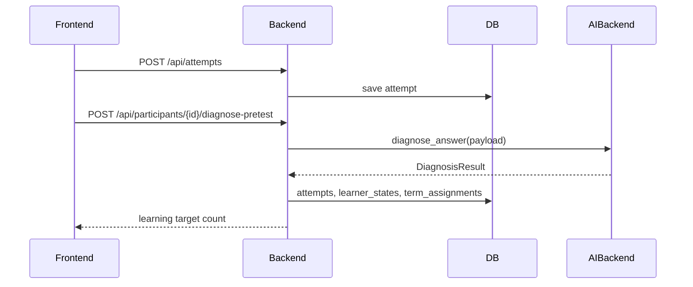
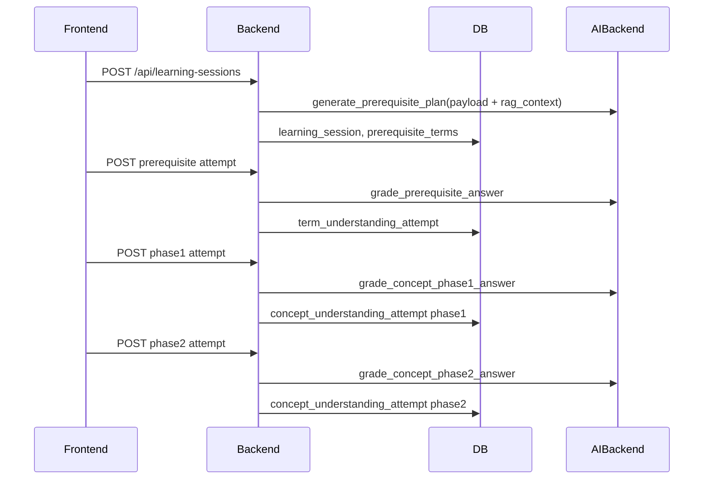
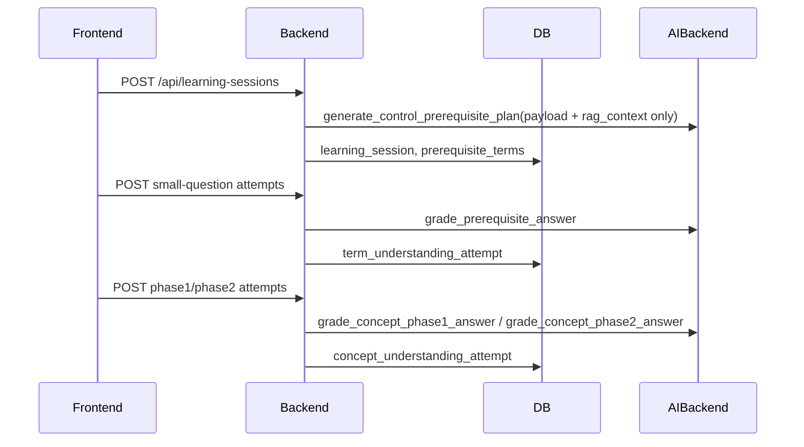

# 05. System Architecture

## 推奨アーキテクチャ

```text
Browser
  ↓
Next.js Frontend
  ↓ REST
FastAPI Backend
  ↓
Application Services
  ├─ ExperimentService
  ├─ DiagnosisService
  ├─ LearningSessionService
  ├─ EvaluationService
  ├─ ExportService
  └─ AIBackendService
  ↓
SQLite/PostgreSQL
  ↓
AIBackend Interface
  ├─ CodexAppServerBackend（通常実行）
  └─ MockAIBackend（テスト・切り分け専用）
  ↓
Codex app-server
```

## 技術スタック

- frontend: Next.js, TypeScript, React
- backend: FastAPI, SQLAlchemy, Pydantic, websockets client
- db: 現行実装はSQLite/PostgreSQL互換のSQLAlchemyモデル
- AI: Codex app-server経由。OpenAI APIキーは使わない
- RAG: `rag_ready_教材` のローカルTF-IDF成果物

## サービス責務

| Service | 責務 |
|---|---|
| ExperimentService | 参加者作成、進捗管理、群割当、フェーズ遷移 |
| DiagnosisService | pretest選択肢に基づく初期診断、学習対象選定 |
| LearningSessionService | control/proposedの3段階学習セッション、提案群の適応的戻り、統制群の非適応小問 |
| EvaluationService | 再テスト採点、再発判定、phase1/phase2指標、群別集計 |
| ExportService | CSV作成、エクスポート履歴管理 |
| AIBackendService | AIBackend実装の選択、AI呼び出しログ保存 |

旧 `ScaffoldingService` 相当のL3/L2/L1更新は現行フローでは使わない。足場掛けは、提案群の前提用語理解、教材あり概念理解、教材なし概念説明、再テストという段階構造で実装する。

## AIBackend抽象化

AI呼び出しは必ず抽象化する。

```python
class AIBackend(Protocol):
    async def diagnose_answer(self, payload: dict) -> dict: ...
    async def generate_prerequisite_plan(self, payload: dict) -> dict: ...
    async def generate_control_prerequisite_plan(self, payload: dict) -> dict: ...
    async def grade_prerequisite_answer(self, payload: dict) -> dict: ...
    async def generate_concept_phase1_material(self, payload: dict) -> dict: ...
    async def grade_concept_phase1_answer(self, payload: dict) -> dict: ...
    async def generate_concept_phase2_prompt(self, payload: dict) -> dict: ...
    async def grade_concept_phase2_answer(self, payload: dict) -> dict: ...
    # legacy compatibility
    async def generate_concept_material(self, payload: dict) -> dict: ...
    async def grade_concept_answer(self, payload: dict) -> dict: ...
    async def grade_response(self, payload: dict) -> dict: ...
```

実装:

- `CodexAppServerBackend`: 通常実行用。Codex app-serverを使い、ChatGPT/CodexログインでAI応答を生成する。
- `MockAIBackend`: テスト・CI・障害切り分け用。決定論的に返す。

OpenAI APIキーを直接使う実装は作らない。

## データフロー

### 事前テスト診断



### 提案群学習セッション



### 統制群学習セッション



## 研究ロジックとAIの分離

AIは教材案、確認質問、フィードバック案を出すが、以下はbackendが決める。

- 群条件の適用
- 問題の出し分け
- 前提用語/概念理解の試行上限
- recurrence_flag
- 評価指標
- CSV出力値
