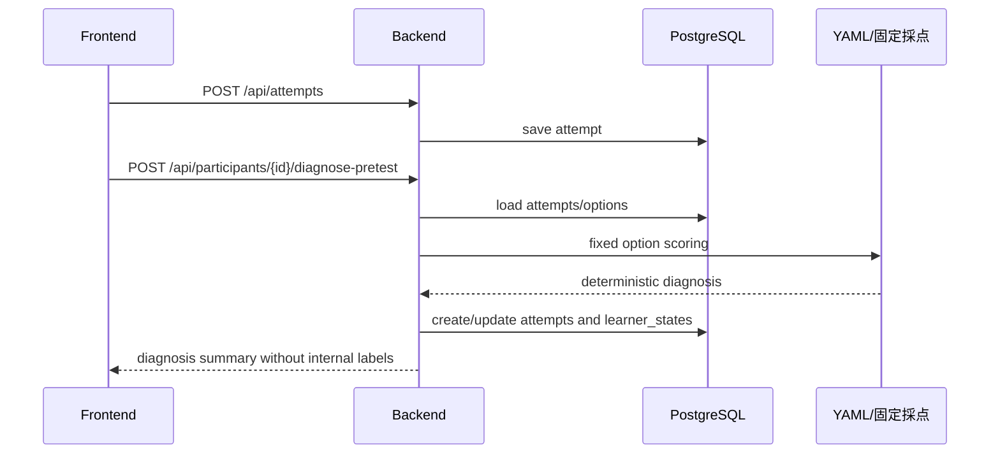
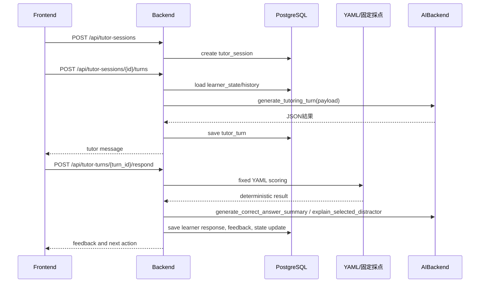
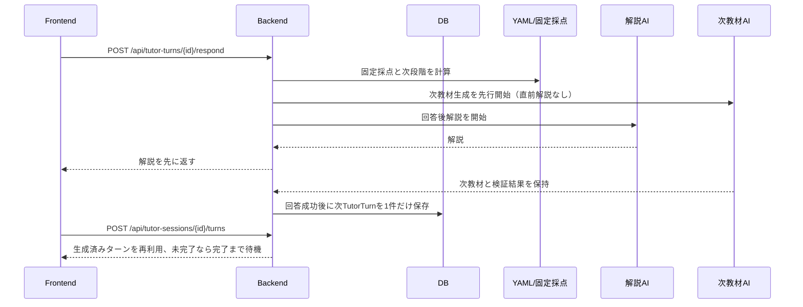

# 05. System Architecture

## 計画書に対する位置づけ

採用仕様は[計画書対応表](20_experiment_plan_alignment.md)。構成図の将来分割案と現行実装を区別する。新6仮説はservices/hypothesis_metrics、新アンケート・表示記録はservices/research_protocolが担当する。旧記録保護は仕様版とprotocol_idで限定する。

現行仕様版52では新規参加者のsnapshotされた問題モードに応じて`split-actions-v5`、`split-actions-basic-v1`、`split-actions-four-topic-v2`を使う。RuntimeSetting保存値を尊重し、未設定時は4用語版を既定とする。application/basic_understandingは各用語の設問1、four_topic_fundamentalsは4用語各1問を出題する。4用語版v2では「ファインチューニング」に用語表記を統一し、仕様版51以前はprotocolに応じて復元する。保存済み回答の選択内容と正誤を同じテスト画面内に表示し、AIサービスは回答採点に呼ばない。必要な全設問が採点済みで全問正解なら、事前・再テスト・内部`final_test`を問わず学習・後続テストを省略して事後アンケートへ進む。特に4用語版の再テスト1満点時は学習対象を固定しない。未達時の既存経路は維持する。結果確認は事前・再テストの登録時snapshotに従う。事後アンケート`posttest-5point-v3`では教材量設問を「教材の量はどの程度でしたか」とし、他の設問・選択肢・集計方法は維持する。登録後の設定変更は既存参加者へ遡及しない。仮説集計はモード別に分離する。事前アンケート理解度の質問文と4用語版の表示用語は保存版を分けて管理する。仕様版51以前はprotocol・snapshotに応じて復元する。仕様版51には早期終了と事後設問文改訂の二つのprotocolがあり、いずれも読み取り専用で保全する。仕様版41の`split-actions-v6-q1-only-v1` protocolは履歴復元用に保全し、protocol IDを使ってV6から復元する。旧設問1・2契約は[詳細](40_question_pair_answer_review.md)。教材用語解説モードは[41](41_learning_glossary_material_mode.md)、文字数目標は[42](42_learning_glossary_material_length.md)、用語辞書と言い換えは[43](43_glossary_definition_paraphrase.md)、問題モードは[50](50_basic_understanding_question_mode.md)・[51](51_four_topic_foundation_mode.md)、事前アンケートは[49](49_presurvey_baseline.md)、事後アンケートは[52](52_posttest_five_point_evaluation.md)。

## 現行MVPの実装

現行コードは、FastAPIの単一backendサービスとNext.js frontendを中心に構成される。実験フロー、問題seed、学習セッション、評価再計算は主に `backend/app/services/experiment.py` に実装され、AI呼び出しは `AIBackend` 経由で `CodexAppServerBackend` または明示指定時の `MockAIBackend` が処理する。Docker Composeではbackend、frontend、PostgreSQLを起動し、ローカルの直接起動ではSQLiteを使用できる。

以下の分離サービス図は将来の責務分割案であり、現行コードに同名の独立サービスクラスがすべて存在することを意味しない。

## 将来の推奨アーキテクチャ

```text
Browser
  ↓
Next.js Frontend
  ↓ REST / optional SSE
FastAPI Backend
  ↓
Application Services
  ├─ ExperimentService
  ├─ QuestionService
  ├─ DiagnosisService
  ├─ LearnerStateService
  ├─ TutoringService
  ├─ ScaffoldingService
  ├─ EvaluationService
  ├─ ExportService
  └─ AiBackendService
  ↓
PostgreSQL
  ↓
AIBackend Interface
  ├─ CodexAppServerBackend（通常実行）
  └─ MockAIBackend（テスト・切り分け専用）
  ↓
Codex app-server
  ↓
ChatGPT/Codex Login
```

## 技術スタック

### frontend（現行）

- Next.js
- TypeScript
- Reactのローカルstateによるフォーム管理
- `frontend/app/globals.css` を中心としたCSS
- 管理画面は現行の一覧・サマリー表示を中心とし、詳細グラフは将来対応

### backend（現行）

- FastAPI
- SQLAlchemy
- Pydantic
- 同期SQLAlchemy engine（PostgreSQLはDocker、ローカルはSQLite）
- websockets client for Codex app-server
- 標準CSV出力

Alembicによるマイグレーション運用、非同期DBドライバ、専用グラフライブラリは将来対応である。

### db（現行）

- PostgreSQL 16系
- Docker volumeで永続化
- ローカル直接起動時はSQLite
- 起動時に `Base.metadata.create_all` と互換用の不足列追加を実行
- IDはアプリケーション上36文字の文字列、構造化列はSQLAlchemyのJSON型

## モノレポ構成

将来実装時は以下の構成を推奨する。

```text
.
├── frontend/
│   ├── app/
│   ├── components/
│   ├── lib/
│   └── tests/
├── backend/
│   ├── app/
│   │   ├── api/
│   │   ├── core/
│   │   ├── db/
│   │   ├── models/
│   │   ├── schemas/
│   │   ├── services/
│   │   ├── ai/
│   │   ├── seed/
│   │   └── exports/
│   ├── alembic/              # 将来のマイグレーション候補
│   └── tests/
├── docs/
├── exports/
├── docker-compose.yml
├── Makefile
└── README.md
```

## 現行コード上の責務境界

| Service | 責務 |
|---|---|
| `backend/app/services/experiment.py` | 参加者作成、問題取得、回答保存、診断、学習状態、再発、学習ターン、評価再計算 |
| `backend/app/services/prefetch.py` | 初回教材レスポンス後の後続用語v1先行生成ワーカー、独立DBセッション、best-effortの待機管理 |
| `backend/app/seed/content_loader.py` / `seed_questions.py` | YAML検証と問題seed |
| `backend/app/ai/backend.py` | AIBackendプロトコル、方略・段階の互換ロジック |
| `backend/app/ai/codex_app_server_backend.py` | Codex app-server呼び出し、構造化JSON、教材・解説生成 |
| `backend/app/rag/retriever.py` | 用語別RAG検索とLangGraph除外 |
| `backend/app/main.py` | APIルート、起動時DB初期化・seed、管理API |

管理画面とCSVでは、`Attempt` と `TutorTurn` を物理的に統合しない。Experiment/Exportサービス層で `answer_history` を作り、テスト回答を `source_type=test_attempt`、学習ターン回答を `source_type=learning_turn` として同じ回答履歴に並べる。

## AIBackend抽象化

AI呼び出しは必ず抽象化する。

```python
from typing import Any, Protocol

class AIBackend(Protocol):
    provider: str

    async def generate_tutoring_turn(self, payload: dict[str, Any]) -> dict[str, Any]: ...
    async def generate_correct_answer_summary(self, payload: dict[str, Any]) -> dict[str, Any]: ...
    async def explain_selected_distractor(self, payload: dict[str, Any]) -> dict[str, Any]: ...
```

実装:

- `CodexAppServerBackend`: 通常実行用。Codex app-serverを使い、ChatGPT/CodexログインでAI応答を生成する。
- `MockAIBackend`: テスト・CI・障害切り分け用。決定論的に返す。

OpenAI APIキーを直接使う実装は作らない。

## データフロー

### 事前テスト診断



### 提案群学習セッション



### #97 学習教材の先行生成

初回教材を返した後、後続の未達用語について現行v2の初回variant教材を先行生成する。旧試用はworker開始前に拒否する。対象用語ごとに独立DBセッションを使い、AI待機中は参加者行・TutorSessionのロックを保持しない。

先行生成用の`TutorSession`は`pending`→`generating`→`ready`と進み、次の用語の既存APIが`ready`の未回答`TutorTurn`をそのまま返して`consumed`へ進める。利用者が先に次の用語へ進んだ場合、workerの結果は`discarded`として保存し、現在のリクエストは従来の同期生成へ切り替える。AI失敗は`failed`と`AICallLog`へ記録し、参加者には返さず、次の用語で通常生成する。内部`IdempotencyRecord`のキーで同じ先行生成を二重実行しない。

現在用語の不正解は先行生成済みの後続用語へ影響させず、現在用語の次ターンだけが既存の`previous_learning_misconception`と履歴で適応される。ギブアップ、実験終了、再テスト後の新しい学習周回では未使用の先行生成を破棄する。先行生成状態は参加者レスポンスや画面へ追加せず、`TutorTurn.diagnosis_json`、`AICallLog`、管理者ログで監査する。未使用の教材は回答履歴と学習負担の実績値へ算入しない。

### #138 共通履歴と診断連動の共通出題

両群で既存proposedの診断連動出題規則を使用し、unknownはenrichment、M1/M3はconceptual_changeを選ぶ。出題規則版はshared-diagnosis-route-v1であり、旧control-fixed-v1を新規処理で使わない。controlのLLMには分類や診断由来段階を渡さない。

services/interaction_history.pyが同じ参加者・用語の採点済みAttempt/TutorTurnを全周回から統合する。ai/interaction_history.pyが共通allowlistとproposed専用allowlistを適用し、履歴内の診断・教授情報も除く。教材・正答要約・誤答解説の3タスクで同じ共通履歴を使い、proposedだけに明示的な誤概念対応を追加する。

同一セッションの次教材では、固定採点した現在回答と時刻を履歴へ投影してAI呼出しを先行する。回答確定後の同期履歴と同じ入力になり、解説失敗時は公開しない。履歴からAI解説を除き、生成教材への過去問題/回答prefix追記をしない。

履歴の版・件数・SHA-256、出題規則版、群別追加情報、入力投影を既存JSONで監査する。仕様版43で統合CSVに`test_content_mode`列を追加し、他の従来列とvalue_jsonを維持する。protocol_id・アンケート・表示時刻・指標のnullable列を使用する。進行・集計・補修は現行仕様版とprotocol_idに限定する。共通テスト回数は既存回数と採点済みfinal_testから導出し、回数用の新列は追加しない。テスト注釈の保存用nullable JSON列は別に追加する。

教材章立ては両群ともAI生成し、material_structureでMarkdownの見出しと節本文を解析する。実験群の必須教授証拠は任意の節本文で検証する。章立て・証拠配置は既存JSONへ記録し、固定見出しからの自動補正はしない。

生成検証は契約内の対象ID・方略・必須フィールド・本文証拠・構造・文字数・禁止文字列を扱う機械検査であり、教材の事実的正しさや反駁の意味的妥当性まで保証しない。入力分離・プロンプト指示・研究者の目視確認は別の責務として扱う。詳細は [AI契約](10_ai_prompt_contracts.md#出力検証) を参照する。

## app-server起動方式

### 方式A: host Codex app-server

Macホスト上でCodexをログイン・起動する。現行`.env.example`の既定値は`BACKEND_NETWORK_MODE=host`と`ws://127.0.0.1:4500`で、backendはホストネットワーク上のapp-serverへ接続する。bridgeネットワークを選ぶ場合だけ、backendの接続先を`ws://host.docker.internal:4500`へ上書きし、DB接続先などもその構成に合わせる。

### 方式B: codex sidecar container

Codex CLIを含むコンテナを起動し、device code flowでChatGPTログインする。認証・ブラウザ連携・トークン保存で詰まりやすいため後回し。

## 非同期処理

MVPでは耐久キューを導入しない。#97の後続用語の先行教材はレスポンス後のbackend内ワーカーで実行し、同じ用語の次ターン教材は回答後解説と並行するタスクで生成する。DBに保存した状態と回答確定の境界を正しさの基準にする。プロセス再起動で`pending`または`generating`が残っても、利用者が到達した時点で同期生成へフォールバックする。backendの固定採点・分類やCSV出力はリクエスト内で処理する。ただし以下の処理は将来キュー化できるよう、サービス境界を分ける。

- 大量CSV出力
- 全参加者の評価再計算
- Codex app-server再試行
- 遅延再テスト通知

## 設定値

`.env` で管理する。

| Key | 例 | 説明 |
|---|---|---|
| `APP_ENV` | `development` | 実行環境 |
| `DATABASE_URL` | `sqlite:///./.local/app.db` | ローカル既定DB接続。Docker ComposeではPostgreSQLを指定する |
| `AI_BACKEND` | `codex_app_server` | 通常実行のAI実装。`mock` はテスト時のみ明示指定 |
| `CODEX_APP_SERVER_URL` | `ws://127.0.0.1:4500` | app-server接続先。現行Composeの既定はhost network。bridge構成に上書きする場合は `ws://host.docker.internal:4500` を使う |
| `CODEX_WS_TOKEN_FILE` | optional | capability token。現行composeの既定環境では設定しない |
| `CODEX_APP_SERVER_CWD` | `/tmp` | app-server threadの作業ディレクトリ |
| `CODEX_TURN_TIMEOUT_SEC` | `120` | AI応答タイムアウト |
| `CODEX_MODEL` | `gpt-6-luna` | Codex app-serverへ渡すモデル。環境設定が優先。管理画面の一時上書きはbackend再起動で消える |
| `CODEX_REASONING_EFFORT` | `low` | 現行既定値。管理上書き不一致を警告・監査 |
| `RAG_BASE_DIR` | `./rag_agent_knowledge_base` | read-only RAG資産のルート |
| `MAX_LEARNING_TARGETS` | `3` | 学習対象数の上限。現行seedは3用語 |
| `MAX_TURNS_PER_TERM` | `3` | 1用語の回答挑戦上限。不正解が上限に達したら未達のまま次用語へ進む |
| `MAX_POST_PRETEST_TESTS` | `2` | final_test込みの事前後テスト上限。2回目未達は未達のままsurvey。事前込み最大3回 |

## 研究ロジックとAIの分離

AIは教材・正答要約・誤答解説だけを生成する。採点とM1/M3/unknown分類、教授方略はbackendが決める。

- 群条件の適用
- 問題の出し分けと固定多選択問題の採点
- 意味的な学習stageと固定教授方略
- recurrence_flag
- 評価指標
- CSV出力値

AIに任せすぎると実験条件が揺れるため、研究指標に関わるロジックは決定論的に実装する。

## 学習ターンの先行生成

学習確認問題で不正解となり、かつ同じ用語に残りの挑戦回数がある場合、回答処理は固定採点結果から次ターンの生成計画を組み立てる。回答後解説のCodex app-server呼び出しと、次教材の`generate_tutoring_turn`呼び出しは別タスクとして同時に開始する。次教材のpayloadには直前のAI解説を含めず、固定採点結果から得た次段階・回答・学習履歴の投影だけを使う。

解説生成が成功するまで、現在の`TutorTurn`、`LearnerState`、回答結果は確定しない。先行生成タスクはAI応答と検証結果を保持し、回答APIのトランザクションが成功した後にだけ次の未回答`TutorTurn`を保存する。解説生成が失敗した場合は先行生成を破棄し、現在の回答も従来どおり確定しない。先行生成が失敗した場合は回答を成功させ、次ターン取得APIが同じセッションの完了を待って通常の同期生成へフォールバックする。



先行生成は単一backendプロセス内のメモリ管理であり、新しいDBテーブルや公開APIは追加しない。セッションのギブアップ時は保留中タスクを中止し、終了済みセッションへ新教材を保存しない。プロセス再起動で保留状態が失われた場合は、次ターン取得時に通常生成する。
