# 全M3選択肢・カテゴリー階層図（Mermaid）

対象：添付「split_assessment_v3_change_comparison (1)(2).md」の **事前テスト9件＋再テストv1 9件＋再テストv2 9件＝全27件**。

## 図の読み方

- 最上段：設問の対象となる上位カテゴリー。
- 左右の枝：**正しい分類**で区別される技術・処理・情報の種類。青と緑は識別用の色で、正誤を表しません。
- **赤い破線（M3）**：その選択肢で、左のカテゴリーを右のカテゴリーと同一視している誤り。これは正しい親子関係を表す線ではありません。
- 各図は**設問の選択肢が前提としている実装・用語を図式化**したもので、普遍的な分類体系を定義するものではありません。「同じ仕組みではない」は「組み合わせて使用できない」の意味ではありません。

### 技術的な裏付けに用いた公式資料

- [OpenAI：Supervised fine-tuning](https://developers.openai.com/api/docs/guides/supervised-fine-tuning) — 事例からモデルの動作を調整する学習工程。
- [OpenAI Agents SDK：Agents](https://openai.github.io/openai-agents-python/agents/) — AIエージェントの定義と複数エージェントの協調。
- [OpenAI Agents SDK：Tools](https://openai.github.io/openai-agents-python/tools/) — 検索などのツールと、エージェントをツールとして呼び出す例外。
- [Microsoft：Multi-agent patterns](https://learn.microsoft.com/en-us/agents/architecture/multi-agent-patterns) — エージェント間の情報受け渡し。
- [AWS：Memory types](https://docs.aws.amazon.com/bedrock-agentcore/latest/devguide/memory-types.html) — 同一セッションの会話履歴と長期記憶。
- [AWS：User preference memory strategy](https://docs.aws.amazon.com/bedrock-agentcore/latest/devguide/user-preference-memory-strategy.html) — 利用者ごとの希望の抽出・保存・統合。

※各選択肢の本文は**添付された比較資料の「整形後」から変更せず転記**しています。図と解説は、その内容を説明するために新しく作成したものです。


## 事前テスト（pretest_v1）


### LLMに知識を与える方法（llm_knowledge）

#### 設問1：最新の取扱説明書を参照する方法｜M3（選択肢C）

**選択肢（整形後・原文そのまま）**

> 追加訓練したAIが学習した内容から回答する方法は、質問のたびに説明書の該当箇所を検索して参照する方法と同じ仕組みだと考えるため、改訂後の取扱説明書の内容をもとにAIを追加訓練し、そのAIが学習した内容から回答させる。

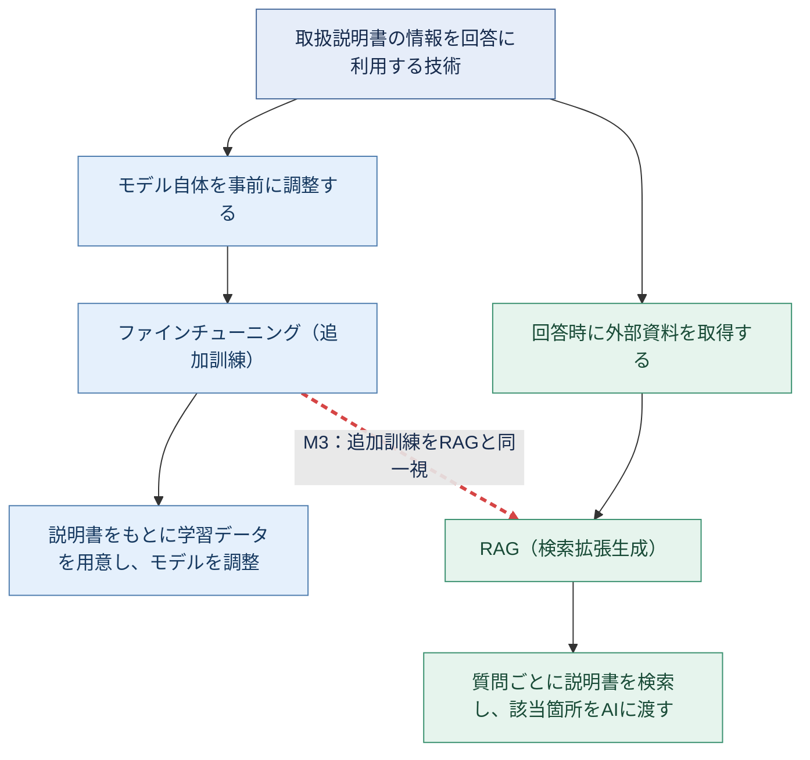

**カテゴリー誤りの位置：** 追加訓練をRAGと同一視。

**診断理由：** 重みの調整を行う訓練方式を、推論時に外部文書を取得する検索方式と同じカテゴリーとして扱っている。

**解釈上の注意：** 追加訓練によって学習した内容を回答に使うことと、資料の該当箇所を検索できることは別。両技術は併用可能。

#### 設問2：回答形式を指定する方法｜M3（選択肢C）

**選択肢（整形後・原文そのまま）**

> プロンプトに含めた取扱説明書の本文から質問に合う情報を選んで回答させる方法は、外部の文書データベースから必要な情報を検索して取り出す方法と同じ仕組みだと考えるため、説明書の本文をあらかじめAIへのプロンプトに含め、その中から質問に合う情報を選んで回答させる。

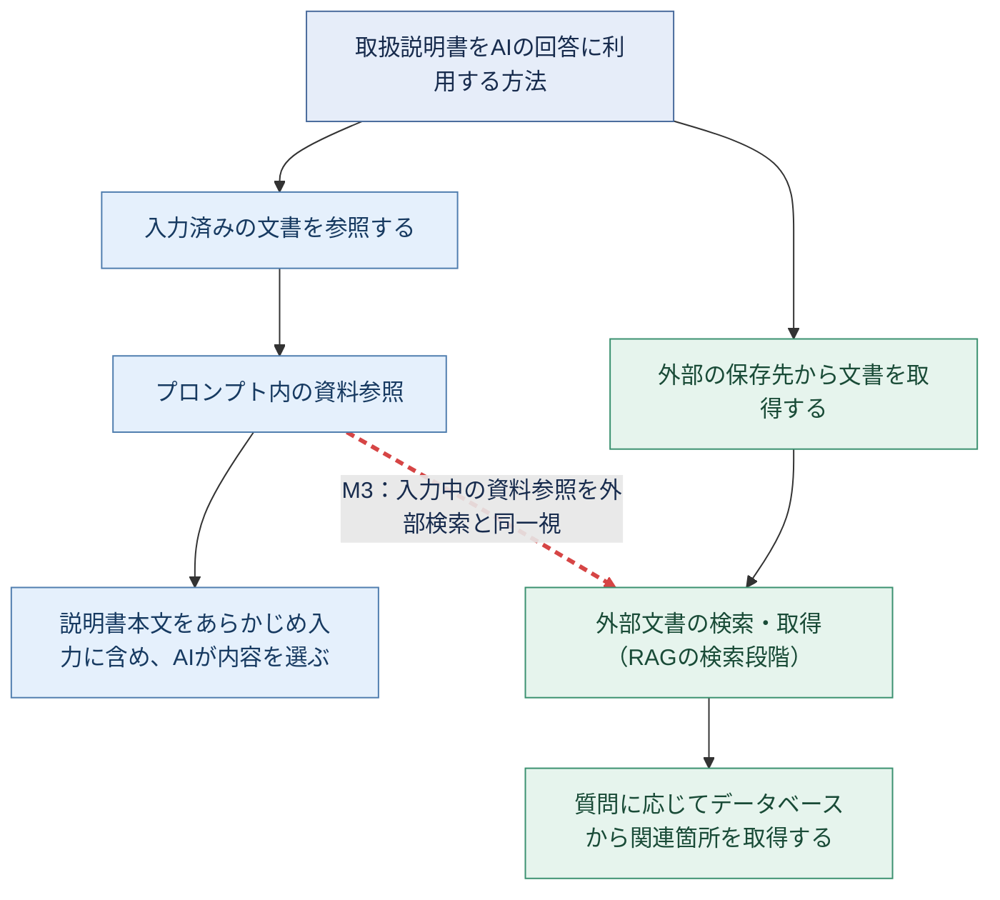

**カテゴリー誤りの位置：** 入力中の資料参照を外部検索と同一視。

**診断理由：** AIにすでに渡した本文から選ぶ処理を、外部データベースに検索問い合わせをして取得する処理と同じカテゴリーに置いている。

**解釈上の注意：** どちらもプロンプトの文脈を利用できるが、外部検索の有無とタイミングが異なる。

#### 設問3：回答例を使った追加訓練｜M3（選択肢C）

**選択肢（整形後・原文そのまま）**

> 回答方法を追加学習させるため、質問と回答の事例をRAGの検索対象へ登録して訓練を済ませる。

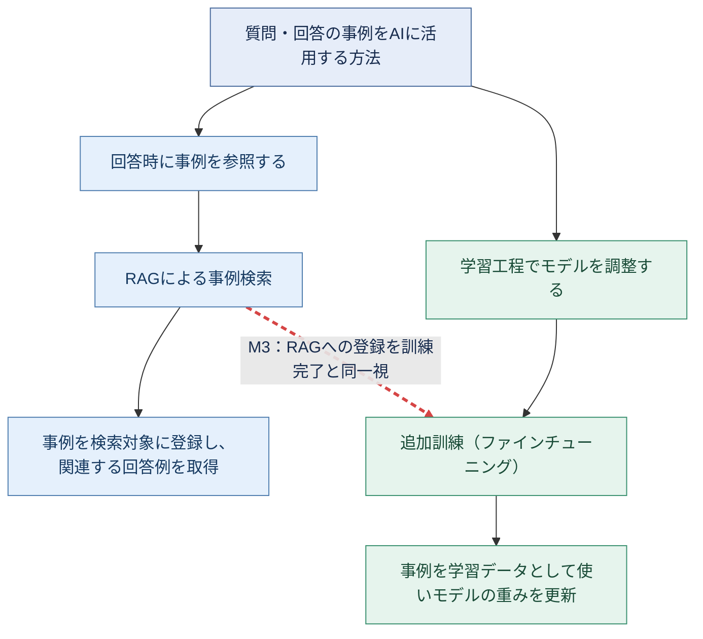

**カテゴリー誤りの位置：** RAGへの登録を訓練完了と同一視。

**診断理由：** 文書や事例を検索可能にする工程を、モデルのパラメーターを更新する学習工程に誤って分類している。

**解釈上の注意：** 同じ事例を検索にも追加訓練にも利用できるが、一方を行ったことだけで他方が成立するわけではない。


### マルチエージェント（multi_agent）

#### 設問1：役割分担｜M3（選択肢C）

**選択肢（整形後・原文そのまま）**

> 1つのAIが「本が図書館にあるかを調べる役」と「本を借りられるかを確認する役」の両方を行う構成は、2つのAIエージェントが役割分担する仕組みと同じだと考えるため、図書館の案内AIにその2つの役割を指示し、1つのAIに両方の仕事を行わせる。

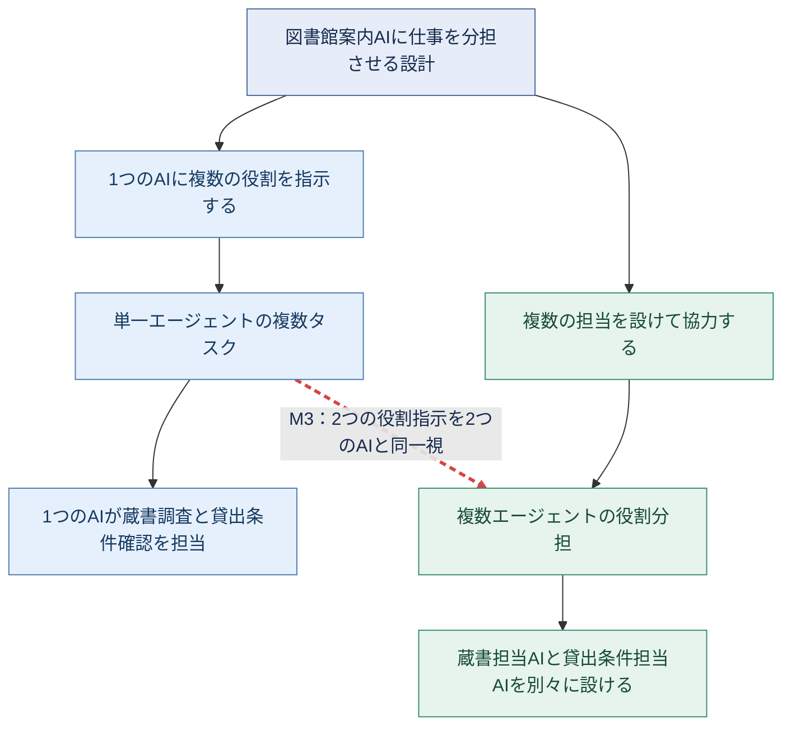

**カテゴリー誤りの位置：** 2つの役割指示を2つのAIと同一視。

**診断理由：** 1つのエージェントに2つの役割を指示した構成を、独立した2つのエージェントを設けた構成と同じカテゴリーに置いている。

**解釈上の注意：** 同じ基盤モデルを共有していても、別々のエージェントを実装することは可能。比較対象はモデル数ではなく担当の構成。

#### 設問2：担当間の情報共有｜M3（選択肢C）

**選択肢（整形後・原文そのまま）**

> 本の一覧や貸出状況を返す検索ツールも貸出に関する情報を調べているため、蔵書担当のAIが使うその検索ツールを、利用条件を確認する別のAIエージェントとして数える。

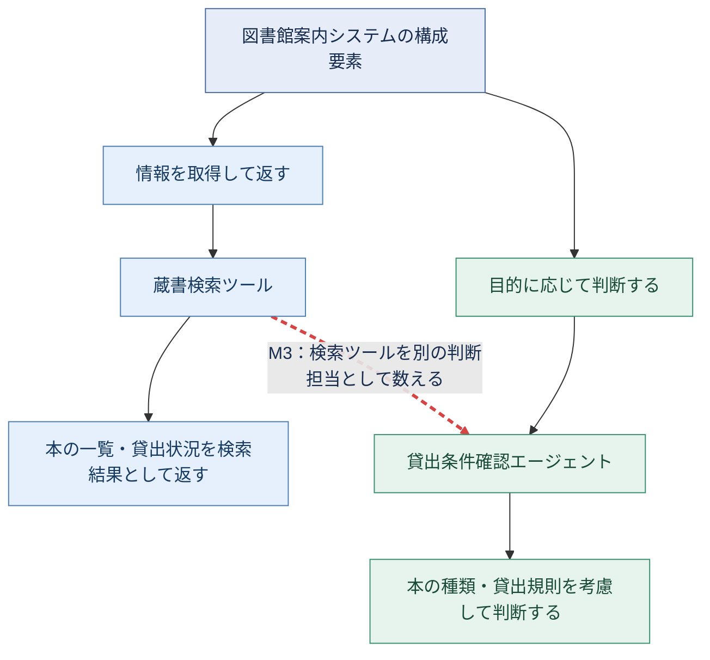

**カテゴリー誤りの位置：** 検索ツールを別の判断担当として数える。

**診断理由：** 本の一覧を返す検索機能を、貸出条件について判断する独立したAIエージェントと同じカテゴリーに分類している。

**解釈上の注意：** エージェントをツールとして呼び出す設計は存在する。ただし本選択肢の「検索結果を返すツール」だけでは、別の判断エージェントを実装したことにならない。

#### 設問3：結果を合わせて案内する｜M3（選択肢C）

**選択肢（整形後・原文そのまま）**

> 貸出可否の条件分岐だけを増やせばエージェント群を構成できると考えるため、判断する担当や情報交換を設けずに、貸出可否の条件分岐だけを増やしてエージェント群を構成する。

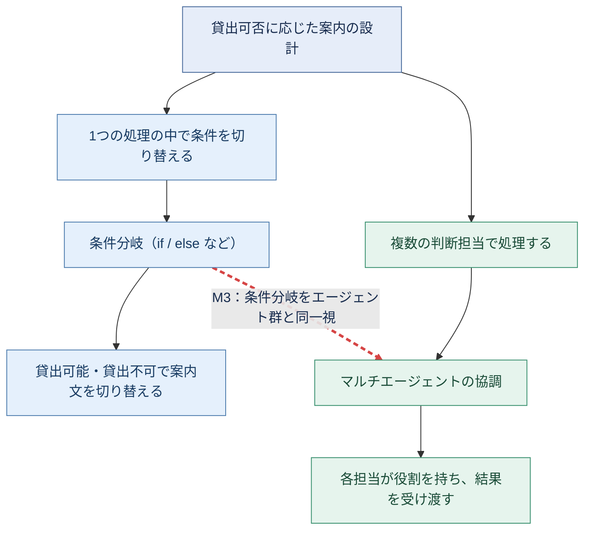

**カテゴリー誤りの位置：** 条件分岐をエージェント群と同一視。

**診断理由：** 処理の分岐の数や経路を、独立したエージェントの数や協調構成に置き換えて捉えている。

**解釈上の注意：** エージェントを切り替える条件分岐も実装できるが、単なるif文だけで担当エージェントが増えるわけではない。


### 記憶プロセス（memory_process）

#### 設問1：希望の保存と利用｜M3（選択肢C）

**選択肢（整形後・原文そのまま）**

> AIを追加訓練することは、利用者ごとの希望を保存して次の相談で取り出す記憶機能と同じ仕組みだと考えるため、利用者が「辛い料理は避けたい」と伝えたとき、その希望に合った献立を回答する質問と回答の例を使ってAIを追加訓練する。

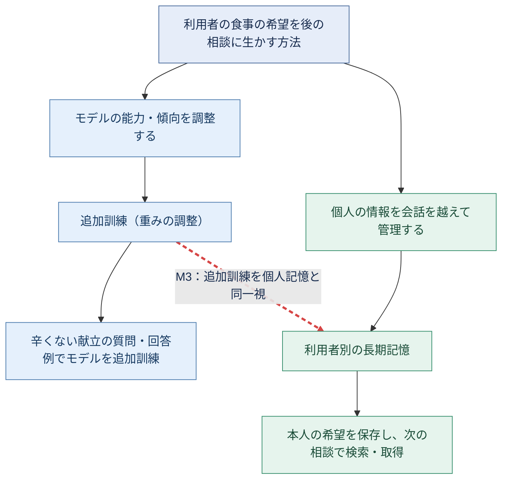

**カテゴリー誤りの位置：** 追加訓練を個人記憶と同一視。

**診断理由：** 一般的な回答傾向を調整する学習処理を、利用者ごとの希望を継続して保存・取得する記憶管理と同じカテゴリーに分類している。

**解釈上の注意：** 個別モデルへの追加訓練は技術的には可能だが、利用者別の保存・検索機能と同義ではない。

#### 設問2：希望の変更｜M3（選択肢C）

**選択肢（整形後・原文そのまま）**

> AIがすべての利用者に共通して使う指示文の変更は、利用者ごとの希望を記憶する仕組みとして利用できると考えるため、利用者が「辛い料理は避けたい」から「少し辛い料理も食べたい」に希望を変更した際、共通指示文を「少し辛い料理も提案する」に変更する。

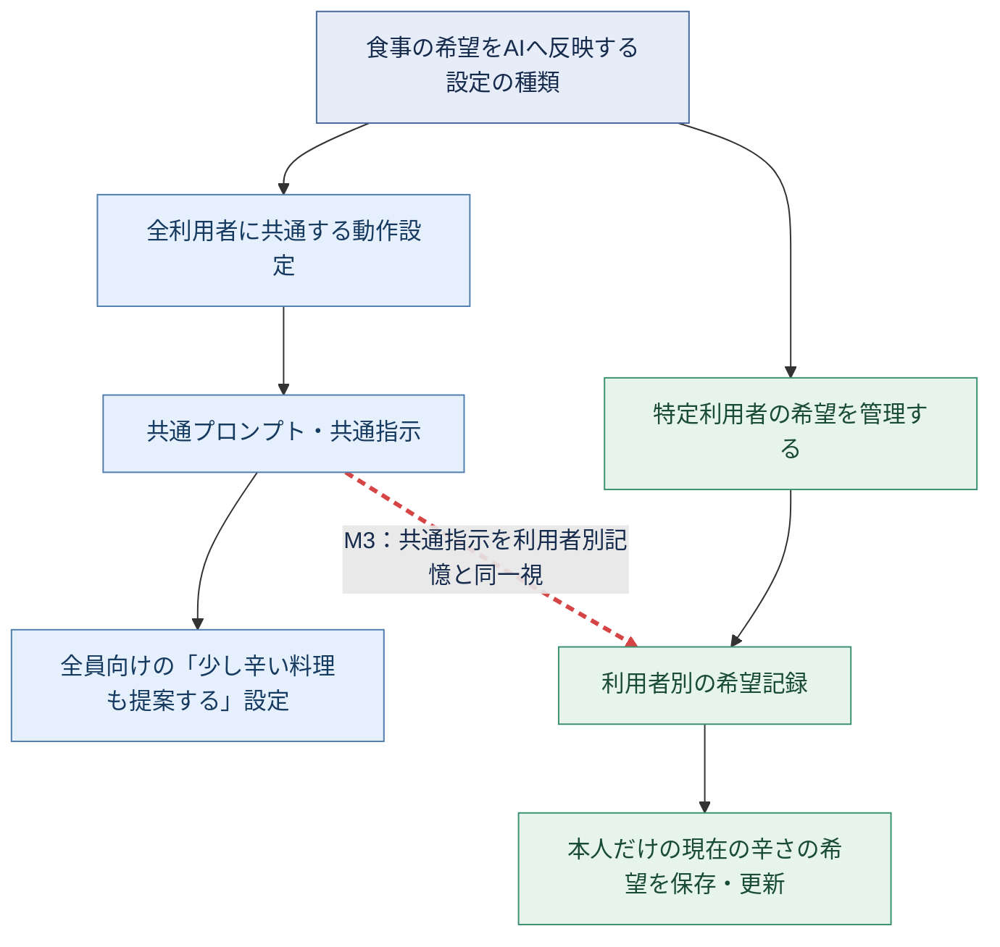

**カテゴリー誤りの位置：** 共通指示を利用者別記憶と同一視。

**診断理由：** 全ユーザーに適用する指示の変更を、特定の利用者が変更した希望の記録を更新する仕組みと同じカテゴリーとして扱っている。

**解釈上の注意：** 共通指示そのものを変更するのは可能。ただし利用者間で異なる希望を区別する記録とは別。

#### 設問3：反応を次回に生かす｜M3（選択肢C）

**選択肢（整形後・原文そのまま）**

> 前回の会話をプロンプトに貼り付ける操作が、会話終了後も情報を保存・検索・更新する記憶機能に当たると考えるため、前回の会話をプロンプトに貼り付けるだけで記憶機能を実現する。

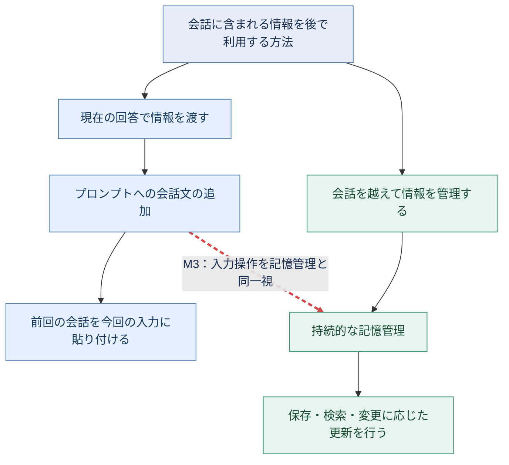

**カテゴリー誤りの位置：** 入力操作を記憶管理と同一視。

**診断理由：** 前回の会話を現在の入力に含める操作を、情報の継続保存・検索・更新を担う仕組みそのものに誤分類している。

**解釈上の注意：** 過去会話を保存して自動挿入するシステムなら記憶機能を構築できるが、「貼り付ける操作だけ」とは区別される。


## 再テスト v1（retest_v1）


### LLMに知識を与える方法（llm_knowledge）

#### 設問1：改訂後の対応手順書を利用する方法｜M3（選択肢C）

**選択肢（整形後・原文そのまま）**

> 追加訓練したAIが学習した内容から回答する方法は、問い合わせのたびに最新の対応手順書を検索して確認する方法と同じ仕組みだと考えるため、改訂後の対応手順書を使ってAIを追加訓練し、そのAIが学習した内容から回答させる。

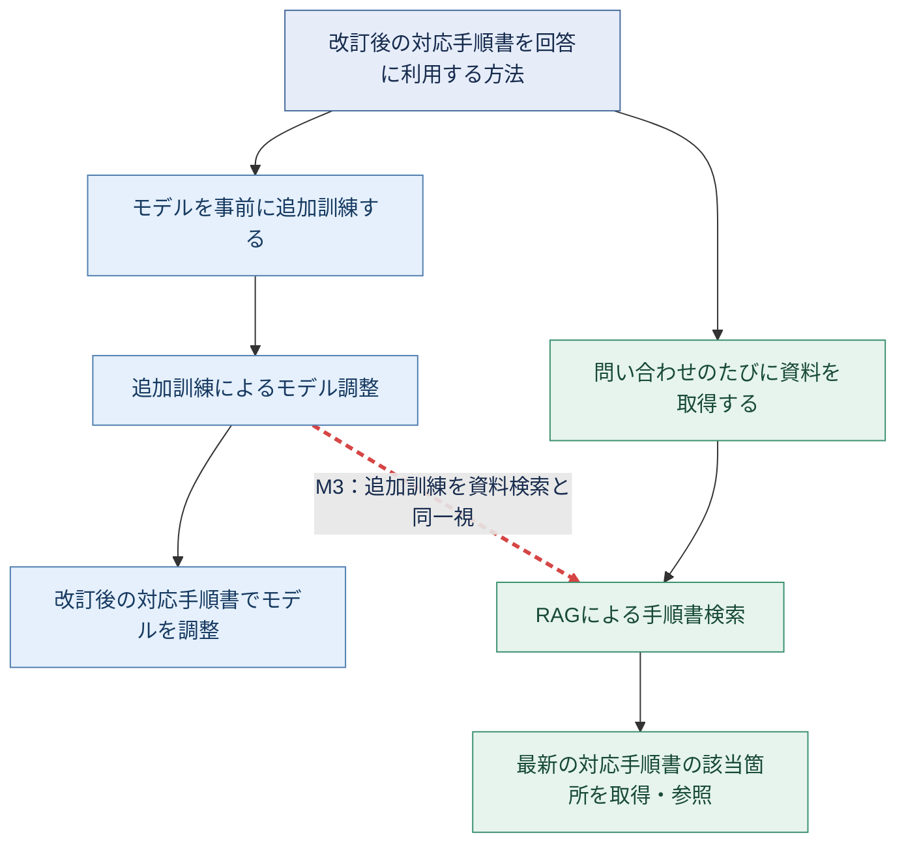

**カテゴリー誤りの位置：** 追加訓練を資料検索と同一視。

**診断理由：** 手順書の学習データで重みを調整したモデルの回答を、毎回最新の手順書を外部検索した回答と同一カテゴリーに置いている。

**解釈上の注意：** 追加訓練では、回答時に最新文書を取得した保証はない。

#### 設問2：回答時の入力を工夫する方法｜M3（選択肢C）

**選択肢（整形後・原文そのまま）**

> 「最新版の対応手順書を確認して答える」と共通指示文（プロンプト）に書くことは、対応手順書から必要な箇所を検索して取り出す仕組みと同じだと考えるため、社員からの質問に応じて、その指示をAIへの共通指示文に書く。

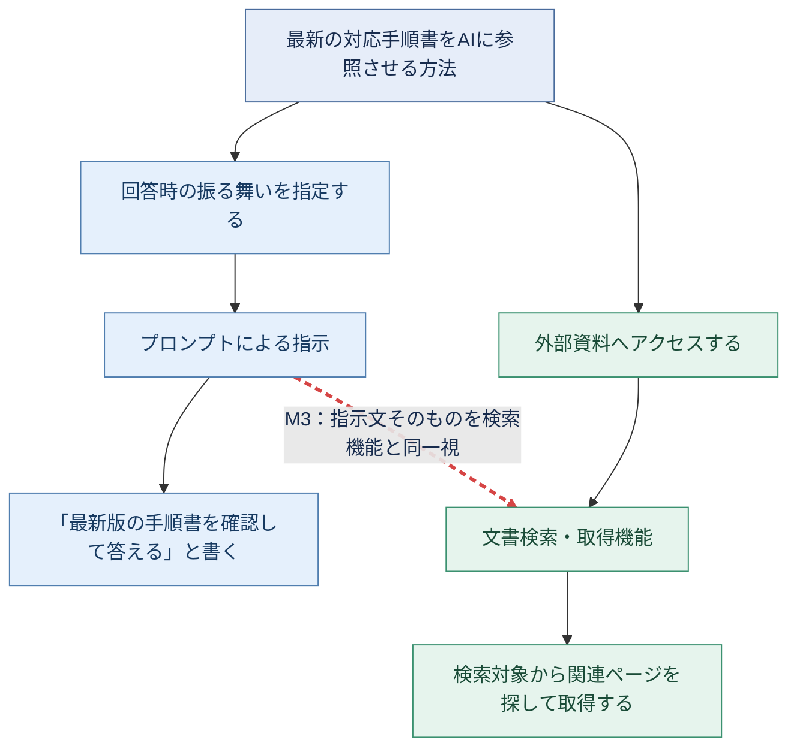

**カテゴリー誤りの位置：** 指示文そのものを検索機能と同一視。

**診断理由：** 文書を確認するよう命令するプロンプトを、実際に文書検索を実行する機能と同じカテゴリーに置いている。

**解釈上の注意：** 検索ツールを呼ぶよう指示すること自体は可能だが、指示の存在だけでは検索手段の実装と同義ではない。

#### 設問3：問い合わせの分類方法を調整する方法｜M3（選択肢C）

**選択肢（整形後・原文そのまま）**

> 保存した分類例から似た事例を検索してAIに渡す方法は、モデル自体を追加訓練する仕組みと同じだと考えるため、担当者が確認した「パスワードを忘れた→アカウント」等の分類例を保存し、問い合わせの度にシステムが似た事例を検索してAIに渡す。

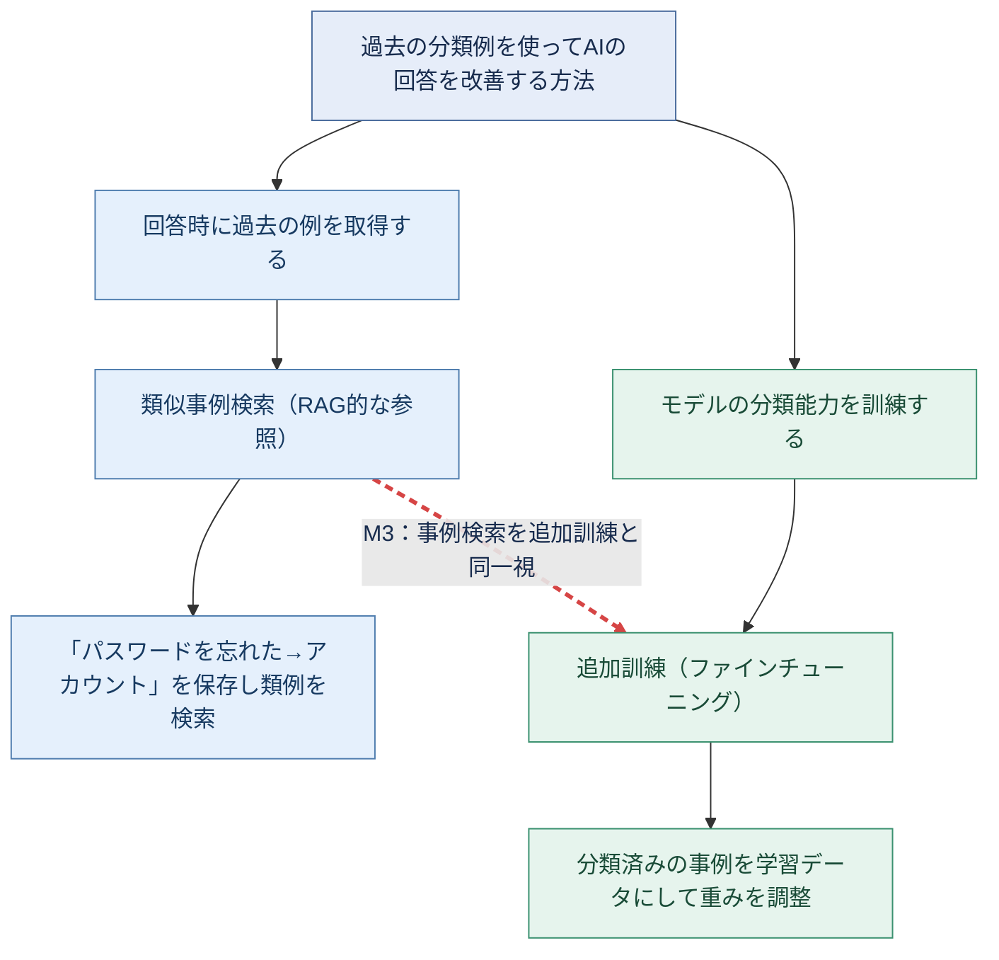

**カテゴリー誤りの位置：** 事例検索を追加訓練と同一視。

**診断理由：** 問い合わせごとの検索・例示を、モデル内部のパラメーターを変更する訓練処理と同じカテゴリーとして扱っている。

**解釈上の注意：** 検索した例を参照すると回答は改善し得るが、重みを更新したことにはならない。


### マルチエージェント（multi_agent）

#### 設問1：役割分担と担当の構成｜M3（選択肢C）

**選択肢（整形後・原文そのまま）**

> 1つのAIに「観光候補」「日程」「移動」の3つの見出しで回答させれば、各見出しが別のAIの担当に当たると考えるため、その3つの見出しで回答させ、複数のエージェントが協力する構成として扱う。

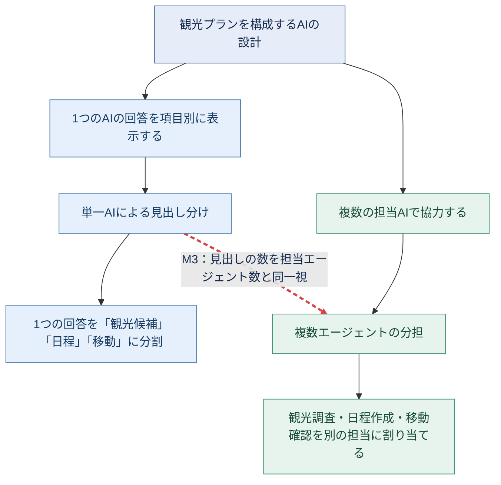

**カテゴリー誤りの位置：** 見出しの数を担当エージェント数と同一視。

**診断理由：** 回答の表示上の3つの見出しを、独立して仕事を行う3つのエージェントと同じカテゴリーとして数えている。

#### 設問2：担当間の情報の受け渡し｜M3（選択肢C）

**選択肢（整形後・原文そのまま）**

> 電車の発着時刻だけを返す乗換検索ツールも、日程担当へ交通情報を渡す役割があるため、その検索ツールを移動条件を判断するAIエージェントの一つとして数える。

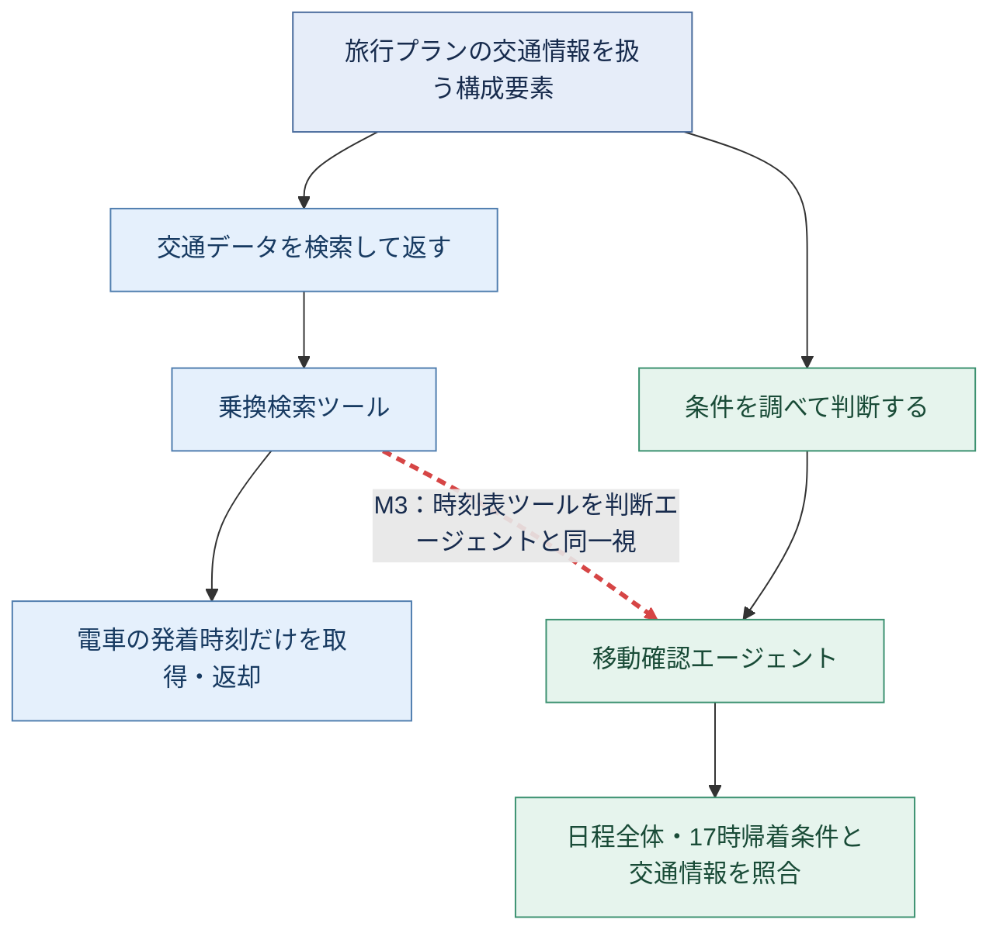

**カテゴリー誤りの位置：** 時刻表ツールを判断エージェントと同一視。

**診断理由：** 発着時刻を返すツールを、旅行計画の実行可能性まで判断する独立のAI担当として扱っている。

**解釈上の注意：** ツールとして提供されたAIエージェントもあり得るが、ここでは単純な時刻検索ツールとして記載されている。

#### 設問3：計画全体の確認と見直し｜M3（選択肢C）

**選択肢（整形後・原文そのまま）**

> 1つのAIが移動距離に応じて徒歩と電車の案内を切り替える場合、切り替え先の処理はそれぞれ独立したAIエージェントに当たると考えるため、切り替え先を複数のAIエージェントとして数え、連携する構成とみなす。

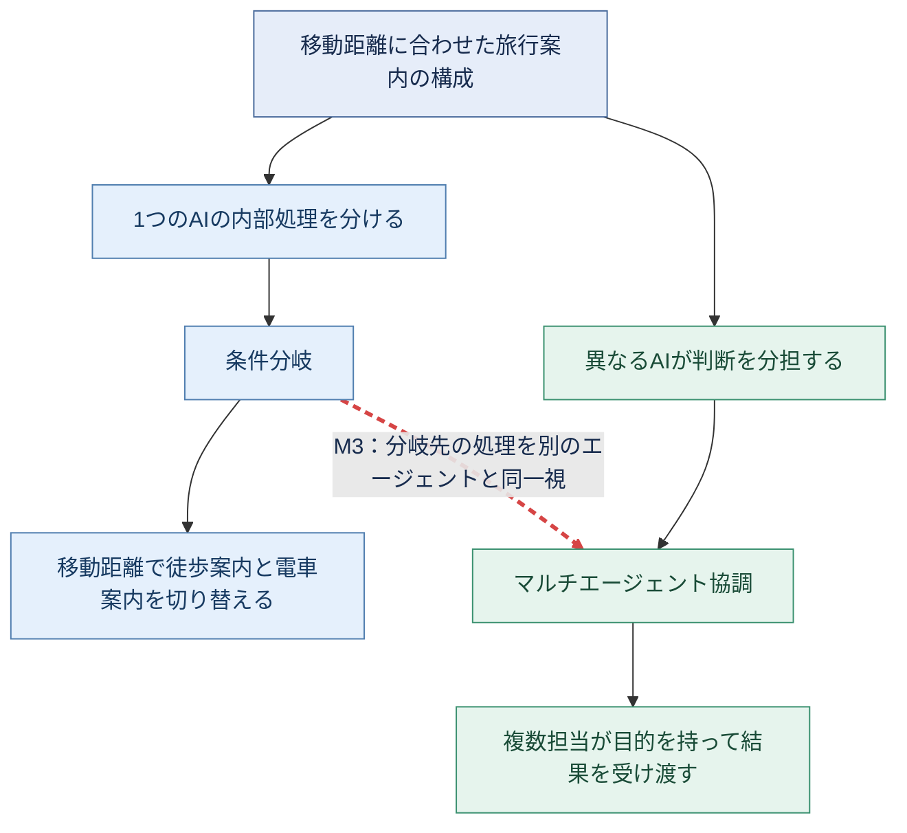

**カテゴリー誤りの位置：** 分岐先の処理を別のエージェントと同一視。

**診断理由：** 単一エージェント内の徒歩・電車への分岐を、別々の判断エージェントとして数えている。


### 記憶プロセス（memory_process）

#### 設問1：希望の保存と利用｜M3（選択肢C）

**選択肢（整形後・原文そのまま）**

> 「ピーマンを避けたい」という希望を追加訓練でモデルの重みに覚えさせる処理は、利用者別の食材の好みを保存し、必要に応じて更新・検索する記憶管理と同じ仕組みだと考えるため、その希望を追加訓練でモデルの重みに覚えさせる。

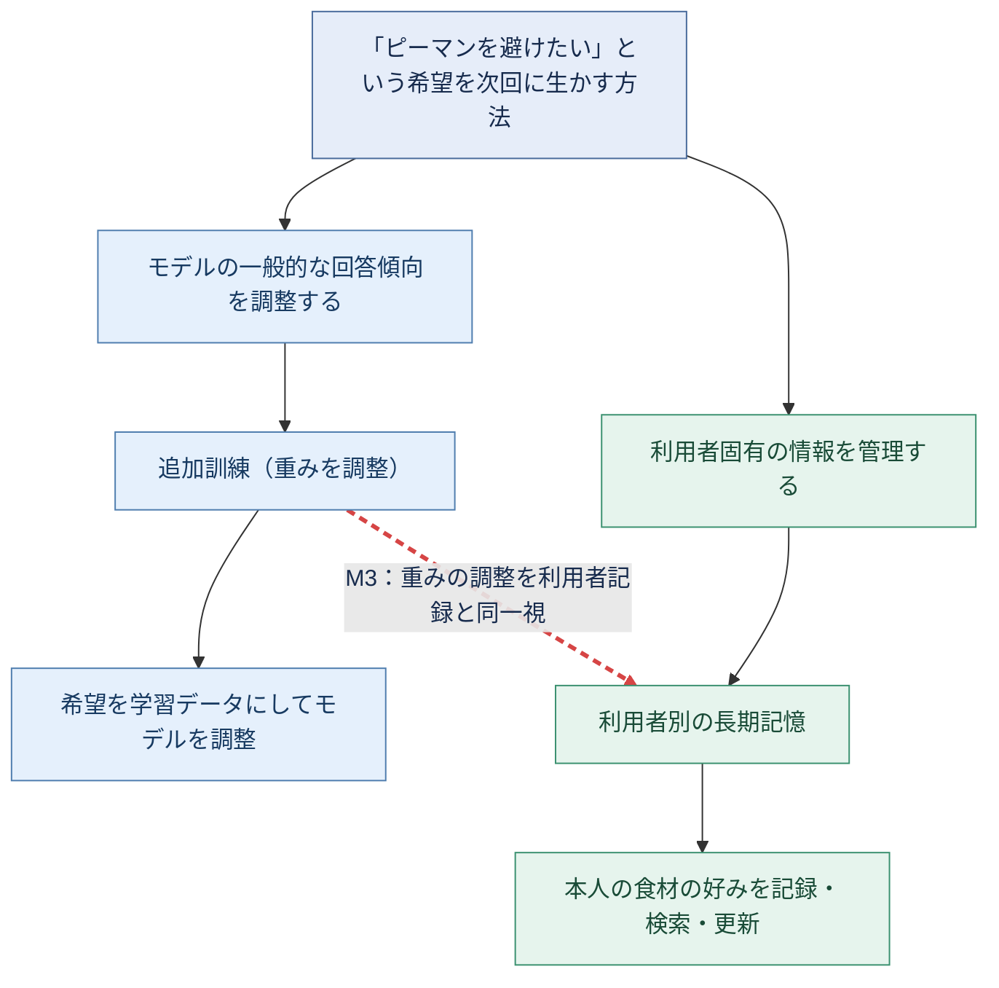

**カテゴリー誤りの位置：** 重みの調整を利用者記録と同一視。

**診断理由：** モデルへの追加訓練を、特定利用者の食材希望を保存して必要時に検索・更新する記憶機能と同じものとして捉えている。

#### 設問2：現在の希望の管理｜M3（選択肢C）

**選択肢（整形後・原文そのまま）**

> 以前AIが提案した「ピーマンを使わない献立」の履歴は、利用者自身が伝えた現在の食材の希望を管理する記憶と同じものだと考えるため、その提案履歴を保存し、現在の希望を管理する記憶として扱う。

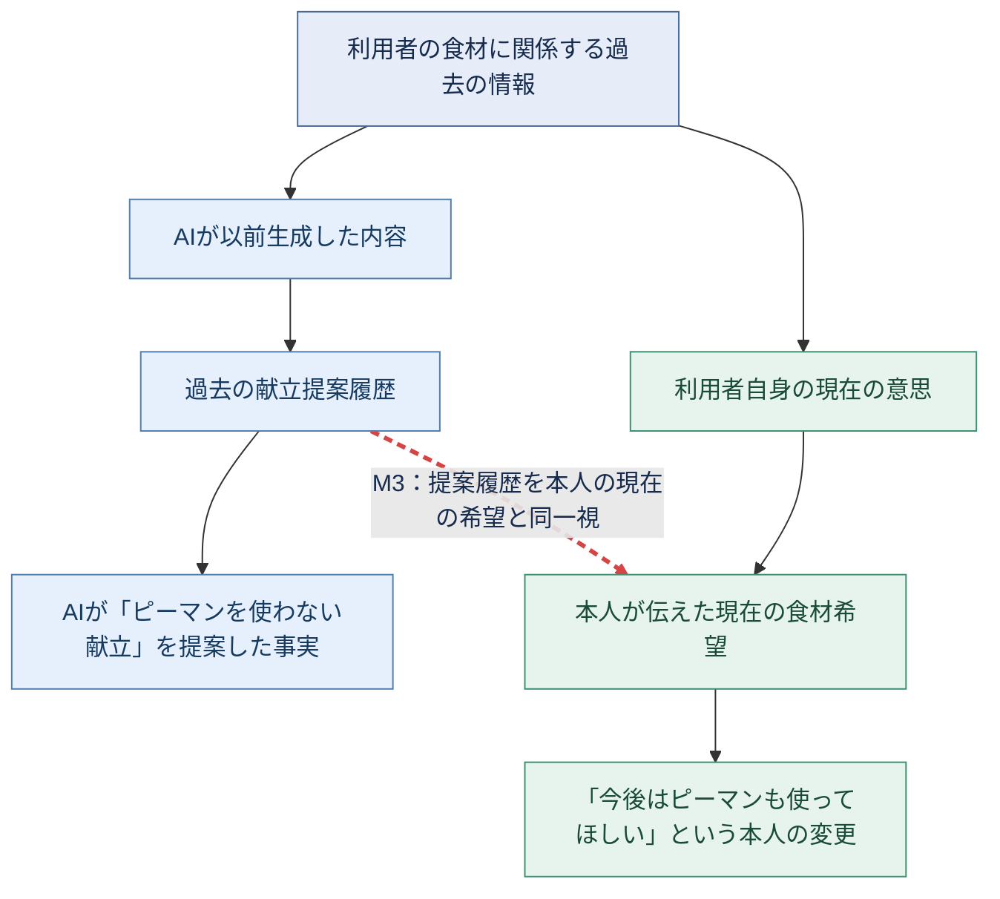

**カテゴリー誤りの位置：** 提案履歴を本人の現在の希望と同一視。

**診断理由：** AI側の過去の提案という記録を、本人の現在の食材希望を表す記録と同じカテゴリーに置いている。

**解釈上の注意：** 提案履歴は希望を推測する手掛かりに使える場合もあるが、希望の現在の有効性や本人の明示的な変更をそのまま保証しない。

#### 設問3：会話で得た情報を後日の提案に生かす｜M3（選択肢C）

**選択肢（整形後・原文そのまま）**

> 同じ会話で「ピーマンも使ってほしい」と伝えた後の献立に希望が反映されたため、会話中の発言を参照する仕組みは別の日の新しい会話でも食材の好みを保存・更新する記憶機能と同じものだと考え、その仕組みを利用する。

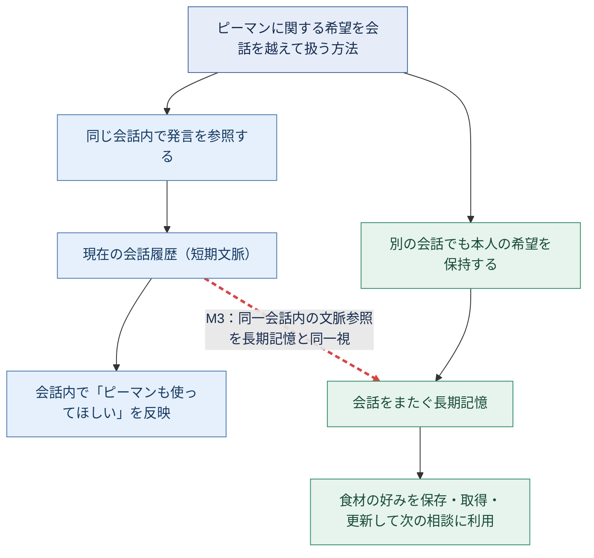

**カテゴリー誤りの位置：** 同一会話内の文脈参照を長期記憶と同一視。

**診断理由：** 同じ会話で発言を反映できたことを、別の新しい会話でも保持・更新できる長期記憶と同じものと見なしている。

**解釈上の注意：** 短期履歴を永続化し後日読み込む仕組みもあるが、記憶なしに同一セッションで参照できることとは別。


## 再テスト v2（retest_v2）


### LLMに知識を与える方法（llm_knowledge）

#### 設問1：改訂後のマニュアルを利用する方法｜M3（選択肢C）

**選択肢（整形後・原文そのまま）**

> 追加訓練したAIが学習した内容から回答する方法は、問い合わせのたびに最新のITサポートマニュアルを検索して確認する方法と同じ仕組みだと考えるため、改訂後のITサポートマニュアルを使ってAIを追加訓練し、そのAIが学習した内容から回答させる。

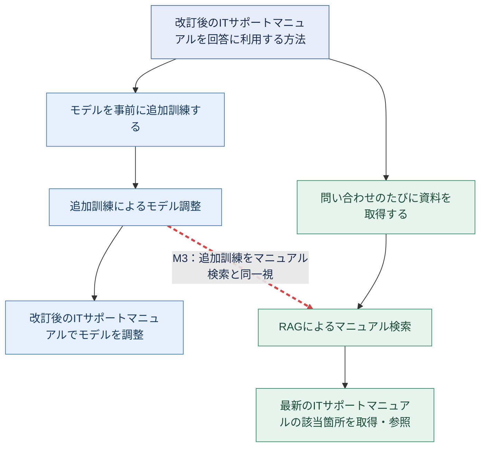

**カテゴリー誤りの位置：** 追加訓練をマニュアル検索と同一視。

**診断理由：** 追加訓練モデルが学習済み情報から回答することを、最新マニュアルを外部検索することと同じカテゴリーに置いている。

**解釈上の注意：** 追加訓練だけで回答時に最新文書の該当箇所が取得されるとは限らない。

#### 設問2：回答時の入力を工夫する方法｜M3（選択肢C）

**選択肢（整形後・原文そのまま）**

> 「最新版のITサポートマニュアルを確認して答える」と共通指示文（プロンプト）に書くことは、ITサポートマニュアルから必要な箇所を検索して取り出す仕組みと同じだと考えるため、教職員からの質問に応じて、その指示をAIへの共通指示文に書く。

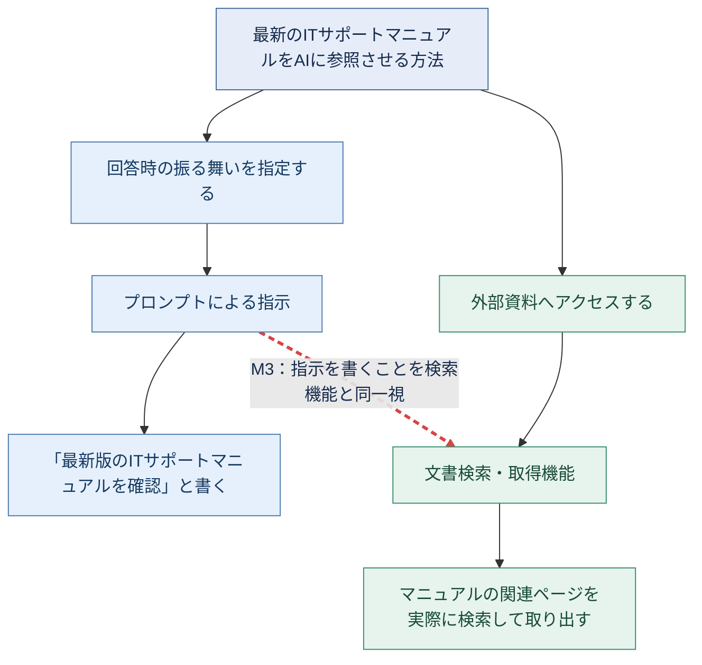

**カテゴリー誤りの位置：** 指示を書くことを検索機能と同一視。

**診断理由：** マニュアルを調べるよう指示文に書く操作と、検索エンジンによってマニュアルから必要情報を取り出す処理を同じカテゴリーに置いている。

**解釈上の注意：** 検索可能なツールと組み合わせて指示すれば資料を調べられるが、指示だけでは検索機能を実装したことにならない。

#### 設問3：問い合わせの分類方法を調整する方法｜M3（選択肢C）

**選択肢（整形後・原文そのまま）**

> 保存した分類例から似た事例を検索してAIに渡す方法は、モデル自体を追加訓練する仕組みと同じだと考えるため、担当者が確認した「学内ポータルのパスワードを忘れた→アカウント」等の分類例を保存し、問い合わせの度にシステムが似た事例を検索してAIに渡す。

```mermaid
flowchart TB
  Root["過去の分類例を使ってIT問い合わせを改善する方法"]
  Root --> L0["回答時に類例を参照する"]
  Root --> R0["学習工程で分類能力を調整する"]
  L0 --> L1["類似事例検索（RAG的な参照）"]
  L1 --> L2["「ポータルのパスワード忘れ→アカウント」を検索"]
  R0 --> R1["追加訓練（ファインチューニング）"]
  R1 --> R2["分類済みの問い合わせ例でモデルの重みを更新"]
  L1 -. "M3：類例検索を追加訓練と同一視" .-> R1
  classDef root fill:#e6edf9,stroke:#496b9c,color:#172b4d
  classDef left fill:#e5f0fc,stroke:#507eaf,color:#173a61
  classDef right fill:#e6f4ed,stroke:#3b9170,color:#194b37
  class Root root
  class L0,L1,L2 left
  class R0,R1,R2 right
  linkStyle 6 stroke:#d64545,stroke-width:3px,stroke-dasharray:6 4
```

**カテゴリー誤りの位置：** 類例検索を追加訓練と同一視。

**診断理由：** 問い合わせごとに類似した分類例を取り出す処理を、モデル自体を訓練する処理と同じカテゴリーに置いている。


### マルチエージェント（multi_agent）

#### 設問1：役割分担と担当の構成｜M3（選択肢C）

**選択肢（整形後・原文そのまま）**

> 1つのAIに「展示候補」「見学計画」「移動」の3つの見出しで回答させれば、各見出しが別のAIの担当に当たると考えるため、その3つの見出しで回答させ、複数のエージェントが協力する構成として扱う。

```mermaid
flowchart TB
  Root["博物館の見学案を構成するAIの設計"]
  Root --> L0["1つのAIの回答を項目別に表示する"]
  Root --> R0["複数の担当AIで協力する"]
  L0 --> L1["単一AIによる見出し分け"]
  L1 --> L2["1つの回答を「展示候補」「見学計画」「移動」に分割"]
  R0 --> R1["複数エージェントの分担"]
  R1 --> R2["展示調査・見学計画・移動確認を別担当に割り当てる"]
  L1 -. "M3：回答欄の数を担当AIの数と同一視" .-> R1
  classDef root fill:#e6edf9,stroke:#496b9c,color:#172b4d
  classDef left fill:#e5f0fc,stroke:#507eaf,color:#173a61
  classDef right fill:#e6f4ed,stroke:#3b9170,color:#194b37
  class Root root
  class L0,L1,L2 left
  class R0,R1,R2 right
  linkStyle 6 stroke:#d64545,stroke-width:3px,stroke-dasharray:6 4
```

**カテゴリー誤りの位置：** 回答欄の数を担当AIの数と同一視。

**診断理由：** 回答中の3つの見出しを、別々に仕事を担当する3つのAIエージェントと同じものとして分類している。

#### 設問2：担当間の情報の受け渡し｜M3（選択肢C）

**選択肢（整形後・原文そのまま）**

> 展示室間の所要時間だけを返す館内経路検索ツールも、見学計画担当へ移動情報を渡す役割があるため、その検索ツールを移動条件を判断するAIエージェントの一つとして数える。

```mermaid
flowchart TB
  Root["博物館の移動情報を扱う構成要素"]
  Root --> L0["移動情報を検索して返す"]
  Root --> R0["条件を調べて判断する"]
  L0 --> L1["館内経路検索ツール"]
  L1 --> L2["展示室間の所要時間だけを取得・返却"]
  R0 --> R1["移動確認エージェント"]
  R1 --> R2["見学順・滞在時間と40分制約を照合"]
  L1 -. "M3：経路検索ツールを判断担当と同一視" .-> R1
  classDef root fill:#e6edf9,stroke:#496b9c,color:#172b4d
  classDef left fill:#e5f0fc,stroke:#507eaf,color:#173a61
  classDef right fill:#e6f4ed,stroke:#3b9170,color:#194b37
  class Root root
  class L0,L1,L2 left
  class R0,R1,R2 right
  linkStyle 6 stroke:#d64545,stroke-width:3px,stroke-dasharray:6 4
```

**カテゴリー誤りの位置：** 経路検索ツールを判断担当と同一視。

**診断理由：** 所要時間のみを返す検索ツールを、見学計画の成立可否まで判断するAIエージェントと同じカテゴリーとして扱っている。

**解釈上の注意：** 本例の検索ツールは所要時間だけを返すと明示されている。

#### 設問3：計画全体の確認と見直し｜M3（選択肢C）

**選択肢（整形後・原文そのまま）**

> 1つのAIが展示室の階数に応じて階段とエレベーターの案内を切り替える場合、切り替え先の処理はそれぞれ独立したAIエージェントに当たると考えるため、切り替え先を複数のAIエージェントとして数え、連携する構成とみなす。

```mermaid
flowchart TB
  Root["博物館の移動方法を切り替える構成"]
  Root --> L0["1つのAIの内部処理を分ける"]
  Root --> R0["複数の担当AIが判断する"]
  L0 --> L1["条件分岐"]
  L1 --> L2["展示室の階数で階段案内とエレベーター案内を切替"]
  R0 --> R1["マルチエージェント協調"]
  R1 --> R2["役割を持つ複数エージェントが結果を受け渡す"]
  L1 -. "M3：階段・エレベーターの分岐を担当AIと同一視" .-> R1
  classDef root fill:#e6edf9,stroke:#496b9c,color:#172b4d
  classDef left fill:#e5f0fc,stroke:#507eaf,color:#173a61
  classDef right fill:#e6f4ed,stroke:#3b9170,color:#194b37
  class Root root
  class L0,L1,L2 left
  class R0,R1,R2 right
  linkStyle 6 stroke:#d64545,stroke-width:3px,stroke-dasharray:6 4
```

**カテゴリー誤りの位置：** 階段・エレベーターの分岐を担当AIと同一視。

**診断理由：** 同じAIの内部にある2つの処理経路を、2つの独立したAIエージェントとして数えている。


### 記憶プロセス（memory_process）

#### 設問1：希望の保存と利用｜M3（選択肢C）

**選択肢（整形後・原文そのまま）**

> 「電話で連絡してほしい」という希望を追加訓練でモデルの重みに覚えさせる処理は、利用者別の連絡方法の好みを保存し、必要に応じて更新・検索する記憶管理と同じ仕組みだと考えるため、その希望を追加訓練でモデルの重みに覚えさせる。

```mermaid
flowchart TB
  Root["「電話で連絡してほしい」という希望を次回に生かす方法"]
  Root --> L0["モデル自体を追加訓練する"]
  Root --> R0["本人の連絡方法を個別に記録する"]
  L0 --> L1["追加訓練（重みを調整）"]
  L1 --> L2["連絡方法の好みを学習データにして調整"]
  R0 --> R1["利用者別の長期記憶"]
  R1 --> R2["電話希望を利用者別に保存・検索・更新"]
  L1 -. "M3：追加訓練を個別記憶と同一視" .-> R1
  classDef root fill:#e6edf9,stroke:#496b9c,color:#172b4d
  classDef left fill:#e5f0fc,stroke:#507eaf,color:#173a61
  classDef right fill:#e6f4ed,stroke:#3b9170,color:#194b37
  class Root root
  class L0,L1,L2 left
  class R0,R1,R2 right
  linkStyle 6 stroke:#d64545,stroke-width:3px,stroke-dasharray:6 4
```

**カテゴリー誤りの位置：** 追加訓練を個別記憶と同一視。

**診断理由：** 学習によってモデルを調整する工程を、特定利用者の連絡希望を保存し取り出す記憶の仕組みと同じカテゴリーに置いている。

#### 設問2：現在の希望の管理｜M3（選択肢C）

**選択肢（整形後・原文そのまま）**

> 以前AIが提案した「電話で連絡する方法」の履歴は、利用者自身が伝えた現在の連絡方法の希望を管理する記憶と同じものだと考えるため、その提案履歴を保存し、現在の希望を管理する記憶として扱う。

```mermaid
flowchart TB
  Root["利用者の連絡方法に関係する過去の情報"]
  Root --> L0["AIが以前生成した内容"]
  Root --> R0["利用者自身の現在の意思"]
  L0 --> L1["過去の案内提案履歴"]
  L1 --> L2["AIが「電話で連絡する方法」を案内した記録"]
  R0 --> R1["本人が指定した現在の連絡方法"]
  R1 --> R2["「今後はメールで連絡してほしい」という最新の希望"]
  L1 -. "M3：過去の案内履歴を現在の本人希望と同一視" .-> R1
  classDef root fill:#e6edf9,stroke:#496b9c,color:#172b4d
  classDef left fill:#e5f0fc,stroke:#507eaf,color:#173a61
  classDef right fill:#e6f4ed,stroke:#3b9170,color:#194b37
  class Root root
  class L0,L1,L2 left
  class R0,R1,R2 right
  linkStyle 6 stroke:#d64545,stroke-width:3px,stroke-dasharray:6 4
```

**カテゴリー誤りの位置：** 過去の案内履歴を現在の本人希望と同一視。

**診断理由：** AIが以前作成した電話連絡案を、利用者自身が現在指定している連絡方法を示す記録と同じカテゴリーに置いている。

**解釈上の注意：** 過去の提案から好みを推測することはあり得るが、本人の最新の指定と同一ではない。

#### 設問3：会話で得た情報を後日の案内に生かす｜M3（選択肢C）

**選択肢（整形後・原文そのまま）**

> 同じ会話で「メールで連絡してほしい」と伝えた後の案内に希望が反映されたため、会話中の発言を参照する仕組みは別の日の新しい会話でも連絡方法の好みを保存・更新する記憶機能と同じものだと考え、その仕組みを利用する。

```mermaid
flowchart TB
  Root["連絡方法の希望を会話を越えて扱う方法"]
  Root --> L0["同じ会話で発言を参照する"]
  Root --> R0["別の新しい会話にも希望を持ち越す"]
  L0 --> L1["現在の会話履歴（短期文脈）"]
  L1 --> L2["会話内で「メールで連絡してほしい」を反映"]
  R0 --> R1["会話をまたぐ長期記憶"]
  R1 --> R2["連絡方法の希望を保存・検索・更新して後日に利用"]
  L1 -. "M3：同一会話の文脈参照を長期記憶と同一視" .-> R1
  classDef root fill:#e6edf9,stroke:#496b9c,color:#172b4d
  classDef left fill:#e5f0fc,stroke:#507eaf,color:#173a61
  classDef right fill:#e6f4ed,stroke:#3b9170,color:#194b37
  class Root root
  class L0,L1,L2 left
  class R0,R1,R2 right
  linkStyle 6 stroke:#d64545,stroke-width:3px,stroke-dasharray:6 4
```

**カテゴリー誤りの位置：** 同一会話の文脈参照を長期記憶と同一視。

**診断理由：** 同じ会話での希望反映を、別の日の新しい相談でも希望を保持する長期記憶と同じカテゴリーとみなしている。

**解釈上の注意：** 会話履歴を永続化し後で読み込む設計は可能だが、単なる会話内参照とは区別が必要。
