# v5で追加されたM3選択肢E・カテゴリー階層図（全27件）

参照ファイル：`split_assessment_v5(10).yml`（status: `active_standard_split_v5`）。**新規に追加されたE（M3）27件**のみを対象にしています。以前からのD（M3）27件は今回の図には含めません。

## 図の読み方

- 最上段：問題で扱う技術や情報の共通目的・上位カテゴリー。
- 青・緑の実線：実際には区別されるカテゴリーへの分類（左右に正誤の優劣はありません）。
- 赤い破線：M3選択肢が**左側の処理／情報を右側の処理／情報と取り違えた関係**。正しい分類関係ではありません。
- 選択肢本文：添付YAMLのE（M3）の`body`を一字も変更せず転載。図・診断理由・注意点は新規に説明用に作成。
- これらはM3を説明する**設問依存の概念図**です。例外的なシステム構成を否定する普遍的な型階層ではありません。

## 参考にした公式資料

- [Amazon Bedrock Knowledge Bases（RAGの検索と生成）](https://docs.aws.amazon.com/bedrock/latest/userguide/knowledge-base.html)
- [OpenAI Agents SDK：Agent orchestration](https://openai.github.io/openai-agents-python/multi_agent/)
- [OpenAI Agents SDK：Tools](https://openai.github.io/openai-agents-python/tools/)
- [Amazon Bedrock AgentCore：User preference memory strategy](https://docs.aws.amazon.com/bedrock-agentcore/latest/devguide/user-preference-memory-strategy.html)
- [Amazon Bedrock AgentCore：Memory types](https://docs.aws.amazon.com/bedrock-agentcore/latest/devguide/memory-types.html)

---


## 事前テスト（pretest_v1）


### LLMに知識を与える方法（llm_knowledge）

#### 設問1：最新の取扱説明書を参照する方法｜M3・E

**選択肢E（添付v5の原文）**

> 製品の新しい操作手順をAIに学習させるため、改訂後の取扱説明書をRAGの検索用索引に登録する。説明書が更新された場合も索引の内容を入れ替えて対応し、利用者から質問を受けた際は、登録した内容を学習済みのAIに操作手順や注意点を案内させる。

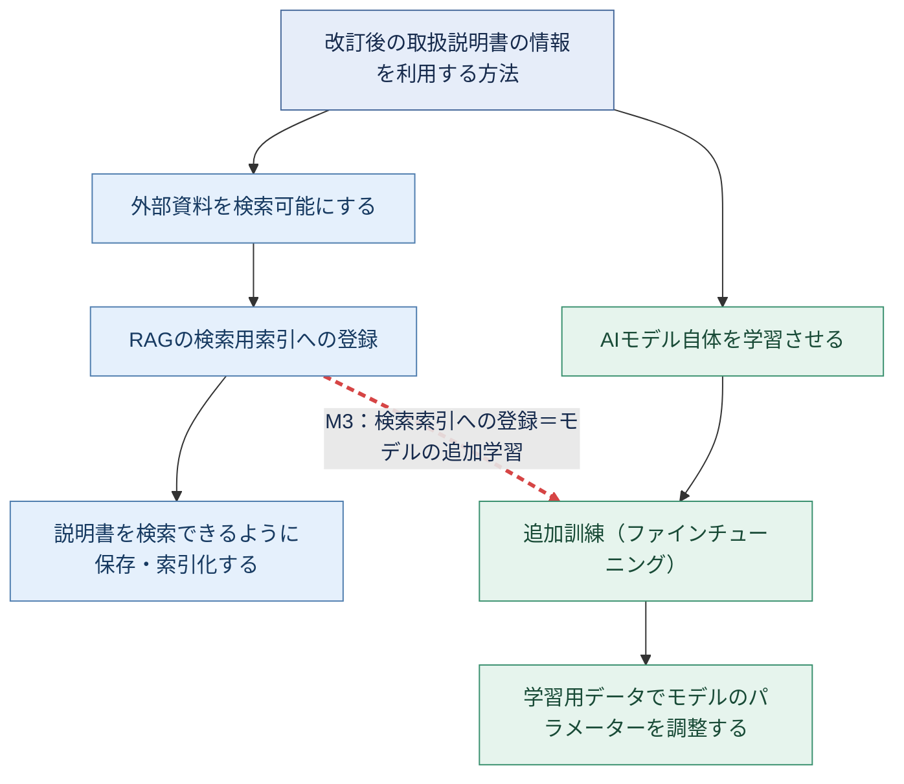

**取り違え：** 検索索引への登録＝モデルの追加学習。

**M3の診断理由：** 説明書の索引を更新して検索可能にすることを、モデルの重みを更新して操作手順を学習させることと同一視している。

**技術的な注意点：** 索引を更新すると回答時に新しい情報を利用できるが、それだけでモデルの重みが変わったわけではない。


#### 設問2：回答形式を指定する方法｜M3・E

**選択肢E（添付v5の原文）**

> プロンプトで回答順を指定する操作はモデルの重みを追加訓練で更新する処理と同じため、「結論・操作手順・注意点」の指示文を設定し、その入力操作をモデル自体の形式調整として利用する。

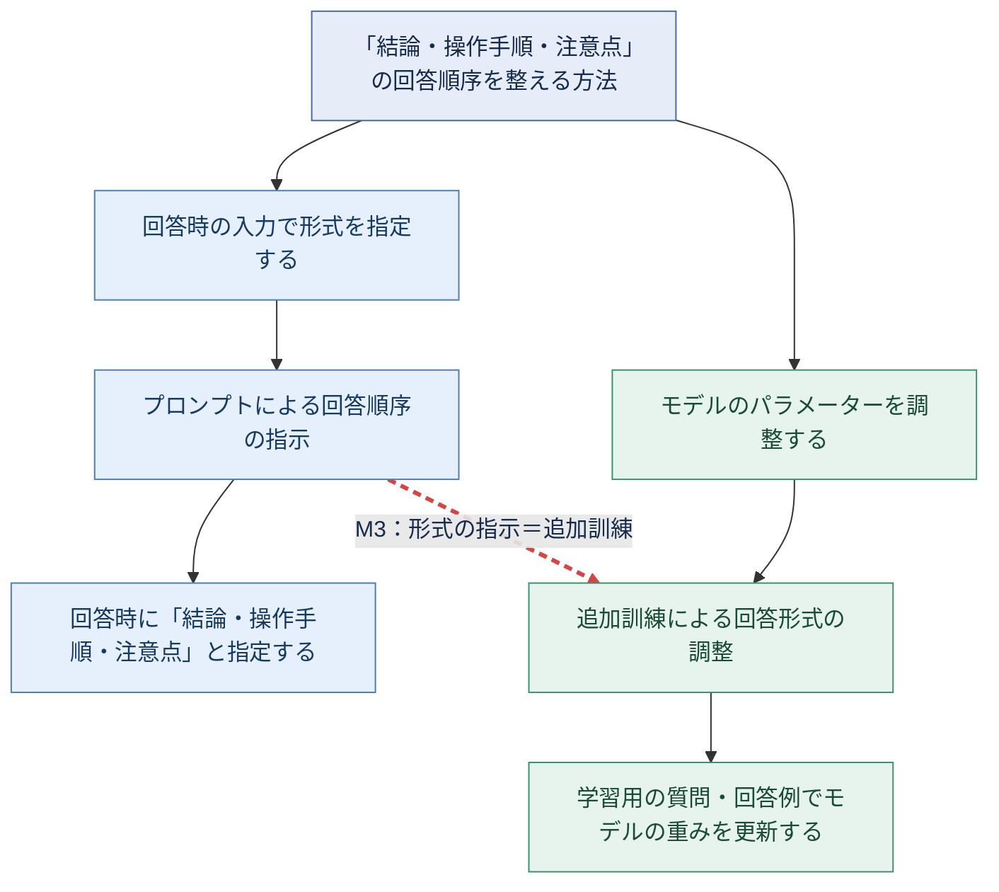

**取り違え：** 形式の指示＝追加訓練。

**M3の診断理由：** プロンプトで回答順を指定する入力操作を、追加訓練によってモデル自体の回答形式を変える処理と同じカテゴリーに分類している。

**技術的な注意点：** どちらも回答形式を整える目的で使えるが、プロンプトの指定自体は重み更新ではない。


#### 設問3：回答例を使った追加訓練｜M3・E

**選択肢E（添付v5の原文）**

> 質問と回答の見本をプロンプトへ含める操作は学習用データによる追加訓練と同じ処理のため、担当者が確認した回答例を毎回の入力に加え、その入力をモデルの回答方法の学習として扱う。

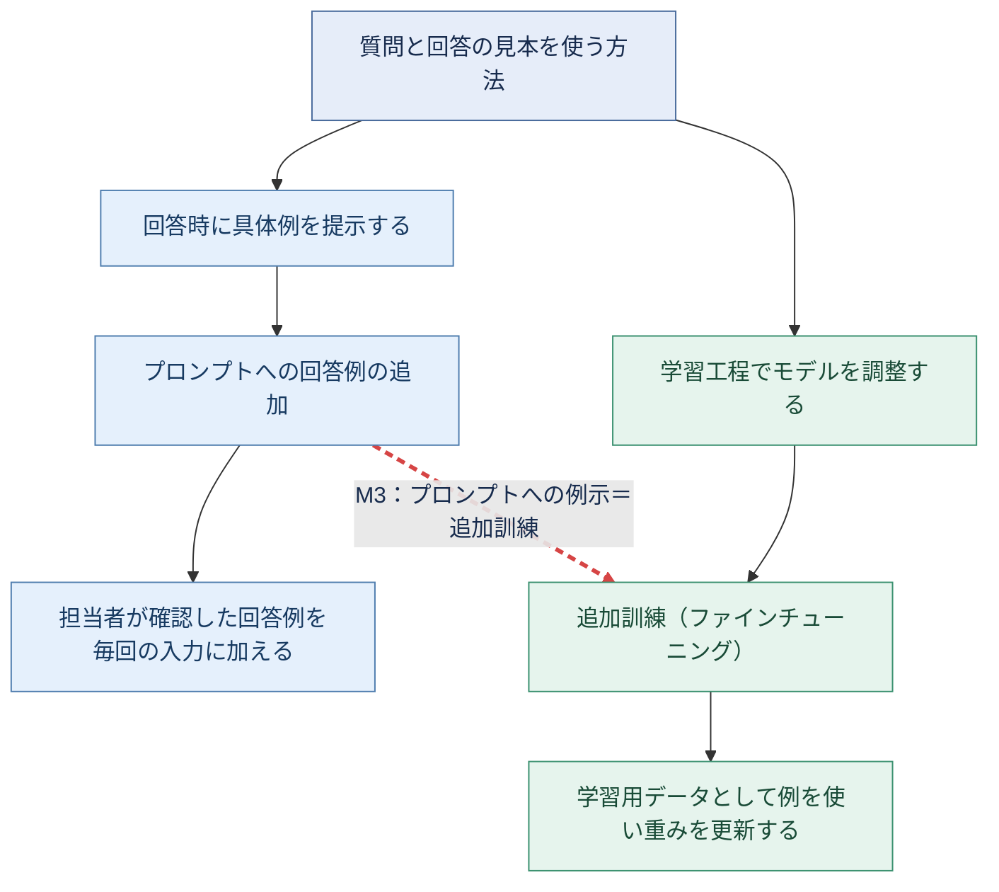

**取り違え：** プロンプトへの例示＝追加訓練。

**M3の診断理由：** 回答時に例を見せることを、訓練データとしてモデルの重みを更新する工程と同じ処理だと捉えている。

**技術的な注意点：** 例示によって回答が改善する場合はあるが、それだけで追加訓練が行われたわけではない。


### マルチエージェント（multi_agent）

#### 設問1：役割分担｜M3・E

**選択肢E（添付v5の原文）**

> 図書館の案内AIに、本の有無を調べる機能と、貸出条件を確認する機能をそれぞれ用意する。2つの機能に「蔵書担当AI」「貸出条件担当AI」という名前を付け、1つのAIがそれぞれの機能を使って得た情報を、2つの担当AIが分担して調べた結果としてまとめ、学生への案内を作成する。

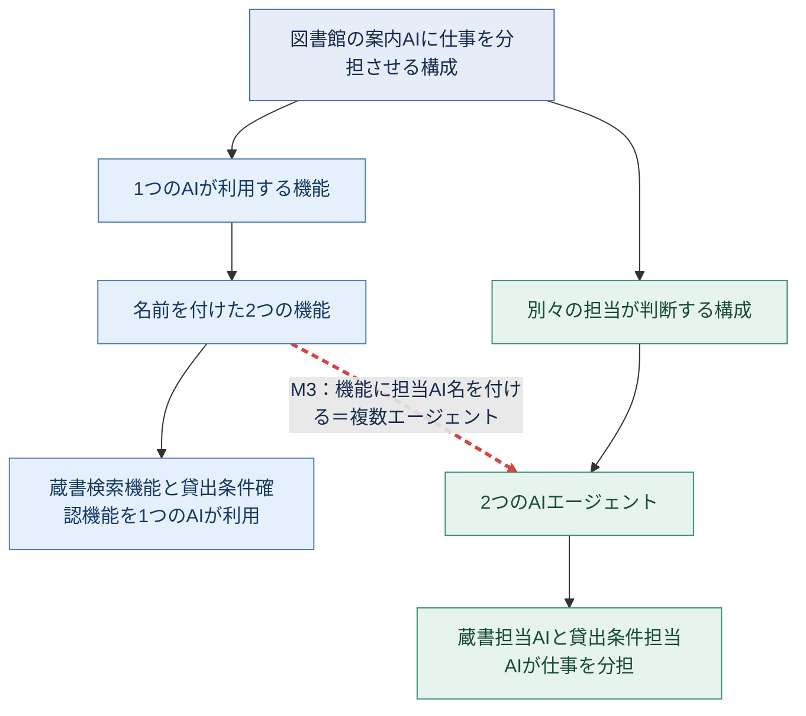

**取り違え：** 機能に担当AI名を付ける＝複数エージェント。

**M3の診断理由：** 単一AIが使う2つの機能を、別々に設けた2つの判断エージェントと同じカテゴリーとして数えている。

**技術的な注意点：** 1つの基盤モデルを使って複数エージェントを構築すること自体は可能。ただし機能の名称だけでは複数エージェントの構成を示さない。


#### 設問2：担当間の情報共有｜M3・E

**選択肢E（添付v5の原文）**

> 蔵書担当と利用条件担当の結果を同じ画面に並べることは担当間で情報を交換する仕組みと同じため、蔵書と貸出条件の結果を2つの表示欄にまとめ、その画面表示を情報共有の仕組みとして利用する。

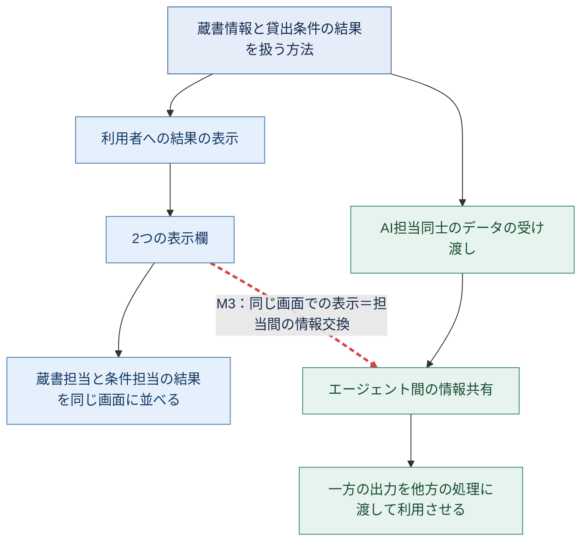

**取り違え：** 同じ画面での表示＝担当間の情報交換。

**M3の診断理由：** 利用者が閲覧できる画面の表示を、AIエージェント同士が結果を渡し受け取る処理と同一視している。

**技術的な注意点：** 表示画面を共有情報の確認に使う設計は可能だが、画面に並べるだけで後続AIに情報が渡るとは限らない。


#### 設問3：結果を合わせて案内する｜M3・E

**選択肢E（添付v5の原文）**

> 一度の回答に設けた「蔵書情報」と「貸出条件」の欄は別々のAIの成果に当たるため、1つのAIでその2欄をまとめて生成し、その表示を担当エージェント間の結果の統合として利用する。

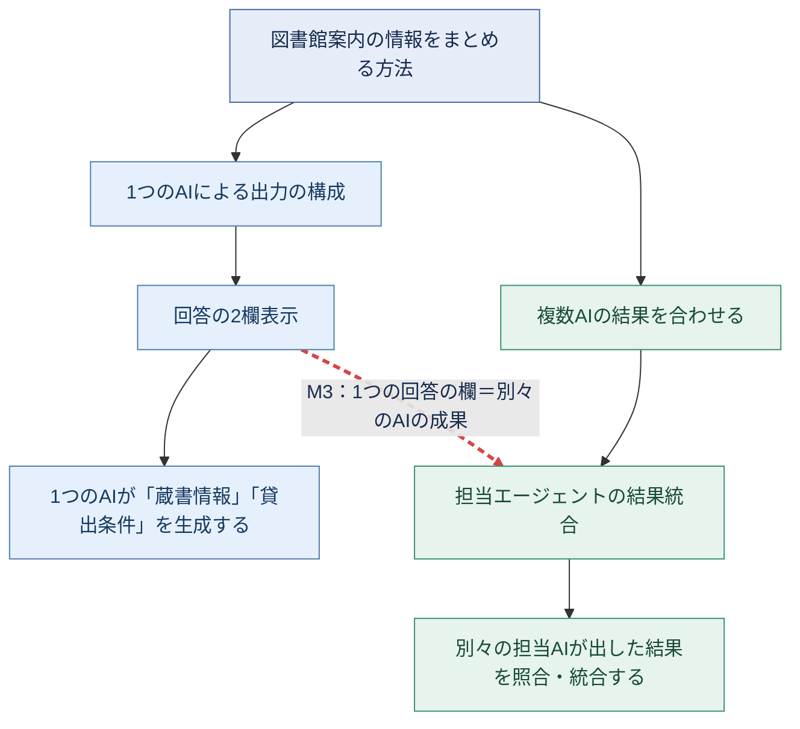

**取り違え：** 1つの回答の欄＝別々のAIの成果。

**M3の診断理由：** 単一AIが出力した2つの欄を、別々のAIエージェントによる成果の統合と同じ種類のものとして扱っている。

**技術的な注意点：** 出力欄の数は、その処理を実行したAIエージェントの数を示さない。


### 記憶プロセス（memory_process）

#### 設問1：希望の保存と利用｜M3・E

**選択肢E（添付v5の原文）**

> 利用者が「辛い料理は避けたい」と伝えた後、同じ会話の中で続けて献立を相談したときにも、その希望を反映できるよう、直前までの会話履歴をAIに渡す機能を設ける。この会話内で履歴を参照する機能を利用者ごとの長期記憶として採用し、別の日に新しく相談したときも以前の希望に沿った献立を提案させる。

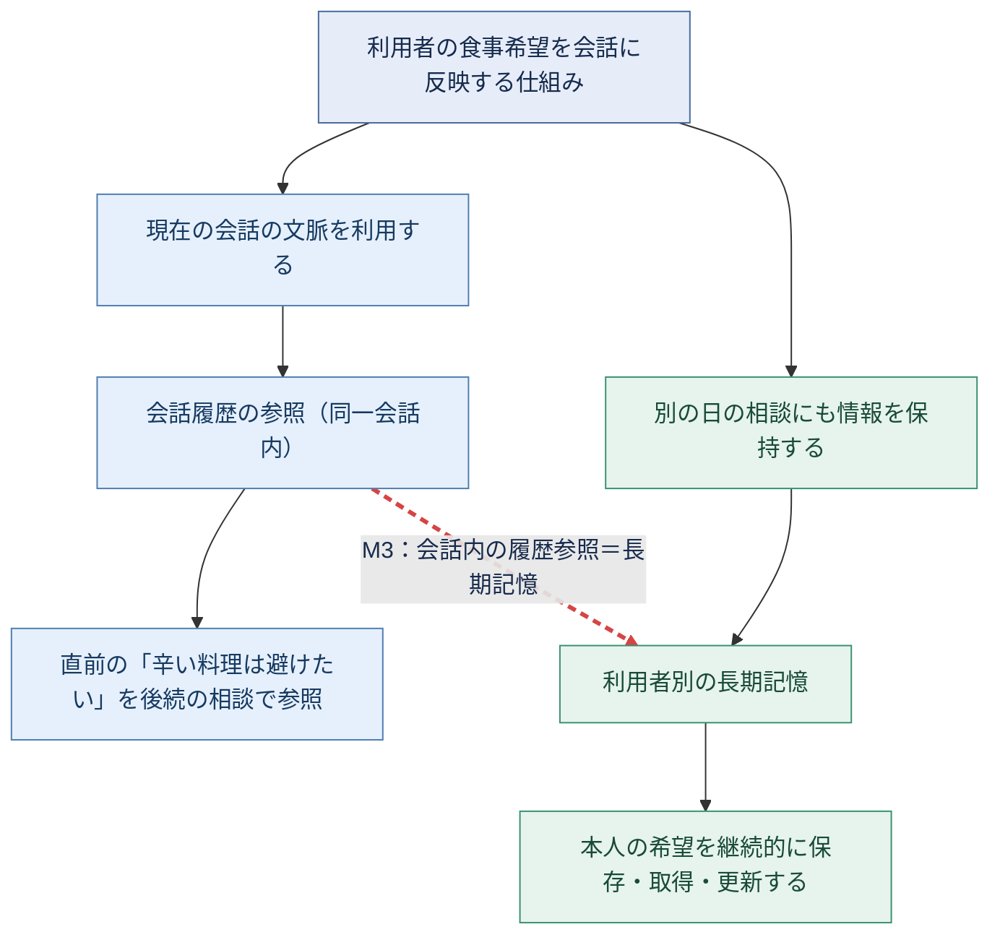

**取り違え：** 会話内の履歴参照＝長期記憶。

**M3の診断理由：** 同じ会話で履歴を参照する機能を、会話をまたいで希望を保持する利用者別の長期記憶と同じものとして扱っている。

**技術的な注意点：** 会話履歴を永続保存して後から読み込む設計は可能だが、同じ会話内で文脈を渡すだけでは別の日にも利用できるとは限らない。


#### 設問2：希望の変更｜M3・E

**選択肢E（添付v5の原文）**

> 希望の変更後にAIが生成した献立の回答文は利用者本人の現在の希望を保存した記録と同じため、少し辛い料理を含む献立の提案文を保存し、その文章を次回の食事希望の記録として利用する。

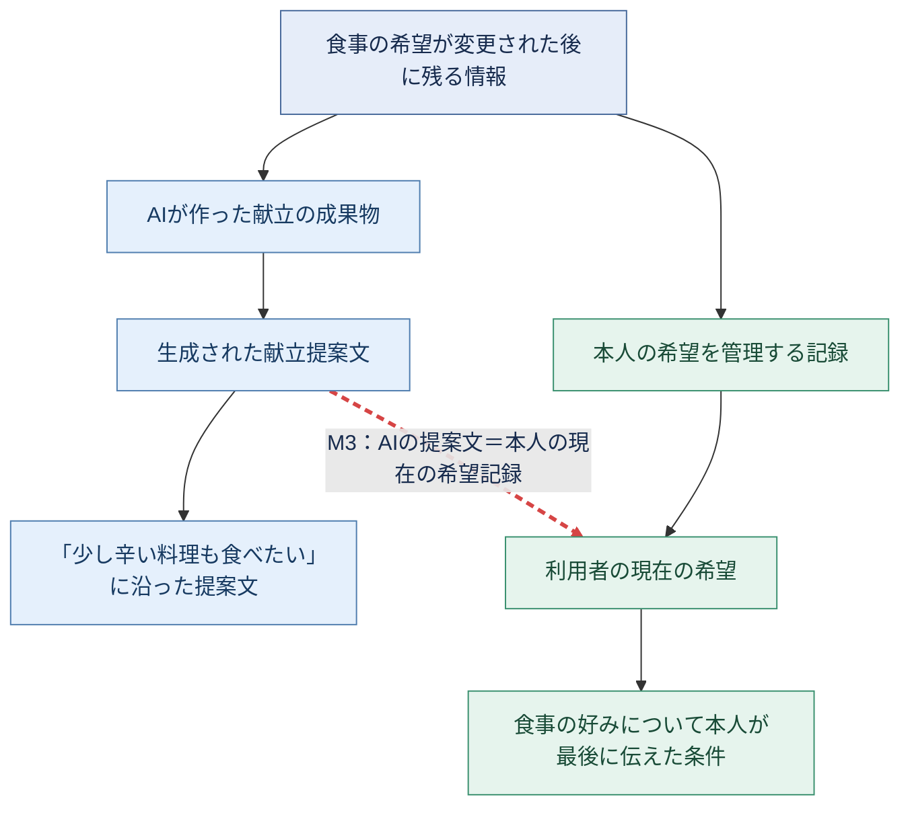

**取り違え：** AIの提案文＝本人の現在の希望記録。

**M3の診断理由：** AIが生成した献立の文章を、本人が直接伝えた現在の希望を保存した記録と同じ種類の情報として扱っている。

**技術的な注意点：** 提案履歴は希望推定の手掛かりにはなるが、本人の現在の意思をそのまま表すとは限らない。


#### 設問3：反応を次回に生かす｜M3・E

**選択肢E（添付v5の原文）**

> 利用者が感想を見返せる会話履歴の表示はAIが次回に必要な情報を検索する記憶管理と同じため、「次から量を少なめに」という発言を履歴画面に表示し、その画面を次回の希望の保存先として利用する。

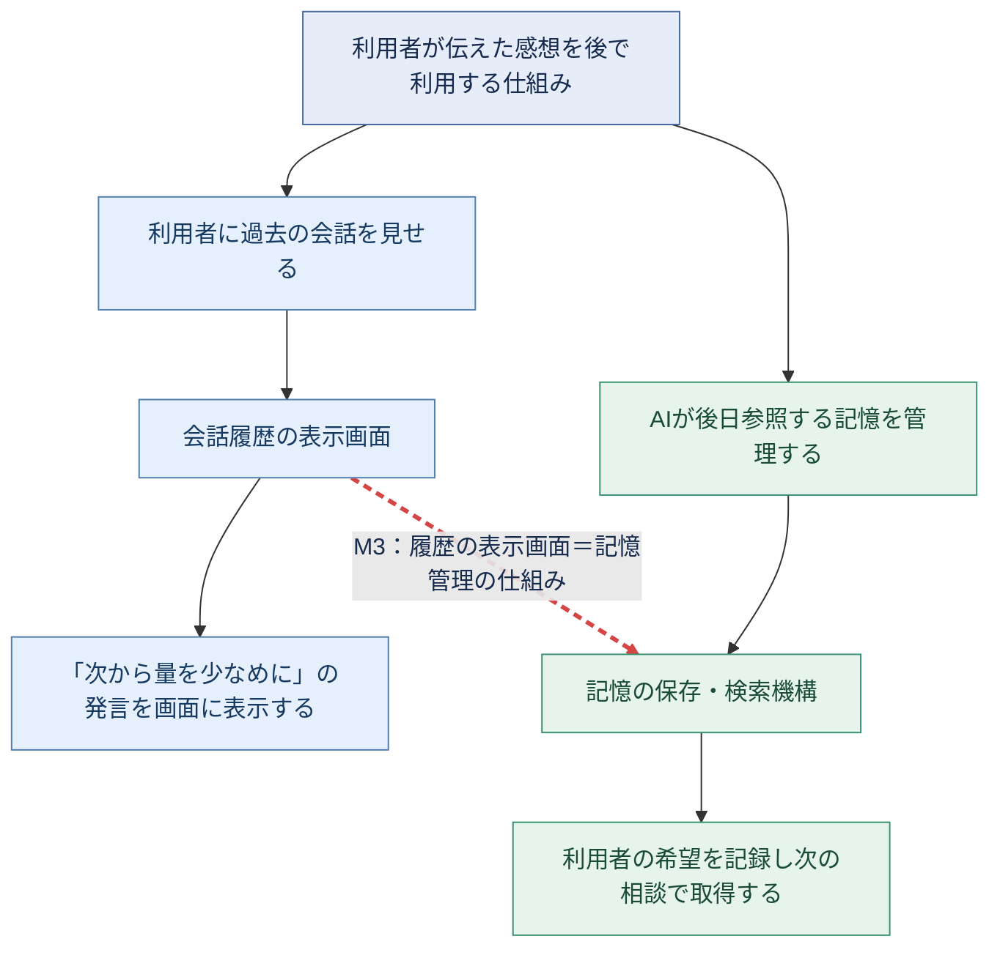

**取り違え：** 履歴の表示画面＝記憶管理の仕組み。

**M3の診断理由：** 利用者向けに会話を表示する機能を、AIが後の回答のために情報を保存・検索する機能と同一視している。

**技術的な注意点：** 履歴画面が記憶データと連動する設計は可能。ただし表示機能だけでは保存・検索を実装したことにはならない。


## 再テスト v1（retest_v1）


### LLMに知識を与える方法（llm_knowledge）

#### 設問1：改訂後の対応手順書を利用する方法｜M3・E

**選択肢E（添付v5の原文）**

> 改訂後の対応手順書を、社内Wi-Fiの接続方法やパスワードの再設定方法などの項目に分け、文書検索用の索引へ登録する。この登録作業をAIモデルに新しい対応方法を学習させる工程として実施し、登録後は追加訓練を終えたAIに社員からの問い合わせへの案内を作成させる。

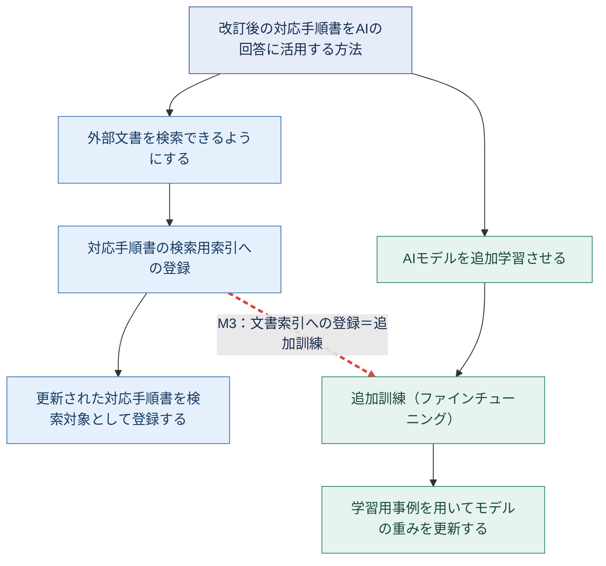

**取り違え：** 文書索引への登録＝追加訓練。

**M3の診断理由：** 対応手順書を検索対象にする登録作業を、モデルの重みを変更する学習工程と取り違えている。

**技術的な注意点：** 新しいマニュアルを検索対象へ登録すると、その情報を回答の根拠に使えるが、モデル自体の再訓練とは区別される。


#### 設問2：回答時の入力を工夫する方法｜M3・E

**選択肢E（添付v5の原文）**

> 回答の項目や順序をプロンプトに指定する操作はモデルの回答形式を追加訓練する処理と同じため、「確認すること・対応手順・注意点」の順を共通指示文に加え、その指示を学習済みの形式調整として利用する。

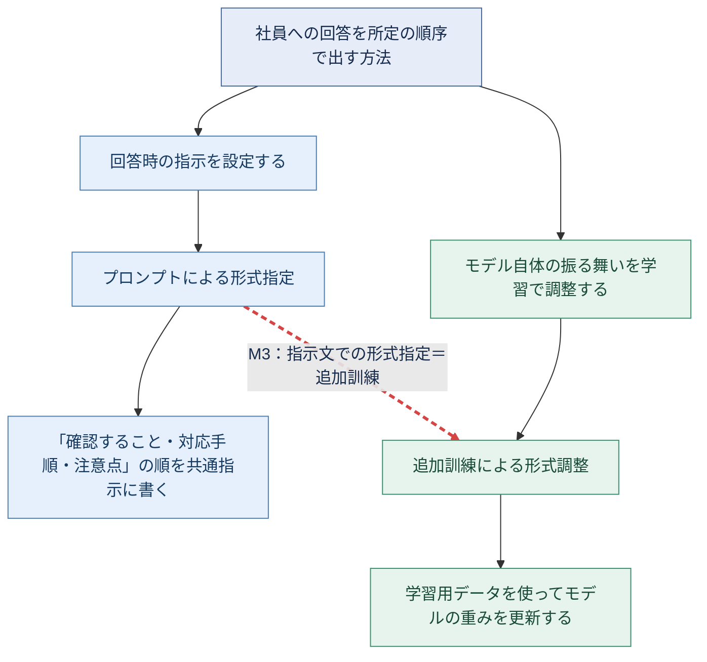

**取り違え：** 指示文での形式指定＝追加訓練。

**M3の診断理由：** プロンプトに項目や順序を指定する処理を、モデル自体を学習させて回答形式を調整する工程と同じカテゴリーに置いている。

**技術的な注意点：** 同じ回答形式を目指す方法として併用可能だが、プロンプトの編集と追加訓練は別。


#### 設問3：問い合わせの分類方法を調整する方法｜M3・E

**選択肢E（添付v5の原文）**

> 分類例をAIへのプロンプトに加える操作は分類モデルの追加訓練と同じ処理のため、「パスワードを忘れた→アカウント」などの問い合わせと分類結果を入力文に含め、その入力をモデル自体の学習として利用する。

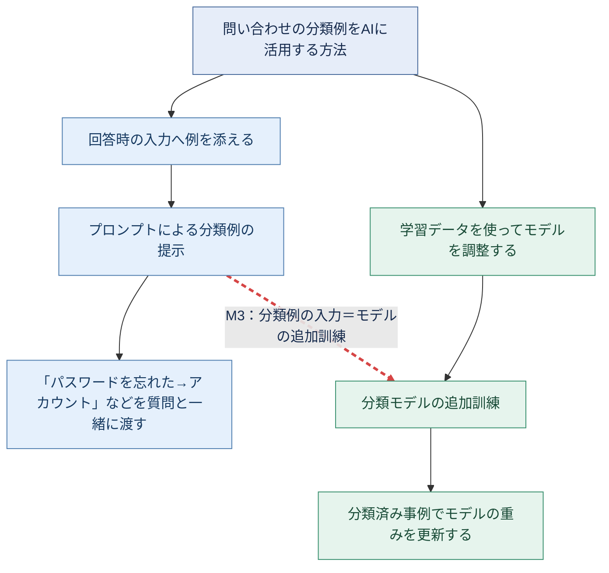

**取り違え：** 分類例の入力＝モデルの追加訓練。

**M3の診断理由：** 分類例を今回の入力文に含める操作を、分類モデルそのものを学習用データで追加訓練する工程と同じカテゴリーとして扱っている。

**技術的な注意点：** プロンプトの例示は推論時の参照情報であり、単独ではモデルの重みを更新しない。


### マルチエージェント（multi_agent）

#### 設問1：役割分担と担当の構成｜M3・E

**選択肢E（添付v5の原文）**

> 旅行計画を作るAIエージェントを1つ用意し、観光候補の調査、日程作成、移動確認を順番に行わせる。各段階に「観光候補担当AI」「日程担当AI」「移動確認担当AI」という名前を付け、3つの担当AIが処理を引き継ぐ構成として運用する。

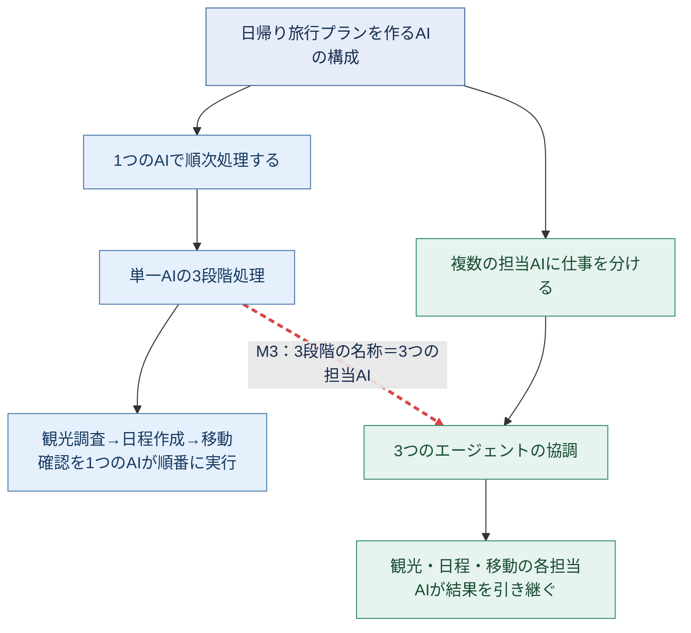

**取り違え：** 3段階の名称＝3つの担当AI。

**M3の診断理由：** 単一エージェント内の3段階を「担当AI」と名付けることで、実際に別々のエージェントが存在する構成と同一視している。

**技術的な注意点：** 同一モデルを用いても複数のエージェントを構成できるが、単に処理段階に名前を付けることとは異なる。


#### 設問2：担当間の情報の受け渡し｜M3・E

**選択肢E（添付v5の原文）**

> 日程担当が作成した訪問順と予定時刻の表は、移動条件を判断する独立した担当と同じ働きをするため、その予定表を移動確認エージェントとして数え、日程担当から結果を受け渡す相手に設定する。

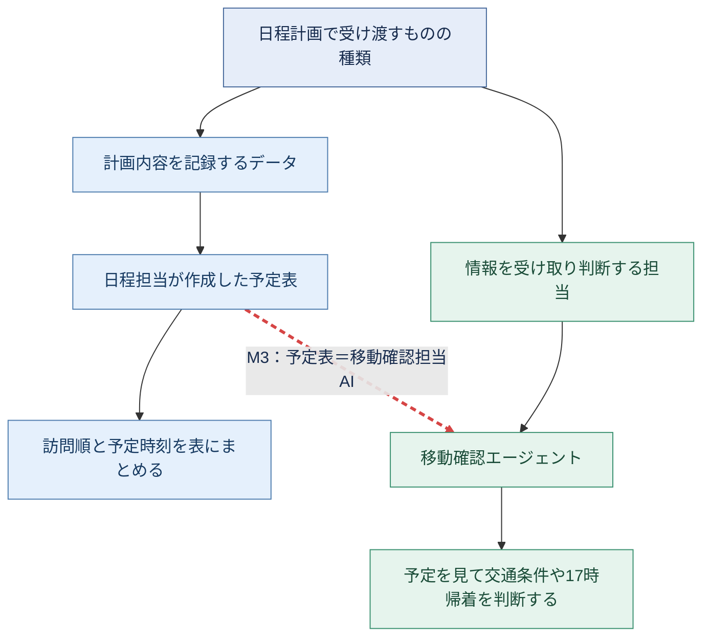

**取り違え：** 予定表＝移動確認担当AI。

**M3の診断理由：** 日程担当が作った予定表というデータを、その表を読み取って移動条件を判断するAIエージェントと同じカテゴリーに置いている。

**技術的な注意点：** 予定表はエージェントに渡す入力になり得るが、それ自体が判断するAIではない。


#### 設問3：計画全体の確認と見直し｜M3・E

**選択肢E（添付v5の原文）**

> 電車の検索ツールが返す複数の移動候補は、別々のAIエージェントによる計画案と同じ情報のため、検索された候補を複数担当の判断結果として並べ、その一覧を旅行計画の統合結果として利用する。

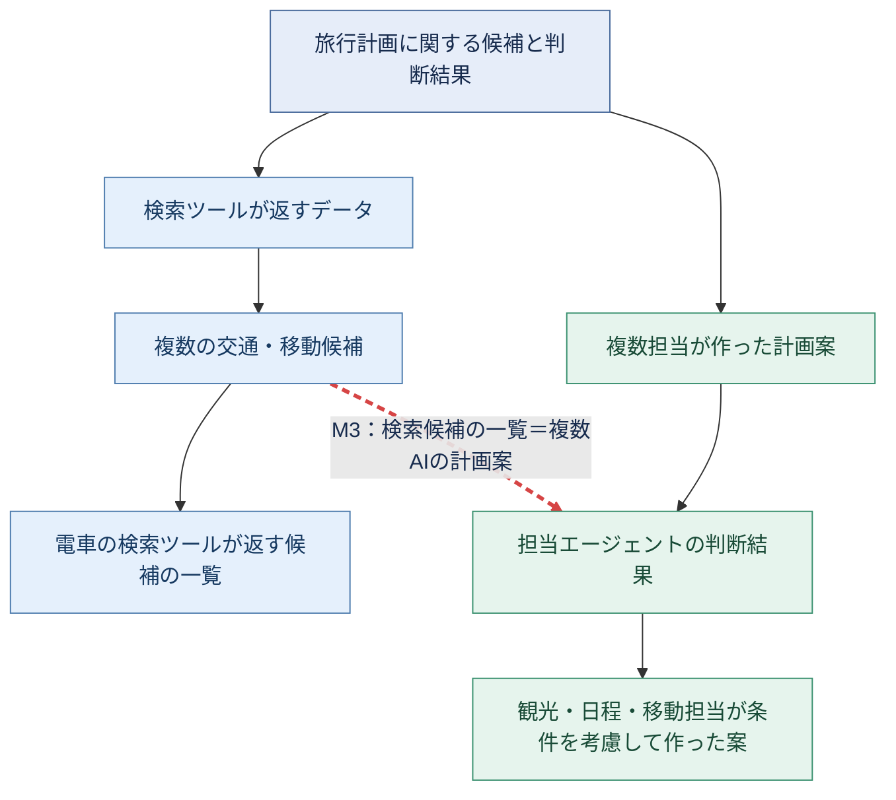

**取り違え：** 検索候補の一覧＝複数AIの計画案。

**M3の診断理由：** 検索ツールが返した選択肢の集合を、独立した複数の担当AIが判断した成果物と同じ種類の情報として捉えている。

**技術的な注意点：** 検索候補を複数の担当が評価することはできるが、検索結果そのものが担当の判断結果とは限らない。


### 記憶プロセス（memory_process）

#### 設問1：希望の保存と利用｜M3・E

**選択肢E（添付v5の原文）**

> 利用者が「ピーマンを避けたい」と伝えた発言を、相談ごとに管理する会話履歴へ記録し、その相談中の献立提案に利用する。別の日に新しい相談が始まった際は、新しい相談の会話履歴をAIに渡して、前回伝えた食材の希望も踏まえた献立を作成させる。

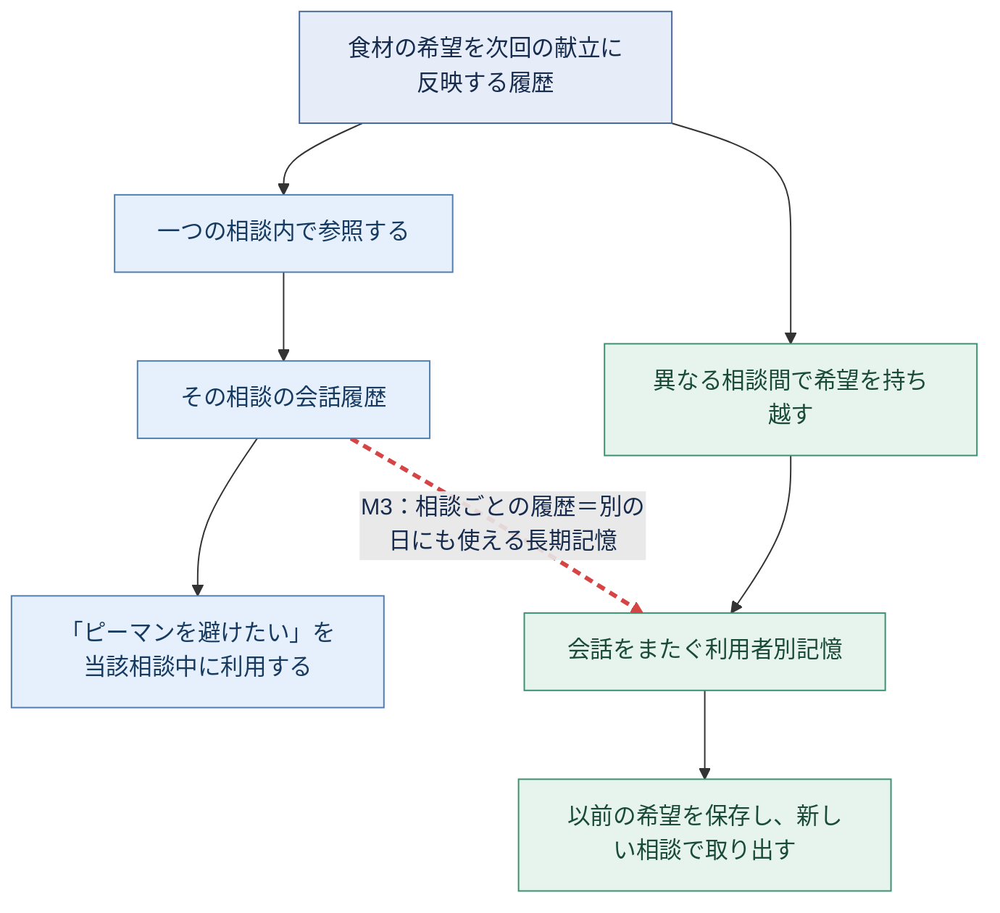

**取り違え：** 相談ごとの履歴＝別の日にも使える長期記憶。

**M3の診断理由：** その相談中の会話履歴を扱うことを、新しい相談でも同じ利用者の過去の希望を取得できる記憶管理と同じカテゴリーに置いている。

**技術的な注意点：** 前回の履歴を検索・取得して新しい相談へ渡す設計なら継続利用は可能だが、この選択肢は新しい相談の履歴しか渡していない。


#### 設問2：現在の希望の管理｜M3・E

**選択肢E（添付v5の原文）**

> 利用者の希望変更を今回のプロンプトに書くことは、保存済みの個人別の希望を更新する仕組みと同じため、「今後はピーマンも使ってほしい」という希望を入力に加え、その入力操作を利用者別の記録の更新として利用する。

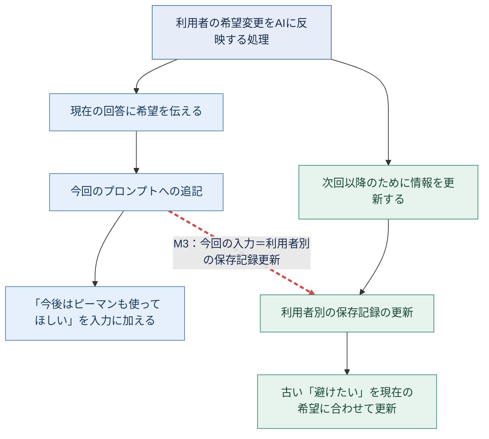

**取り違え：** 今回の入力＝利用者別の保存記録更新。

**M3の診断理由：** その場のプロンプトに新しい希望を含めることを、保存済みの個人別記録を更新する処理と同じカテゴリーとして扱っている。

**技術的な注意点：** プロンプトを受けて別途記憶を書き換える仕組みは可能だが、入力欄への追記だけでは更新の実装とはいえない。


#### 設問3：会話で得た情報を後日の提案に生かす｜M3・E

**選択肢E（添付v5の原文）**

> AIが今回作った改善後の献立は利用者本人が伝えた現在の味付けの希望を保存した記録と同じ情報のため、「次から薄味にしてほしい」という希望に沿って生成した献立を保存し、その内容を後日の献立の希望条件として利用する。

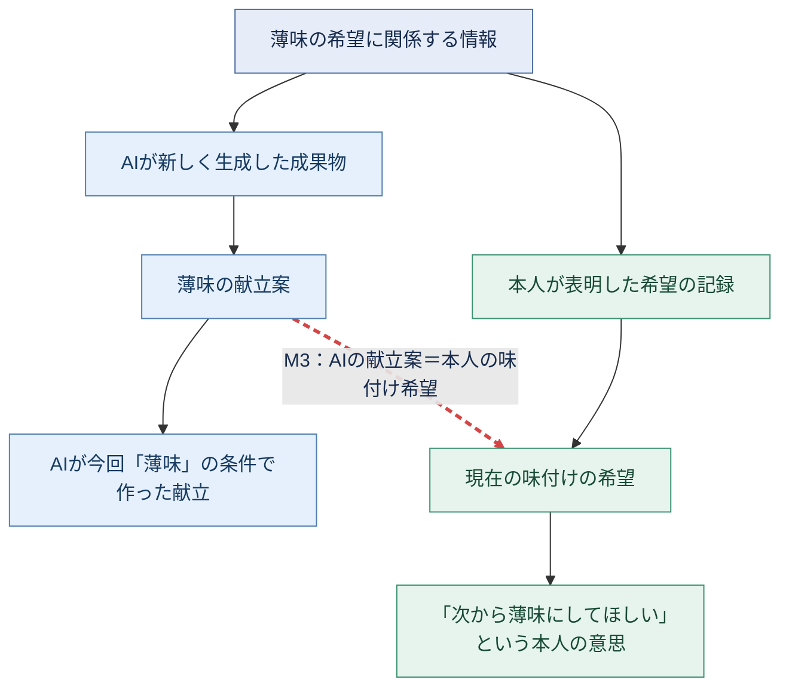

**取り違え：** AIの献立案＝本人の味付け希望。

**M3の診断理由：** AIが生成した改善後の献立を、利用者が直接伝えた現在の味付け希望の記録と同一視している。

**技術的な注意点：** 生成された献立から好みを推測することはあり得るが、本人の表明内容をそのまま保証するものではない。


## 再テスト v2（retest_v2）


### LLMに知識を与える方法（llm_knowledge）

#### 設問1：改訂後のマニュアルを利用する方法｜M3・E

**選択肢E（添付v5の原文）**

> ITサポートマニュアルを文書検索の対象へ登録することはモデルに新しい対応方法を追加訓練する処理と同じため、改訂後のITサポートマニュアルを検索用の索引へ追加し、その登録を対応方法の学習として案内に利用する。

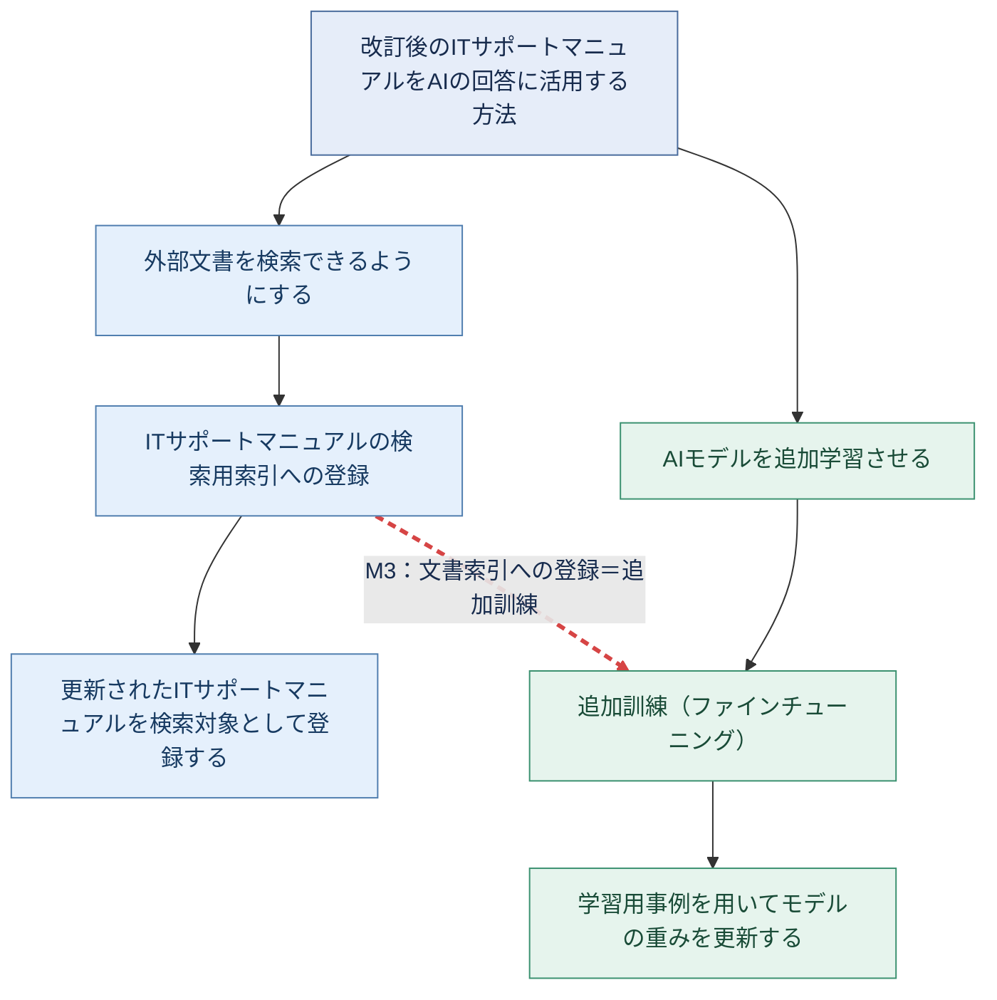

**取り違え：** 文書索引への登録＝追加訓練。

**M3の診断理由：** ITサポートマニュアルを検索対象にする登録作業を、モデルの重みを変更する学習工程と取り違えている。

**技術的な注意点：** 新しいマニュアルを検索対象へ登録すると、その情報を回答の根拠に使えるが、モデル自体の再訓練とは区別される。


#### 設問2：回答時の入力を工夫する方法｜M3・E

**選択肢E（添付v5の原文）**

> 回答の項目や順序をプロンプトに指定する操作はモデルの回答形式を追加訓練する処理と同じため、「確認すること・対応手順・注意点」の順を共通指示文に加え、その指示を学習済みの形式調整として利用する。

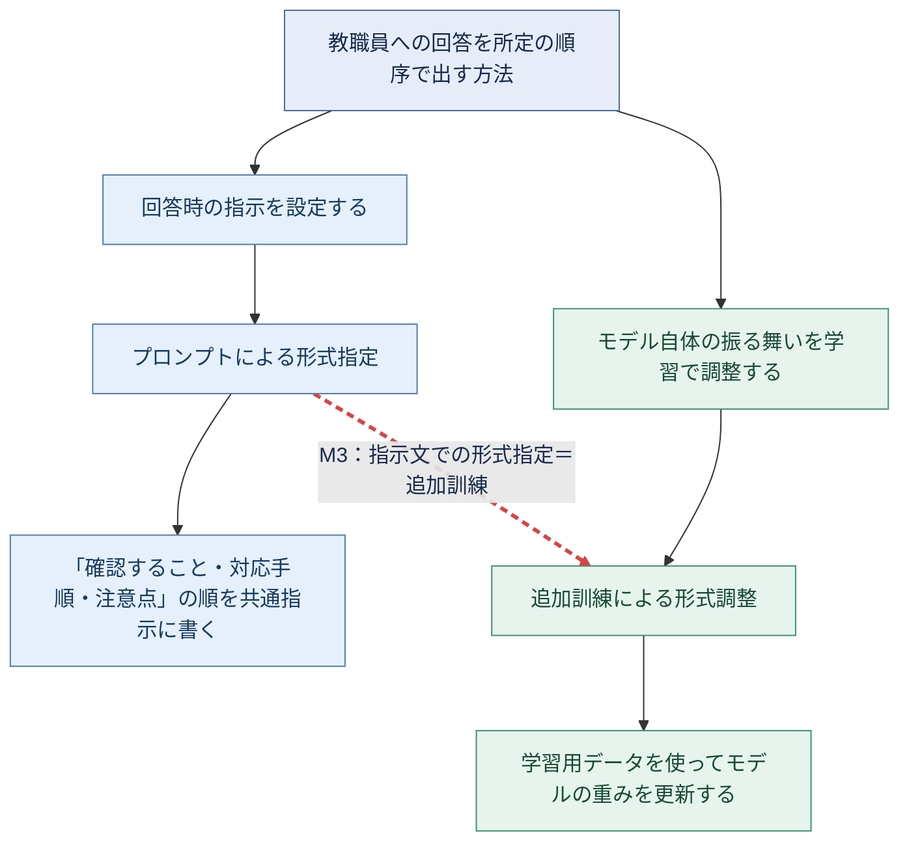

**取り違え：** 指示文での形式指定＝追加訓練。

**M3の診断理由：** プロンプトに項目や順序を指定する処理を、モデル自体を学習させて回答形式を調整する工程と同じカテゴリーに置いている。

**技術的な注意点：** 同じ回答形式を目指す方法として併用可能だが、プロンプトの編集と追加訓練は別。


#### 設問3：問い合わせの分類方法を調整する方法｜M3・E

**選択肢E（添付v5の原文）**

> 分類例をAIへのプロンプトに加える操作は分類モデルの追加訓練と同じ処理のため、「学内ポータルのパスワードを忘れた→アカウント」などの問い合わせと分類結果を入力文に含め、その入力をモデル自体の学習として利用する。

```mermaid
flowchart TB
  Root["問い合わせの分類例をAIに活用する方法"]
  Root --> L0["回答時の入力へ例を添える"]
  Root --> R0["学習データを使ってモデルを調整する"]
  L0 --> L1["プロンプトによる分類例の提示"]
  L1 --> L2["「学内ポータルのパスワードを忘れた→アカウント」などを質問と一緒に渡す"]
  R0 --> R1["分類モデルの追加訓練"]
  R1 --> R2["分類済み事例でモデルの重みを更新する"]
  L1 -. "M3：分類例の入力＝モデルの追加訓練" .-> R1
  classDef root fill:#e6edf9,stroke:#496b9c,color:#172b4d
  classDef left fill:#e5f0fc,stroke:#507eaf,color:#173a61
  classDef right fill:#e6f4ed,stroke:#3b9170,color:#194b37
  class Root root
  class L0,L1,L2 left
  class R0,R1,R2 right
  linkStyle 6 stroke:#d64545,stroke-width:3px,stroke-dasharray:6 4
```

**取り違え：** 分類例の入力＝モデルの追加訓練。

**M3の診断理由：** 分類例を今回の入力文に含める操作を、分類モデルそのものを学習用データで追加訓練する工程と同じカテゴリーとして扱っている。

**技術的な注意点：** プロンプトの例示は推論時の参照情報であり、単独ではモデルの重みを更新しない。


### マルチエージェント（multi_agent）

#### 設問1：役割分担と担当の構成｜M3・E

**選択肢E（添付v5の原文）**

> 1つのAIが展示候補の調査・見学計画の作成・移動確認を3つの手順として順番に実行することは、3つのAIエージェントが役割分担する構成と同じため、単一AIの処理を3段階に分け、各段階を独立した担当AIとして数える。

```mermaid
flowchart TB
  Root["博物館の見学計画を作るAIの構成"]
  Root --> L0["1つのAIで順次処理する"]
  Root --> R0["複数の担当AIに仕事を分ける"]
  L0 --> L1["単一AIの3段階処理"]
  L1 --> L2["展示調査→見学計画→移動確認を1つのAIが実行"]
  R0 --> R1["3つのエージェントの協調"]
  R1 --> R2["展示・見学計画・移動の担当AIが結果を引き継ぐ"]
  L1 -. "M3：3つの手順＝3つの担当AI" .-> R1
  classDef root fill:#e6edf9,stroke:#496b9c,color:#172b4d
  classDef left fill:#e5f0fc,stroke:#507eaf,color:#173a61
  classDef right fill:#e6f4ed,stroke:#3b9170,color:#194b37
  class Root root
  class L0,L1,L2 left
  class R0,R1,R2 right
  linkStyle 6 stroke:#d64545,stroke-width:3px,stroke-dasharray:6 4
```

**取り違え：** 3つの手順＝3つの担当AI。

**M3の診断理由：** 単一AIによる3段階の実行を、3つの独立したエージェントが仕事を分担する構成と同じカテゴリーとして扱っている。

**技術的な注意点：** 処理を3段階に分けること自体は合理的だが、それだけでエージェント数が3になるわけではない。


#### 設問2：担当間の情報の受け渡し｜M3・E

**選択肢E（添付v5の原文）**

> 見学計画担当が作成した見学順と予定時刻の表は、移動条件を判断する独立した担当と同じ働きをするため、その予定表を移動確認エージェントとして数え、見学計画担当から結果を受け渡す相手に設定する。

```mermaid
flowchart TB
  Root["見学計画で受け渡すものの種類"]
  Root --> L0["計画内容を記録するデータ"]
  Root --> R0["受け取った情報から判断する担当"]
  L0 --> L1["見学計画担当の予定表"]
  L1 --> L2["展示の訪問順と予定時刻を表にまとめる"]
  R0 --> R1["移動確認エージェント"]
  R1 --> R2["館内移動条件と40分の制約を判断する"]
  L1 -. "M3：見学予定表＝移動確認担当AI" .-> R1
  classDef root fill:#e6edf9,stroke:#496b9c,color:#172b4d
  classDef left fill:#e5f0fc,stroke:#507eaf,color:#173a61
  classDef right fill:#e6f4ed,stroke:#3b9170,color:#194b37
  class Root root
  class L0,L1,L2 left
  class R0,R1,R2 right
  linkStyle 6 stroke:#d64545,stroke-width:3px,stroke-dasharray:6 4
```

**取り違え：** 見学予定表＝移動確認担当AI。

**M3の診断理由：** 見学計画の予定表というデータを、その予定表を使って移動の成立条件を判断するAIエージェントと同じカテゴリーとして扱っている。

**技術的な注意点：** 予定表の内容はAIに渡す情報だが、表そのものは判断エージェントではない。


#### 設問3：計画全体の確認と見直し｜M3・E

**選択肢E（添付v5の原文）**

> 館内経路の検索ツールが返す複数の移動候補は、別々のAIエージェントによる計画案と同じ情報のため、検索された候補を複数担当の判断結果として並べ、その一覧を見学計画の統合結果として利用する。

```mermaid
flowchart TB
  Root["館内の移動候補と計画の判断結果"]
  Root --> L0["館内経路検索ツールの出力"]
  Root --> R0["各担当が検討した計画案"]
  L0 --> L1["複数の館内移動候補"]
  L1 --> L2["館内経路検索が返した移動候補の一覧"]
  R0 --> R1["AIエージェントの判断結果"]
  R1 --> R2["見学順・滞在・移動の条件を考えた案"]
  L1 -. "M3：経路検索の候補＝複数の担当AIの計画案" .-> R1
  classDef root fill:#e6edf9,stroke:#496b9c,color:#172b4d
  classDef left fill:#e5f0fc,stroke:#507eaf,color:#173a61
  classDef right fill:#e6f4ed,stroke:#3b9170,color:#194b37
  class Root root
  class L0,L1,L2 left
  class R0,R1,R2 right
  linkStyle 6 stroke:#d64545,stroke-width:3px,stroke-dasharray:6 4
```

**取り違え：** 経路検索の候補＝複数の担当AIの計画案。

**M3の診断理由：** 検索結果に含まれる複数の移動候補を、複数エージェントが検討して作った計画案と同じ種類の情報として扱っている。

**技術的な注意点：** 検索候補は計画の材料になるが、独立したAI担当の判断結果とは限らない。


### 記憶プロセス（memory_process）

#### 設問1：希望の保存と利用｜M3・E

**選択肢E（添付v5の原文）**

> 同じ会話で以前の発言を参照できる履歴機能は、別の日にも希望を取り出せる利用者別の長期記憶と同じため、「電話で連絡してほしい」という発言を含む会話履歴を、継続的な希望の記憶として運用する。

```mermaid
flowchart TB
  Root["連絡方法の希望を会話を越えて利用する仕組み"]
  Root --> L0["現在の会話で発言を参照する"]
  Root --> R0["別の日の相談でも本人の希望を保持する"]
  L0 --> L1["同一会話の履歴機能"]
  L1 --> L2["同じ相談中に「電話で連絡してほしい」を参照"]
  R0 --> R1["利用者別の長期記憶"]
  R1 --> R2["電話希望を保存・検索・更新して後の相談へ渡す"]
  L1 -. "M3：同じ会話の履歴参照＝長期記憶" .-> R1
  classDef root fill:#e6edf9,stroke:#496b9c,color:#172b4d
  classDef left fill:#e5f0fc,stroke:#507eaf,color:#173a61
  classDef right fill:#e6f4ed,stroke:#3b9170,color:#194b37
  class Root root
  class L0,L1,L2 left
  class R0,R1,R2 right
  linkStyle 6 stroke:#d64545,stroke-width:3px,stroke-dasharray:6 4
```

**取り違え：** 同じ会話の履歴参照＝長期記憶。

**M3の診断理由：** 同じ会話で以前の発言を参照する機能を、異なる会話にも本人の希望を持ち越す長期記憶と同じカテゴリーとして扱っている。

**技術的な注意点：** 履歴を永続化して次回に読み込むなら継続利用できるが、同じ会話での参照そのものと長期記憶は区別される。


#### 設問2：現在の希望の管理｜M3・E

**選択肢E（添付v5の原文）**

> 利用者の希望変更を今回のプロンプトに書くことは、保存済みの個人別の希望を更新する仕組みと同じため、「今後はメールで連絡してほしい」という希望を入力に加え、その入力操作を利用者別の記録の更新として利用する。

```mermaid
flowchart TB
  Root["利用者の連絡方法の変更を反映する処理"]
  Root --> L0["今回の回答に希望を伝える"]
  Root --> R0["後の相談へ引き継ぐ情報を更新する"]
  L0 --> L1["今回のプロンプトへの追記"]
  L1 --> L2["「今後はメールで連絡してほしい」を入力に加える"]
  R0 --> R1["利用者別の記録の更新"]
  R1 --> R2["以前の電話希望をメール希望へ更新・管理する"]
  L1 -. "M3：今回の入力＝保存記録の更新" .-> R1
  classDef root fill:#e6edf9,stroke:#496b9c,color:#172b4d
  classDef left fill:#e5f0fc,stroke:#507eaf,color:#173a61
  classDef right fill:#e6f4ed,stroke:#3b9170,color:#194b37
  class Root root
  class L0,L1,L2 left
  class R0,R1,R2 right
  linkStyle 6 stroke:#d64545,stroke-width:3px,stroke-dasharray:6 4
```

**取り違え：** 今回の入力＝保存記録の更新。

**M3の診断理由：** 今回の入力文に希望変更を加えることを、保存済みの利用者別の連絡方法の記録を更新する処理と同一視している。

**技術的な注意点：** プロンプトの内容から別途記録を更新する機構があれば更新できるが、入力操作だけでは更新を保証しない。


#### 設問3：会話で得た情報を後日の案内に生かす｜M3・E

**選択肢E（添付v5の原文）**

> AIが今回作った改善後の案内文は利用者本人が伝えた現在の案内文の構成の希望を保存した記録と同じ情報のため、「次からは要点を先に書いてほしい」という希望に沿って生成した案内文を保存し、その内容を後日の案内の希望条件として利用する。

```mermaid
flowchart TB
  Root["案内文に関係する希望と生成結果"]
  Root --> L0["AIが今回生成した成果物"]
  Root --> R0["本人が指定した文章構成の希望"]
  L0 --> L1["要点を先に書いた案内文"]
  L1 --> L2["希望に沿ってAIが作った今回のメール文面"]
  R0 --> R1["案内文の現在の希望の記録"]
  R1 --> R2["「次からは要点を先に」の希望内容を保存"]
  L1 -. "M3：AIの生成文＝本人の現在の文章構成希望" .-> R1
  classDef root fill:#e6edf9,stroke:#496b9c,color:#172b4d
  classDef left fill:#e5f0fc,stroke:#507eaf,color:#173a61
  classDef right fill:#e6f4ed,stroke:#3b9170,color:#194b37
  class Root root
  class L0,L1,L2 left
  class R0,R1,R2 right
  linkStyle 6 stroke:#d64545,stroke-width:3px,stroke-dasharray:6 4
```

**取り違え：** AIの生成文＝本人の現在の文章構成希望。

**M3の診断理由：** AIが作った案内文の内容を、本人が直接伝えた現在の文章構成の希望を保存した記録と同じカテゴリーとして扱っている。

**技術的な注意点：** 完成した文章を希望の推測に利用することはできるが、現在有効な希望の記録と同一ではない。

