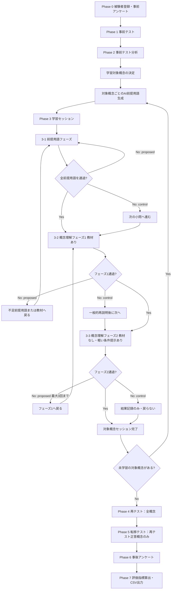

# 学習ログ駆動型AIチューター：3段階学習セッション版 実験フロー詳細設計 v2

## 0. 本ドキュメントの位置づけ

本ドキュメントは、既存の「3段階学習セッション版 実験フロー詳細設計」を、追加確認事項への回答に基づいて更新したものである。

従来の学習セッションは、対象概念ごとに以下の2段階で構成されていた。

```text
前提用語フェーズ
  ↓
概念理解フェーズ1：教材提示あり
```

本改訂では、学習セッションを以下の3段階にする。

```text
前提用語フェーズ
  ↓
概念理解フェーズ1：教材提示あり
  ↓
概念理解フェーズ2：教材提示なし・軽い条件提示あり
```

概念理解フェーズ2は、最終評価そのものではない。最終的な支援なし理解は再テストで、転移は転移テストで評価する。ただし、概念理解フェーズ2は、学習セッション内で足場掛けを外した状態に近い確認であり、**主評価ではないが、補助指標として強く扱う**。

### 0.1 今回反映した確定事項

| 質問 | 確定内容 | 実験フローへの反映 |
|---|---|---|
| Q1 | フェーズ2は主評価ではないが、補助指標として強く扱う | `教材なし概念説明成功率` を重要な補助指標にする |
| Q2 | フェーズ2では、かなり軽い条件提示を許可 | 教材本文は非表示。ただし着目条件・使用語の一部・制約は表示可 |
| Q3 | フェーズ2の問いは、同じ概念だが問い方を少し変える | 丸暗記ではなく再構成を測る |
| Q4 | フェーズ2 fail 時は最大3回、時間が許す限り再支援 | 最大3回までフェーズ1へ戻す。時間切れ時はその時点で終了 |
| Q5 | 統制群にも同じ数の小問を入れるが、戻り処理はしない | 学習機会数を揃え、適応的戻り処理だけを提案群の特徴にする |
| Q6 | 前提用語はAIが毎回生成 | 生成結果をログ保存し、再現性確保のため生成プロンプトも保存 |
| Q7 | 表層的回答はfail | フェーズ1・2とも、特にフェーズ2は厳しめに判定 |
| Q8 | pass/fail + ルーブリック別スコアを保存 | `core_concept`, `prerequisite_usage`, `misconception_absence`, `clarity` などを保存 |
| Q9 | フェーズ2は全対象概念で必須 | すべての学習対象概念でフェーズ2を実施 |
| Q10 | 再テストは全概念に出す | 学習対象外の概念も再テストし、維持・偶然正答を確認 |
| Q11 | 転移テストは再テストで正答した概念だけに出す | 基本理解が確認された概念だけ転移可否を見る |
| Q12 | フェーズ2 fail 概念も再テスト対象。転移は再テスト正答時のみ | フェーズ2失敗後の遅延的改善も確認できる |

---

## 1. 研究上の基本方針

### 1.1 本研究の目的

本研究の目的は、AI・情報系専門用語の学習において、学習者の回答ログから理解状態や誤概念を把握し、それに応じて学習支援を調整するAIチューターを設計・評価することである。

特に、本研究では以下を重視する。

1. 学習者が同じ誤概念を再発させないか。
2. 教材やヒントがなくても、自分の言葉で説明できるか。
3. 学習時とは異なる文脈でも概念を使えるか。
4. 教材あり理解から教材なし説明へ移行できるか。
5. その移行過程において、どの段階でつまずくかをログとして残せるか。

### 1.2 本設計での足場掛けの考え方

本設計では、足場掛けを単なるヒント量の大小として扱うのではなく、学習セッション全体の段階構造として実装する。

| 段階 | 役割 | 足場掛けの意味 | 評価上の位置づけ |
|---|---|---|---|
| 前提用語フェーズ | 対象概念を理解するための下位概念を確認する | メイン問題を小問に分解する支援 | 学習準備・前提確認 |
| 概念理解フェーズ1 | 教材を提示し、前提用語を使って対象概念を説明させる | 教材ありの構造化支援 | 教材あり理解 |
| 概念理解フェーズ2 | 教材本文を提示せず、軽い条件だけで対象概念を再説明させる | 学習セッション内の足場外し確認 | 重要な補助指標 |
| 再テスト | 全概念を支援なしで問う | 最終的な同型問題理解の確認 | 主評価 |
| 転移テスト | 再テスト正答概念だけを別文脈で問う | 支援なし転移の確認 | 主評価 |

概念理解フェーズ2は「学習セッション内のミニL0」に近い。ただし、直前に学習した内容を思い出して答えるため、完全な最終評価とは見なさない。したがって、主評価ではなく、**教材なし説明成功率**や**フェーズ2失敗後再学習成功率**として補助的に扱う。

---

## 2. 先行研究との対応

### 2.1 scaffolding questions

scaffolding questionsとは、メイン問題をそのまま解かせ続けるのではなく、その問題を解くために必要な途中ステップを小問として提示する支援である。

本研究では、対象概念をいきなり説明させるのではなく、まず前提用語を1つずつ学習させる。これは、対象概念というメイン問題を、前提用語という小問に分解していることに対応する。

例として、`Attention` を学習する場合、いきなり「Attentionを説明してください」と問うのではなく、先に以下を確認する。

| 前提用語 | 確認する理由 |
|---|---|
| Token | Attentionが何同士の関係を見るのかを理解するため |
| 重み付け | Attentionが重要度をどう扱うのかを理解するため |
| 文脈情報 | Attentionが文脈に応じた表現を作ることを理解するため |

ただし、本改訂では、前提用語は研究者固定ではなく、AIが毎回生成する。これにより、対象概念・事前テストでの誤答・学習者の状態に応じた前提用語分解が可能になる。一方で、再現性を確保するため、AIが生成した前提用語リスト、生成理由、使用したプロンプト、生成時刻、モデル情報を必ず保存する。

### 2.2 contingency

contingencyとは、学習者の反応に応じて支援を調整することである。

本研究では、提案群において、学習者の回答状態に応じて学習経路を変える。

| 学習者の状態 | 提案群の対応 |
|---|---|
| 前提用語に正答 | 次の前提用語へ進む |
| 前提用語に不正解 | 再説明と具体例を提示し、同じ前提用語を再確認する |
| 概念理解フェーズ1で不正解 | 不足している前提用語へ戻す、または概念教材を再提示する |
| 概念理解フェーズ2で不正解 | 教材なしでは未定着と判断し、概念理解フェーズ1へ戻す |
| フェーズ2で繰り返し不正解 | 最大3回まで再支援し、それでも不十分なら failed_phase2 として記録する |

統制群にも同じ数の小問を入れるが、統制群では回答結果に応じた戻り処理を行わない。つまり、両群の学習機会数をなるべく揃えながら、提案群だけが「診断に基づいて戻る・再支援する」というcontingencyを持つ。

### 2.3 fading

fadingとは、学習者の理解が進むにつれて支援を減らしていくことである。

本設計では、概念理解フェーズ1では教材を提示するが、概念理解フェーズ2では教材本文を提示しない。ただし、完全に何も提示しないのではなく、かなり軽い条件提示は許可する。

```text
教材ありで理解する
  ↓
教材なし・軽い条件提示ありで説明する
  ↓
再テストで支援なしに解く
  ↓
転移テストで別文脈に適用する
```

### 2.4 transfer of responsibility

transfer of responsibilityとは、最初はシステムが支援し、最終的には学習者自身が説明・判断できるようにすることである。

本設計では、以下のように説明責任を段階的に学習者へ移す。

| 段階 | 説明責任の所在 |
|---|---|
| 前提用語フェーズ | システムが前提用語と教材を提示し、学習者は小問に答える |
| 概念理解フェーズ1 | システムが教材を提示し、学習者は教材を参照しながら説明する |
| 概念理解フェーズ2 | システムは教材を外し、学習者が自分の言葉で再説明する |
| 再テスト | システム支援なしで、学習者が同型問題を解く |
| 転移テスト | システム支援なしで、学習者が別文脈に概念を適用する |

### 2.5 worked example fading

worked example fadingとは、最初は例や説明を提示し、徐々にその支援を減らして自力解答へ移す設計である。

本研究では、以下のように対応する。

| worked example fadingの考え方 | 本研究での対応 |
|---|---|
| 完成例・説明を提示する | 概念理解フェーズ1で教材を提示 |
| 学習者が説明を補う | 概念理解フェーズ1で前提用語を使って説明 |
| 支援を減らす | 概念理解フェーズ2で教材本文をなくす |
| 自力で問題を解く | 再テスト・転移テスト |

---

## 3. 実験全体フロー

### 3.1 全体像



### 3.2 学習セッション内の3段階

```text
対象概念セッション開始
  ↓
前提用語フェーズ
  - AIが前提用語を生成
  - 提案群：前提用語ごとに教材と確認質問を提示し、pass/failに応じて戻り処理
  - 統制群：同数の小問を提示するが、戻り処理はしない
  ↓
概念理解フェーズ1：教材提示あり
  - 前提用語を使った対象概念教材を提示
  - 記述式確認質問に回答
  - 提案群：fail時は不足前提用語または教材へ戻る
  - 統制群：failしても適応的には戻らない
  ↓
概念理解フェーズ2：教材提示なし・軽い条件提示あり
  - 教材本文は非表示
  - ただし「何に着目するか」程度の軽い条件は提示
  - フェーズ1とは少し異なる問いで記述回答
  - 提案群：fail時は最大3回までフェーズ1へ戻る
  - 統制群：結果記録のみで戻り処理なし
```

---

## 4. Phase 0：被験者登録・事前アンケート

### 4.1 目的

被験者の背景知識を把握し、後の分析で学習効果やつまずき傾向と対応づける。

### 4.2 取得項目

| 項目 | 形式 | 用途 |
|---|---|---|
| 被験者ID | 自動発行 | 匿名管理 |
| 実験条件 | proposed / control | 群間比較 |
| AI・機械学習の学習経験 | 1〜5 | 背景知識の統制 |
| プログラミング経験 | 1〜5 | 背景知識の統制 |
| ChatGPT等の利用経験 | 1〜5 | AI利用経験の統制 |
| AI専門用語への自信 | 1〜5 | 主観理解の初期値 |

### 4.3 実験条件

| 条件 | 内容 |
|---|---|
| 提案群 | 事前テスト結果とAI診断を用いて、前提用語・教材・戻り処理を適応させる |
| 統制群 | 同じ数の小問・概念確認・教材なし確認を行うが、誤概念・回答結果に基づく適応的戻り処理は行わない |

統制群にも小問と教材なし確認を入れる理由は、単純に提案群だけ学習機会が多くなることを避けるためである。比較したい差は、学習機会数そのものではなく、**誤概念・理解状態に基づいて学習経路を変えるかどうか**である。

---

## 5. Phase 1：事前テスト

### 5.1 目的

学習前の理解度と誤概念タイプを把握する。

### 5.2 問題形式

事前テストは、対象概念ごとに選択式問題で行う。各問題には以下の選択肢を用意する。

| 選択肢タイプ | 役割 |
|---|---|
| 正答選択肢 | 基本理解の確認 |
| M1選択肢 | カテゴリー誤分類型の検出 |
| M2選択肢 | 類似概念境界混同型の検出 |
| M3選択肢 | 表層特徴・キーワード反応型の検出 |
| わからない | 知識不足の検出 |

### 5.3 例：Attention

問題：

```text
TransformerにおけるAttentionの説明として、最も適切なものはどれか。
```

| 選択肢 | 内容 | 判定 |
|---|---|---|
| A | 入力中の各トークン同士の関係の強さを計算し、重要度に応じて情報を重み付けして利用する仕組み | 正答 |
| B | AIが人間のように注意や集中を向ける仕組み | M1 |
| C | Embeddingと同じで、単語を数値ベクトルとして保存する仕組み | M2 |
| D | 文章中の重要語だけを探し、その単語に印を付ける処理 | M3 |
| E | わからない | Unknown |

### 5.4 保存ログ

| ログ項目 | 内容 |
|---|---|
| participant_id | 被験者ID |
| target_concept | 対象概念 |
| question_id | 問題ID |
| selected_option | 選択肢 |
| is_correct | 正誤 |
| initial_misconception_type | M1 / M2 / M3 / unknown |
| phase | pretest |
| created_at | 回答時刻 |

### 5.5 事前テストで行う判定

| 回答 | 判定 | 次の扱い |
|---|---|---|
| 正答 | 初期理解あり | 学習対象から外す、ただし再テストには出す |
| M1 / M2 / M3 | 誤概念あり | 学習対象にする |
| わからない | 知識不足 | 学習対象にする |

---

## 6. Phase 2：事前テスト分析・学習対象決定

### 6.1 目的

事前テストの結果から、学習セッションで扱う対象概念を決定する。

### 6.2 学習対象の決定ルール

| 条件 | 学習対象にするか | 再テスト対象にするか |
|---|---|---|
| 事前テストで誤答 | 学習対象にする | 対象にする |
| 事前テストでわからない | 学習対象にする | 対象にする |
| 事前テストで正答 | 原則として学習対象外 | 対象にする |
| 正答だが研究者が重要概念として指定 | 低優先度で学習対象にしてもよい | 対象にする |

本改訂では、再テストは**全概念**に出す。これにより、学習対象になった概念の改善だけでなく、事前テストで正答していた概念が本当に維持されるか、あるいは偶然正答だったかも確認できる。

### 6.3 優先順位

学習対象が多すぎる場合は、以下の順で優先する。

1. M1またはM2の誤概念がある概念
2. M3の誤概念がある概念
3. unknownの概念
4. 重要概念だが正答した概念

### 6.4 前提用語生成

学習対象概念ごとに、AIが前提用語リストを毎回生成する。

前提用語は、対象概念を理解するために必要な下位概念である。AIは、対象概念、事前テストの誤答、誤概念タイプ、学習者の回答ログを踏まえて、3〜5個の前提用語を提案する。

例：

| 対象概念 | AIが生成しうる前提用語 |
|---|---|
| Attention | Token、重み付け、文脈情報 |
| Transformer | Token、Attention、FFN、Layer |
| 事前学習 | 大量データ、言語モデル、パラメータ |
| 事後学習 | 事前学習、Fine-tuning、報酬モデル、人間のフィードバック |
| 過学習 | 訓練データ、未知データ、汎化、性能差 |

### 6.5 AI生成前提用語のログ保存

AI生成は個別化の利点がある一方で、参加者ごとに前提用語が変わる。そのため、再現性確保のために以下を必ず保存する。

| ログ項目 | 内容 |
|---|---|
| generated_prerequisite_terms | AIが生成した前提用語リスト |
| generation_reason | なぜその前提用語が必要か |
| source_misconception_type | 事前テストでのMタイプ |
| pretest_selected_option | 事前テストで選んだ選択肢 |
| generation_prompt | AIへ渡したプロンプト |
| generation_model | 使用モデルまたはAIバックエンド |
| generated_at | 生成時刻 |

### 6.6 前提用語数

1つの対象概念につき、前提用語は3〜5個を目安とする。

| 前提用語数 | 判断 |
|---:|---|
| 1〜2個 | 概念理解の分解としてやや少ない可能性 |
| 3〜5個 | 実験時間と理解支援のバランスがよい |
| 6個以上 | 学習時間が長くなりすぎる可能性 |

---

## 7. Phase 3：学習セッション

### 7.1 学習セッションの基本単位

学習セッションは、対象概念ごとに行う。

```text
対象概念：Attention
  ↓
前提用語フェーズ
  ↓
概念理解フェーズ1：教材あり
  ↓
概念理解フェーズ2：教材なし・軽い条件提示あり
  ↓
Attentionセッション完了
```

複数の対象概念がある場合は、この流れを対象概念ごとに繰り返す。

```text
Attentionセッション
  ↓
Transformerセッション
  ↓
事前学習セッション
  ↓
再テスト：全概念
  ↓
転移テスト：再テスト正答概念のみ
```

### 7.2 提案群と統制群の違い

| 項目 | 提案群 | 統制群 |
|---|---|---|
| 前提用語生成 | AIが事前テスト結果・誤概念タイプを踏まえて生成 | AIが対象概念のみから一般的な小問を同数生成 |
| 小問数 | 3〜5個 | 提案群と同数 |
| 前提用語フェーズ | pass/failに応じて再説明・戻り処理あり | 小問は行うが戻り処理なし |
| 概念理解フェーズ1 | fail時に不足前提用語または教材へ戻る | failしても適応的には戻らない |
| 概念理解フェーズ2 | fail時に最大3回までフェーズ1へ戻る | 結果を記録するが戻らない |
| 誤概念タイプの利用 | 支援設計に利用 | 支援には利用しない |
| 再テスト | 全概念 | 全概念 |
| 転移テスト | 再テスト正答概念のみ | 再テスト正答概念のみ |

---

# 8. Phase 3-1：前提用語フェーズ

## 8.1 目的

対象概念を理解するために必要な前提用語を確認する。

この段階では、対象概念そのものを説明させるのではなく、対象概念を理解するための部品となる用語を1つずつ学習させる。

## 8.2 画面構成

```text
対象概念：Attention
現在の段階：前提用語フェーズ

前提用語 1 / 3：Token

[教材]
Tokenとは、モデルが入力文を処理しやすいように分割した単位です。
単語そのものの場合もあれば、単語の一部や記号の場合もあります。

[確認質問]
Tokenとは何かを、あなたの言葉で説明してください。

[回答欄]
...
```

## 8.3 処理手順：提案群

```text
1. AIが前提用語を生成する
2. 前提用語を1つ選ぶ
3. その前提用語の教材を提示する
4. 記述式確認質問を提示する
5. 学習者が回答する
6. AIがpass / failとルーブリック別スコアを判定する
7. passなら次の前提用語へ進む
8. failなら再説明を提示して、同じ前提用語を再確認する
9. 2回failした場合、その対象概念はblockedにする
```

## 8.4 処理手順：統制群

```text
1. AIが対象概念に対する一般的な小問を、提案群と同じ数だけ生成する
2. 小問ごとに教材と確認質問を提示する
3. 学習者が回答する
4. AIがpass / failとスコアを保存する
5. ただし、failしても同じ小問へ戻らず、次の小問へ進む
6. 全小問終了後、概念理解フェーズ1へ進む
```

統制群では、学習機会数を提案群とそろえる。ただし、学習者の失敗に応じて経路を戻すことはしない。

## 8.5 判定基準

前提用語フェーズでは、M1〜M4の詳細分類は必須ではなく、pass / failとルーブリック別スコアを保存する。

| 判定 | 条件 |
|---|---|
| pass | 中核要素が含まれており、対象概念理解を妨げる重大な誤りがない |
| fail | 中核要素が欠けている、別概念と混同している、説明が空欄・極端に曖昧 |

### 8.5.1 ルーブリック

| 観点 | 0点 | 0.5点 | 1点 |
|---|---|---|---|
| core_meaning | 中核意味がない | 部分的にある | 中核意味が明確 |
| relation_to_target | 対象概念との関係がない | 関係が曖昧 | 対象概念との関係が明確 |
| misconception_absence | 重大な誤概念あり | 軽微な曖昧さあり | 重大な誤概念なし |
| explanation_clarity | 空欄・意味不明 | 短いが理解可能 | 自分の言葉で説明できている |

## 8.6 passの例

前提用語：Token

```text
Tokenは、文章をAIが処理しやすい単位に分けたものです。
単語や単語の一部になることがあります。
```

判定：

```text
pass
```

理由：

```text
「処理しやすい単位」「単語や単語の一部」が含まれているため。
```

## 8.7 failの例

```text
TokenはAIが理解した意味のことです。
```

判定：

```text
fail
```

理由：

```text
Tokenを「意味そのもの」として捉えており、入力を分割した処理単位という中核が欠けているため。
```

## 8.8 fail時の再説明：提案群のみ

1回目でfailした場合、同じ教材をそのまま繰り返さない。

```text
前回の回答では、Tokenを「意味そのもの」として説明していました。
しかしTokenは、意味そのものではなく、AIが文を処理するために分けた入力の単位です。

たとえば「ChatGPT」は1つのTokenになる場合もあれば、複数のTokenに分かれる場合もあります。
もう一度、Tokenとは何かを説明してください。
```

## 8.9 通過条件

提案群では、すべての前提用語にpassした場合のみ、概念理解フェーズ1へ進む。

```text
Token：pass
重み付け：pass
文脈情報：pass
  ↓
概念理解フェーズ1へ
```

統制群では、pass/failにかかわらず、同じ数の小問が終了した時点で概念理解フェーズ1へ進む。

---

# 9. Phase 3-2：概念理解フェーズ1：教材提示あり

## 9.1 目的

前提用語フェーズを終えた学習者に対して、対象概念そのものを理解させる。

この段階では、AIが教材を提示する。教材は、学習済みの前提用語を使って対象概念を説明する。

## 9.2 画面構成

```text
対象概念：Attention
現在の段階：概念理解フェーズ1 教材あり

[教材]
Attentionは、入力されたToken同士の関係の強さを計算し、
文脈に応じてどの情報をどの程度重視するかを決める仕組みです。
ここで重要なのは、単に重要語を探すのではなく、
Token間の関係を重みとして扱う点です。

[確認質問]
「Token」「重み付け」「文脈情報」という3つの語を使って、
Attentionをあなたの言葉で説明してください。

[回答欄]
...
```

## 9.3 処理手順：提案群

```text
1. 対象概念の教材を提示する
2. 前提用語を使った記述式確認質問を提示する
3. 学習者が回答する
4. AIが回答を採点する
5. passなら概念理解フェーズ2へ進む
6. failなら、不足している前提用語または概念理解教材へ戻す
```

## 9.4 処理手順：統制群

```text
1. 一般的な対象概念教材を提示する
2. 記述式確認質問を提示する
3. 学習者が回答する
4. AIが回答を採点しログ保存する
5. pass/failにかかわらず、再説明を1回提示するか、概念理解フェーズ2へ進む
6. 不足前提用語への戻り処理は行わない
```

## 9.5 判定基準

| 判定 | 条件 |
|---|---|
| pass | 対象概念の中核を説明でき、指定された前提用語を意味のある形で使えている |
| fail | 前提用語を使っていない、使っていても関係が誤っている、対象概念の中核が欠けている |

## 9.6 ルーブリック

| 観点 | 0点 | 0.5点 | 1点 |
|---|---|---|---|
| core_concept | 対象概念の中核がない | 一部のみ説明 | 中核を明確に説明 |
| prerequisite_usage | 前提用語を使っていない | 用語はあるが関係が弱い | 前提用語を意味のある形で使う |
| misconception_absence | M1〜M3が残っている | 曖昧さがある | 重大な誤概念なし |
| explanation_clarity | 空欄・意味不明 | 短いが理解可能 | 自分の言葉で一貫して説明 |

## 9.7 passの例

```text
Attentionは、入力されたToken同士の関係を見て、
文脈情報に応じてどのTokenをどれくらい重視するかを重み付けする仕組みです。
```

判定：

```text
pass
```

理由：

```text
Token、文脈情報、重み付けが意味のある関係として使われているため。
```

## 9.8 failの例

```text
Attentionは、文章の中で重要そうな単語を見つける機能です。
```

判定：

```text
fail
```

理由：

```text
Token間の関係や重み付けが説明されておらず、表層的な重要語探索の説明にとどまっているため。
```

## 9.9 fail時の戻り処理：提案群のみ

概念理解フェーズ1でfailした場合、AIは何が不足しているかを判断する。

| 不足内容 | 戻り先 |
|---|---|
| Tokenの理解が不足 | 前提用語フェーズのTokenへ戻る |
| 重み付けの理解が不足 | 前提用語フェーズの重み付けへ戻る |
| 前提用語は分かるが概念の統合が不十分 | 概念理解フェーズ1の教材を再提示 |
| 回答が空欄・極端に短い | 概念理解フェーズ1で再回答 |

## 9.10 最大試行回数

概念理解フェーズ1は最大3回までとする。

| 試行 | fail時の処理 |
|---|---|
| 1回目 | 不足前提用語へ戻す、または教材を再提示 |
| 2回目 | より具体例を含む教材を提示 |
| 3回目 | failed_phase1として記録し、次の対象概念へ進む |

---

# 10. Phase 3-3：概念理解フェーズ2：教材提示なし・軽い条件提示あり

## 10.1 目的

概念理解フェーズ1では、学習者は教材を読んだ直後に確認質問へ答える。そのため、回答が教材の短期的な参照や模倣になっている可能性がある。

そこで、概念理解フェーズ2では、教材本文を提示せず、確認質問を出す。これにより、学習者が対象概念を自分の言葉で再構成できるかを確認する。

この段階は、主評価ではないが、補助指標として強く扱う。具体的には、**教材なし概念説明成功率**として集計する。

## 10.2 フェーズ2で表示してよい情報

フェーズ2では、教材本文や模範説明は表示しない。ただし、学習者が何を求められているのかを理解できるように、かなり軽い条件提示は許可する。

| 表示可否 | 内容 | 例 |
|---|---|---|
| 表示しない | 教材本文 | Attentionの定義文、例、比較表 |
| 表示しない | 模範説明 | 「Attentionとは〜です」という完成文 |
| 表示しない | 直接的ヒント | 「Token間の関係を重み付けする」とそのまま示すこと |
| 表示してよい | 問題文 | 「Attentionの役割を説明してください」 |
| 表示してよい | 軽い条件 | 「モデル内部の処理として説明してください」 |
| 表示してよい | 使用語の一部 | 「重み付けという語を使ってください」 |
| 表示してよい | 解答形式 | 「2〜3文で説明してください」 |

### 10.2.1 表示可能な軽い条件の例

```text
ここでは教材を表示しません。
先ほど学習した内容を思い出して、あなたの言葉で説明してください。

条件：
- 日常語ではなく、モデル内部の処理として説明してください。
- 2〜3文で書いてください。
- 必要に応じて「重み付け」という語を使ってください。
```

この程度の条件提示は、教材の再提示ではなく、回答形式と着眼点の最小限の指定として扱う。

## 10.3 画面構成

```text
対象概念：Attention
現在の段階：概念理解フェーズ2 教材なし確認

ここでは教材を表示しません。
先ほど学習した内容を思い出して、あなたの言葉で説明してください。

軽い条件：
- 日常語ではなく、モデル内部の処理として説明してください。
- 「重み付け」という語を使ってください。
- 2〜3文で説明してください。

[確認質問]
Transformerが文の意味を処理するとき、
Attentionは入力同士の関係をどのように扱う仕組みですか。

[回答欄]
...
```

## 10.4 フェーズ1との違い

| 項目 | 概念理解フェーズ1 | 概念理解フェーズ2 |
|---|---|---|
| 教材提示 | あり | なし |
| 模範説明 | あり | なし |
| 例・反例 | あり | なし |
| 軽い条件提示 | あり | あり |
| 目的 | 教材を読んで概念を理解できるか | 教材なしで再説明できるか |
| 位置づけ | 構造化支援 | 足場外し確認 |
| 評価上の扱い | 学習プロセス指標 | 重要な補助指標 |

## 10.5 出題方法

フェーズ2では、フェーズ1と全く同じ問いを出さない。同じ概念を問うが、問い方を少し変える。

### フェーズ1の問い

```text
「Token」「重み付け」「文脈情報」という3つの語を使って、
Attentionをあなたの言葉で説明してください。
```

### フェーズ2の問い

```text
Transformerが文の意味を処理するとき、
Attentionは入力同士の関係をどのように扱う仕組みですか。
「重み付け」という語を使って、2〜3文で説明してください。
```

問い方を変える理由は、フェーズ1教材の丸暗記や直前模倣ではなく、対象概念の中核を再構成できるかを見るためである。

## 10.6 判定基準

フェーズ2は、フェーズ1よりやや厳しめに判定する。

| 判定 | 条件 |
|---|---|
| pass | 教材なしでも対象概念の中核を説明できる。軽い条件に沿って、自分の言葉で再構成できている |
| fail | 教材がないと説明が崩れる。重要語だけになる。前提用語の関係を説明できない。表層的な説明に戻る |

### 10.6.1 fail判定にする例

```text
Attentionは重要な単語を見つける機能です。
```

この回答はfailとする。理由は、重要そうな単語に注目するという表層的説明にとどまり、Token間の関係や重み付けが説明できていないためである。

## 10.7 ルーブリック

| 観点 | 0点 | 0.5点 | 1点 |
|---|---|---|---|
| core_concept | 対象概念の中核がない | 一部あるが不十分 | 中核を明確に説明 |
| independent_reconstruction | 教材なしでは説明が崩れる | 教材の断片的再現 | 自分の言葉で再構成 |
| condition_following | 軽い条件に従っていない | 一部従っている | 条件に沿って説明 |
| misconception_absence | M1〜M3が残っている | 曖昧さがある | 重大な誤概念なし |
| explanation_clarity | 空欄・意味不明 | 短いが理解可能 | 2〜3文で一貫して説明 |

### 10.7.1 passの目安

以下を満たす場合、passとする。

```text
総合スコア 0.70以上
かつ
core_concept 0.70以上
かつ
misconception_absence 0.70以上
```

ただし、AI判定に過度に依存しないため、研究者が後から確認できるよう、AIの判定理由もログ保存する。

## 10.8 passの例

```text
Attentionは、文の中のToken同士の関係を見て、
文脈に応じて重要な情報に重み付けする仕組みです。
そのため、単語を単独で見るのではなく、他のTokenとの関係を使って処理できます。
```

判定：

```text
pass
```

理由：

```text
教材なしでもToken間の関係、文脈、重み付けを結びつけて説明できている。
```

## 10.9 failの例

```text
Attentionは重要な単語を見つける機能です。
```

判定：

```text
fail
```

理由：

```text
教材がない状態で説明が表層的になり、Token間の関係や重み付けが説明できていない。
```

## 10.10 fail時の処理：提案群

概念理解フェーズ2でfailした場合は、教材なしではまだ自力説明ができないと判断する。

```text
概念理解フェーズ2 fail
  ↓
概念理解フェーズ1へ戻る
  ↓
教材を再提示、ただし同じ教材を単純反復しない
  ↓
再度フェーズ1確認
  ↓
フェーズ1通過後、再びフェーズ2へ
```

フェーズ2は最大3回まで実施する。時間が許す限り再支援を行うが、1対象概念あたりの上限時間を超える場合は、その時点で終了する。

| フェーズ2試行 | fail時の処理 |
|---|---|
| 1回目fail | フェーズ1へ戻る。教材を再構成して再支援 |
| 2回目fail | フェーズ1へ戻る。より具体例・反例を含む再支援 |
| 3回目fail | failed_phase2として記録し、次の対象概念へ進む |
| 時間切れ | failed_phase2_time_limitとして記録し、次の対象概念へ進む |

## 10.11 fail時の処理：統制群

統制群では、フェーズ2のpass/failを記録するが、フェーズ1への適応的な戻り処理は行わない。

```text
概念理解フェーズ2 fail
  ↓
結果を保存
  ↓
一般的な短い説明を表示してもよい
  ↓
次の対象概念へ進む
```

## 10.12 フェーズ2のログ上の意味

フェーズ2にpassした場合、以下を記録する。

| ログ項目 | 値 |
|---|---|
| concept_phase2_passed | true |
| material_shown | false |
| light_condition_shown | true |
| within_session_independent_explanation | true |
| scaffold_removed_in_session | true |
| phase2_attempt_index | 1〜3 |
| phase2_rubric_scores | ルーブリック別スコア |

この値は、最終評価指標である「足場掛けなし自力解答率」とは区別する。

---

# 11. 対象概念セッションの完了条件

対象概念ごとに、以下のいずれかでセッションを終了する。

| 状態 | 意味 | 次の処理 |
|---|---|---|
| completed | フェーズ2までpass | 次の対象概念へ |
| blocked | 前提用語を通過できない | 次の対象概念へ、または研究者確認 |
| failed_phase1 | 教材ありでも概念理解できない | 次の対象概念へ |
| failed_phase2 | 教材なしでは説明できない | 次の対象概念へ。ただし再テストには出す |
| failed_phase2_time_limit | 時間制限によりフェーズ2を完了できなかった | 次の対象概念へ。ただし再テストには出す |
| skipped | 実験時間の都合でスキップ | ログに残す |

フェーズ2でfailした概念も、再テストには出す。再テストで正答した場合のみ、転移テストにも出す。

推奨としては、実験時間を統制するため、1対象概念あたり最大12〜15分を目安とする。フェーズ2を最大3回まで行うため、従来案より少し長めに設定する。

---

# 12. 複数対象概念がある場合の処理

## 12.1 対象概念の順序

事前テストで誤答した概念を優先度順に並べる。

```text
1. M1またはM2の誤答
2. M3の誤答
3. unknown
4. その他重要概念
```

## 12.2 学習対象数

1人の被験者が1回の実験で扱う対象概念は最大3〜4個を推奨する。

| 対象概念数 | コメント |
|---:|---|
| 1〜2個 | 実験は短いがデータが少ない |
| 3〜4個 | 実験時間とデータ量のバランスがよい |
| 5個以上 | 被験者負荷が高くなる可能性 |

## 12.3 フェーズ2の必須実施

概念理解フェーズ2は、すべての学習対象概念で必ず実施する。

```text
学習対象概念 = 3個
  ↓
3個すべてで
前提用語フェーズ → フェーズ1 → フェーズ2
を行う
```

これにより、教材なし概念説明成功率を対象概念間で一貫して比較できる。

---

# 13. Phase 4：再テスト

## 13.1 目的

学習後に、事前テストと同型の問題に支援なしで回答できるかを確認する。

また、事前テストで出た誤概念が再発したかを判定する。

## 13.2 出題対象

本改訂では、再テストは**全概念**に出す。

| 概念種別 | 再テスト対象 |
|---|---|
| 学習対象になった概念 | 出す |
| 事前テストで正答した概念 | 出す |
| フェーズ2でfailした概念 | 出す |
| 学習セッションでblockedになった概念 | 出す |

全概念に再テストを出す理由は、学習対象だけでなく、事前テストで正答していた概念の維持や、たまたま正答していた可能性も確認するためである。

## 13.3 出題形式

再テストは、事前テストと同じ対象概念を扱うが、問題文や選択肢の表現を変更する。

```text
事前テストと同じ概念
ただし問題文は変える
選択肢も表現を変える
教材・ヒント・チャットは提示しない
```

## 13.4 例：Attention

### 事前テスト

```text
TransformerにおけるAttentionの説明として、最も適切なものはどれか。
```

### 再テスト

```text
TransformerのAttentionが行っている処理として最も近いものはどれか。
```

## 13.5 判定

| 再テスト回答 | 判定 |
|---|---|
| 正答 | 学習後正答 |
| 事前と同じMタイプ | 同種誤答再発 |
| 事前と異なるMタイプ | 誤概念変化 |
| わからない | 未定着 |

## 13.6 同種誤答再発フラグ

```text
事前テスト：M2
再テスト：M2
  ↓
same_misconception_recurrence = true
```

```text
事前テスト：M2
再テスト：M3
  ↓
same_misconception_recurrence = false
  ただし、別誤概念発生として記録
```

## 13.7 再テスト後の転移テスト対象決定

再テストで正答した概念のみ、転移テストの対象にする。

| 再テスト結果 | 転移テスト |
|---|---|
| 正答 | 出す |
| 誤答 | 出さない |
| わからない | 出さない |

理由は、基本的な同型問題で正答できない概念に対して転移問題を出しても、転移失敗なのか基本理解未定着なのかを区別しにくいためである。

---

# 14. Phase 5：転移テスト

## 14.1 目的

学習時と異なる文脈で、対象概念を支援なしで使えるかを確認する。

## 14.2 出題対象

転移テストは、再テストで正答した概念だけに出す。

| 条件 | 転移テスト対象にするか |
|---|---|
| 再テストで正答 | 対象にする |
| 再テストで誤答 | 対象にしない |
| フェーズ2でfailしたが再テストで正答 | 対象にする |
| フェーズ2でpassしたが再テストで誤答 | 対象にしない |

フェーズ2でfailしていても、再テストで正答できた場合は転移テストに出す。これは、学習セッション内では教材なし説明に失敗したが、後の再テスト時点では基本理解が成立している可能性があるためである。

## 14.3 位置づけ

転移テストは、概念理解フェーズ2よりも厳密な評価である。

| 段階 | 役割 |
|---|---|
| 概念理解フェーズ2 | 学習セッション内で教材なし説明ができるか |
| 再テスト | 同型問題に支援なしで答えられるか |
| 転移テスト | 別文脈の問題に支援なしで応用できるか |

## 14.4 例：過学習

### 学習時の文脈

```text
画像分類モデルが訓練データでは高精度だが、未知データでは低精度である。
```

### 転移テストの文脈

```text
チャットボットが、練習用の質問には正しく答えられるが、
少し言い換えた質問にはうまく答えられない。
この現象を過学習または汎化の観点から説明してください。
```

## 14.5 M4判定

| 条件 | 判定 |
|---|---|
| 再テストは正答、転移テストも正答 | 転移成功 |
| 再テストは正答、転移テストは誤答 | M4：文脈転移失敗型 |
| 再テストが誤答 | 転移テスト対象外。基本理解未定着として扱う |
| 転移テストで表層語に反応 | M3またはM4として記録 |

---

# 15. Phase 6：事後アンケート

## 15.1 目的

学習者の主観評価を取得する。

## 15.2 項目

| 項目 | 形式 |
|---|---|
| 教材は分かりやすかったか | 1〜5 |
| 確認質問は理解に役立ったか | 1〜5 |
| 教材なし確認は難しすぎなかったか | 1〜5 |
| 前提用語から学ぶ流れは理解しやすかったか | 1〜5 |
| 小問の数は多すぎなかったか | 1〜5 |
| 自分で説明できる自信は上がったか | 1〜5 |
| 自由記述 | テキスト |

---

# 16. Phase 7：評価指標算出

## 16.1 主評価指標

| 指標 | 計算方法 | 意味 |
|---|---|---|
| 事前テスト正答率 | 事前正答数 / 事前問題数 | 初期理解 |
| 再テスト正答率 | 再テスト正答数 / 全概念数 | 学習後理解・維持 |
| 同種誤答再発率 | 同じMタイプ再発数 / 初回Mタイプ誤答数 | 誤概念再発抑制 |
| 足場掛けなし自力解答率 | 再テスト正答数 / 再テスト問題数 | 支援なし同型問題の理解 |
| 足場掛けなし転移率 | 転移正答数 / 転移実施数 | 別文脈への応用 |
| M4発生率 | 転移失敗数 / 転移実施数 | 文脈転移失敗の割合 |

## 16.2 重要な補助指標

今回、概念理解フェーズ2を追加するため、以下の補助指標を強く扱う。

### 教材なし概念説明成功率

```text
教材なし概念説明成功率 =
概念理解フェーズ2でpassした対象概念数
/
概念理解フェーズ2を実施した対象概念数
```

この指標は、学習セッション内で教材なしに説明できたかを見る。

### フェーズ2失敗後再学習成功率

```text
フェーズ2失敗後再学習成功率 =
フェーズ2で一度failした後、再度フェーズ1を経てフェーズ2にpassした数
/
フェーズ2で一度failした数
```

この指標は、教材なし確認で失敗した学習者が、再支援によって説明できるようになったかを見る。

### フェーズ2最大再支援到達率

```text
フェーズ2最大再支援到達率 =
フェーズ2で3回目まで到達した対象概念数
/
フェーズ2実施概念数
```

この指標は、教材なし説明への移行がどれくらい難しかったかを見る。

### フェーズ2から再テストへの接続指標

```text
フェーズ2pass後再テスト正答率 =
フェーズ2passかつ再テスト正答の概念数
/
フェーズ2passの概念数
```

```text
フェーズ2fail後再テスト正答率 =
フェーズ2failだが再テスト正答の概念数
/
フェーズ2failの概念数
```

これにより、学習セッション内の教材なし説明成功が、後続の再テスト正答とどの程度対応するかを確認できる。

---

# 17. ログ設計

## 17.1 participants

| 項目 | 内容 |
|---|---|
| participant_id | 被験者ID |
| group_condition | proposed / control |
| started_at | 開始時刻 |
| completed_at | 終了時刻 |

## 17.2 pretest_attempts

| 項目 | 内容 |
|---|---|
| participant_id | 被験者ID |
| target_concept | 対象概念 |
| selected_option | 選択肢 |
| is_correct | 正誤 |
| misconception_type | M1 / M2 / M3 / unknown |
| phase | pretest |

## 17.3 learning_sessions

| 項目 | 内容 |
|---|---|
| session_id | セッションID |
| participant_id | 被験者ID |
| target_concept | 対象概念 |
| current_stage | prerequisite / concept_phase1 / concept_phase2 / completed |
| status | in_progress / completed / blocked / failed_phase1 / failed_phase2 / failed_phase2_time_limit |
| group_condition | proposed / control |
| started_at | 開始時刻 |
| ended_at | 終了時刻 |

## 17.4 generated_prerequisites

| 項目 | 内容 |
|---|---|
| session_id | セッションID |
| target_concept | 対象概念 |
| generated_terms | AIが生成した前提用語リスト |
| generation_reason | 生成理由 |
| source_pretest_result | 事前テスト結果 |
| source_misconception_type | 誤概念タイプ |
| generation_prompt | 生成プロンプト |
| generation_model | 使用AIバックエンド |
| generated_at | 生成時刻 |

## 17.5 prerequisite_attempts

| 項目 | 内容 |
|---|---|
| session_id | セッションID |
| prerequisite_label | 前提用語 |
| material_shown | true |
| check_question | 確認質問 |
| learner_answer | 学習者回答 |
| result | pass / fail |
| attempt_index | 1 / 2 |
| feedback | AIフィードバック |
| remediation_material | 再説明教材 |
| rubric_core_meaning | 0〜1 |
| rubric_relation_to_target | 0〜1 |
| rubric_misconception_absence | 0〜1 |
| rubric_explanation_clarity | 0〜1 |

## 17.6 concept_phase1_attempts

| 項目 | 内容 |
|---|---|
| session_id | セッションID |
| target_concept | 対象概念 |
| material_shown | true |
| material_text | 教材文 |
| check_question | 確認質問 |
| required_terms | 使用すべき前提用語 |
| learner_answer | 学習者回答 |
| result | pass / fail |
| missing_prerequisites | 不足していた前提用語 |
| feedback | AIフィードバック |
| rubric_core_concept | 0〜1 |
| rubric_prerequisite_usage | 0〜1 |
| rubric_misconception_absence | 0〜1 |
| rubric_explanation_clarity | 0〜1 |

## 17.7 concept_phase2_attempts

| 項目 | 内容 |
|---|---|
| session_id | セッションID |
| target_concept | 対象概念 |
| material_shown | false |
| light_condition_shown | true |
| light_condition_text | 軽い条件提示の内容 |
| check_question | 教材なし確認質問 |
| learner_answer | 学習者回答 |
| result | pass / fail |
| independent_explanation_success | true / false |
| attempt_index | 1 / 2 / 3 |
| return_to_phase1 | true / false |
| feedback_for_log | ログ用フィードバック |
| rubric_core_concept | 0〜1 |
| rubric_independent_reconstruction | 0〜1 |
| rubric_condition_following | 0〜1 |
| rubric_misconception_absence | 0〜1 |
| rubric_explanation_clarity | 0〜1 |

## 17.8 retest_attempts

| 項目 | 内容 |
|---|---|
| participant_id | 被験者ID |
| target_concept | 対象概念 |
| was_learning_target | true / false |
| phase2_status | pass / fail / not_learning_target |
| selected_option | 選択肢 |
| is_correct | 正誤 |
| misconception_type | M1 / M2 / M3 / unknown |
| same_misconception_recurrence | true / false |
| answered_without_scaffold | true |

## 17.9 transfer_attempts

| 項目 | 内容 |
|---|---|
| participant_id | 被験者ID |
| target_concept | 対象概念 |
| retest_correct | true |
| learner_answer | 記述回答 |
| is_correct | 正誤 |
| transfer_success | true / false |
| misconception_type | M4 / M3 / unknown など |
| answered_without_scaffold | true |

---

# 18. AIプロンプト設計

## 18.1 前提用語生成プロンプト

```text
あなたは教育実験用AIチューターの前提用語設計モジュールです。
対象概念を理解するために必要な前提用語を3〜5個生成してください。

重要条件：
- 対象概念を理解するために必要な下位概念に限定する。
- 学習者の事前テスト誤答や誤概念タイプを踏まえる。
- 前提用語ごとに、なぜ必要かを1文で説明する。
- 出力はJSONのみ。

対象概念：{target_concept}
事前テストで選んだ選択肢：{selected_option}
誤概念タイプ：{misconception_type}
対象概念の正しい説明：{expected_concept}
```

出力例：

```json
{
  "prerequisites": [
    {
      "label": "Token",
      "reason": "Attentionが何同士の関係を見るのかを理解するため。",
      "check_question": "Tokenとは何かを、あなたの言葉で説明してください。"
    },
    {
      "label": "重み付け",
      "reason": "Attentionが重要度を数値的に扱うことを理解するため。",
      "check_question": "重み付けとは何かを、Attentionと関係づけずに説明してください。"
    }
  ]
}
```

## 18.2 前提用語判定プロンプト

```text
学習者の回答が、前提用語を最低限理解しているか判定してください。

重要条件：
- M1〜M4の詳細分類は必須ではない。
- pass / failとルーブリック別スコアを返す。
- pass基準は中程度とする。
- 完全な専門的説明でなくても、中核要素が含まれ、対象概念理解を妨げる重大な誤りがなければpassとする。
- failの場合、学習者に見せる短いフィードバックを書く。
- 出力はJSONのみ。

前提用語：{prerequisite_term}
期待回答：{expected_answer}
確認質問：{check_question}
学習者回答：{learner_answer}
試行回数：{attempt_index}
```

出力例：

```json
{
  "result": "fail",
  "score": 0.35,
  "rubric": {
    "core_meaning": 0.2,
    "relation_to_target": 0.3,
    "misconception_absence": 0.2,
    "explanation_clarity": 0.5
  },
  "feedback": "Tokenを意味そのものとして説明していますが、TokenはAIが入力文を処理するために分けた単位です。",
  "can_retry": true
}
```

## 18.3 概念理解フェーズ1判定プロンプト

```text
学習者が、教材を読んだ後に対象概念を理解できているか判定してください。

重要条件：
- 学習済み前提用語を意味のある形で使えているかを見る。
- 対象概念の中核要素が説明されているかを見る。
- 表層的な言い換えだけの場合はfailにする。
- failの場合、不足している前提用語を特定する。
- M1〜M4の分類はログ補助として任意で記録してよい。
- 出力はJSONのみ。

対象概念：{target_concept}
学習済み前提用語：{passed_prerequisite_terms}
教材：{material}
確認質問：{check_question}
学習者回答：{learner_answer}
```

出力例：

```json
{
  "result": "fail",
  "score": 0.45,
  "rubric": {
    "core_concept": 0.4,
    "prerequisite_usage": 0.5,
    "misconception_absence": 0.3,
    "explanation_clarity": 0.6
  },
  "feedback": "Tokenという語は使えていますが、Token同士の関係を重み付けする点が説明できていません。",
  "missing_prerequisites": ["重み付け"],
  "return_stage": "prerequisite"
}
```

## 18.4 概念理解フェーズ2判定プロンプト

```text
学習者が、教材本文を見ずに対象概念を自分の言葉で説明できているか判定してください。

重要条件：
- この段階では教材本文は提示されていない。
- ただし、軽い条件提示は表示されている。
- 教材文の丸写しではなく、対象概念の中核を自分の言葉で再構成できているかを見る。
- 表層的な説明、重要語だけの説明、日常語への戻りはfailにする。
- passの場合、学習セッション内の教材なし説明成功として記録する。
- failの場合、教材なしでは未定着として記録し、提案群では概念理解フェーズ1へ戻す。
- 出力はJSONのみ。

対象概念：{target_concept}
軽い条件提示：{light_condition_text}
確認質問：{check_question_without_material}
学習者回答：{learner_answer}
フェーズ2試行回数：{attempt_index}
```

出力例：

```json
{
  "result": "pass",
  "score": 0.82,
  "rubric": {
    "core_concept": 0.85,
    "independent_reconstruction": 0.8,
    "condition_following": 0.8,
    "misconception_absence": 0.9,
    "explanation_clarity": 0.75
  },
  "independent_explanation_success": true,
  "feedback_for_log": "教材なしでもToken間の関係と重み付けを用いてAttentionを説明できている。",
  "return_to_phase1": false
}
```

fail例：

```json
{
  "result": "fail",
  "score": 0.38,
  "rubric": {
    "core_concept": 0.2,
    "independent_reconstruction": 0.3,
    "condition_following": 0.5,
    "misconception_absence": 0.2,
    "explanation_clarity": 0.6
  },
  "independent_explanation_success": false,
  "feedback_for_log": "重要な単語を見つけるという表層的説明に戻っており、Token間の関係や重み付けが説明されていない。",
  "return_to_phase1": true
}
```

---

# 19. 画面遷移設計

## 19.1 被験者画面の全体

```text
/start
  ↓
/survey/pre
  ↓
/pretest
  ↓
/diagnosing
  ↓
/learning-targets
  ↓
/learning/{targetConcept}
    ├─ prerequisite stage
    ├─ concept phase 1 with material
    └─ concept phase 2 without material but with light conditions
  ↓
/retest
  ↓
/transfer-test
  ↓
/survey/post
  ↓
/finish
```

## 19.2 学習画面のステージ表示

学習画面では、現在どの段階にいるかを明示する。

```text
対象概念：Attention

進行状況：
[1] 前提用語  ✓
[2] 概念理解フェーズ1：教材あり  ✓
[3] 概念理解フェーズ2：教材なし確認  現在
```

## 19.3 概念理解フェーズ2画面

```text
対象概念：Attention
現在の段階：概念理解フェーズ2 教材なし確認

ここでは教材を表示しません。
先ほど学習した内容を思い出して、あなたの言葉で説明してください。

軽い条件：
- 日常語ではなく、モデル内部の処理として説明してください。
- 「重み付け」という語を使ってください。
- 2〜3文で説明してください。

確認質問：
Transformerが文の意味を処理するとき、
Attentionは入力同士の関係をどのように扱う仕組みですか。

回答欄：
[　　　　　　　　　　　　　　　　　　　　]

送信
```

---

# 20. 統制群の扱い

## 20.1 統制群の目的

統制群は、提案群の効果を比較するための条件である。

統制群では、学習者の事前テスト結果や誤概念タイプに応じた戻り処理は行わない。ただし、提案群だけ学習機会が多くなることを避けるため、統制群にも同じ数の小問を入れる。

## 20.2 統制群の流れ

```text
事前テスト
  ↓
対象概念に対する一般的な小問を同数実施
  ↓
一般教材提示
  ↓
記述式確認質問
  ↓
教材なし確認質問
  ↓
再テスト：全概念
  ↓
転移テスト：再テスト正答概念のみ
```

## 20.3 提案群との違い

| 項目 | 提案群 | 統制群 |
|---|---|---|
| 前提用語生成 | AIが事前テスト結果・誤概念タイプを踏まえて生成 | AIが対象概念のみから一般的に生成 |
| 小問数 | 3〜5個 | 提案群と同数 |
| 小問fail時 | 再説明して同じ小問へ戻る | 戻らず次へ進む |
| 概念理解フェーズ1 | fail時に不足前提用語や教材へ戻る | 戻り処理なし |
| 概念理解フェーズ2 | fail時に最大3回までフェーズ1へ戻る | 戻り処理なし |
| 誤概念タイプの利用 | 支援設計に利用 | 支援には利用しない |
| 再テスト | 全概念 | 全概念 |
| 転移テスト | 再テスト正答概念のみ | 再テスト正答概念のみ |

統制群にも教材なし確認質問を入れる理由は、テスト機会の数をなるべく揃えるためである。ただし、統制群では、その結果に基づいて前提用語や概念教材へ戻る適応的処理は行わない。

---

# 21. 実験時間の目安

フェーズ2を最大3回まで再支援するため、従来案より学習セッション時間が長くなる可能性がある。

| フェーズ | 時間 |
|---|---:|
| 事前アンケート | 3分 |
| 事前テスト | 8〜10分 |
| 診断・学習対象提示 | 1〜2分 |
| 学習セッション 1概念あたり | 12〜15分 |
| 学習対象3概念の場合 | 36〜45分 |
| 再テスト：全概念 | 10〜12分 |
| 転移テスト：再テスト正答概念のみ | 5〜10分 |
| 事後アンケート | 3〜5分 |
| 合計 | 約65〜85分 |

時間が長くなりすぎる場合は、学習対象概念数を最大3個に制限する。

---

# 22. 実験フローの具体例：Attention

## 22.1 事前テスト

学習者回答：

```text
B. AIが人間のように注意や集中を向ける仕組み
```

診断：

```text
M1：カテゴリー誤分類型
```

学習対象：

```text
Attentionを学習対象にする
```

## 22.2 AIによる前提用語生成

AIが以下のような前提用語を生成する。

| 順 | 前提用語 | 生成理由 |
|---:|---|---|
| 1 | Token | Attentionが何同士の関係を見るのかを理解するため |
| 2 | 重み付け | Attentionが重要度を数値的に扱うことを理解するため |
| 3 | 文脈情報 | Attentionが文脈に応じて情報を扱うことを理解するため |

## 22.3 前提用語フェーズ

Tokenの確認質問：

```text
Tokenとは何かを、あなたの言葉で説明してください。
```

学習者回答：

```text
Tokenは文章をAIが処理しやすい単位に分けたものです。
```

判定：

```text
pass
```

重み付け、文脈情報もpassしたら、概念理解フェーズ1へ進む。

## 22.4 概念理解フェーズ1：教材あり

教材：

```text
Attentionは、入力されたToken同士の関係を見て、
文脈情報に応じてどのTokenをどれくらい重視するかを決める仕組みです。
この重視の度合いを重みとして扱うため、Attentionは単なる重要語探しではありません。
```

確認質問：

```text
Token、重み付け、文脈情報という語を使って、
Attentionを説明してください。
```

学習者回答：

```text
AttentionはToken同士の関係を見て、文脈に合う情報を重み付けして使う仕組みです。
```

判定：

```text
pass
```

概念理解フェーズ2へ進む。

## 22.5 概念理解フェーズ2：教材なし・軽い条件提示あり

教材は表示しない。

軽い条件：

```text
- 日常語ではなく、モデル内部の処理として説明してください。
- 「重み付け」という語を使ってください。
- 2〜3文で説明してください。
```

確認質問：

```text
Transformerが文の意味を処理するとき、
Attentionは入力同士の関係をどのように扱う仕組みですか。
```

学習者回答：

```text
AttentionはToken同士の関係を計算して、
文脈に応じて重要なTokenに大きな重みを与える仕組みです。
```

判定：

```text
pass
```

Attentionセッション完了。

### 22.6 フェーズ2 fail の例

学習者回答：

```text
Attentionは重要な単語を見つける機能です。
```

判定：

```text
fail
```

処理：

```text
フェーズ1へ戻る
  ↓
重要語探しではなくToken間の関係を扱う点を再説明
  ↓
再度フェーズ1確認
  ↓
再度フェーズ2確認
```

最大3回まで再支援する。

---

# 23. 実験フローの具体例：過学習

## 23.1 事前テスト

学習者回答：

```text
D. 「学習」という言葉があるので、訓練回数が多ければすべて過学習である。
```

診断：

```text
M3：表層特徴・キーワード反応型
```

## 23.2 AIによる前提用語生成

前提用語：

| 順 | 前提用語 | 生成理由 |
|---:|---|---|
| 1 | 訓練データ | 過学習がどのデータに適合しすぎるかを理解するため |
| 2 | 未知データ | 汎化性能がどこで見えるかを理解するため |
| 3 | 汎化 | 過学習との対比に必要 |
| 4 | 性能差 | 訓練データと未知データの違いを見るため |

## 23.3 概念理解フェーズ1：教材あり

教材：

```text
過学習とは、モデルが訓練データに適合しすぎて、
未知データに対する性能が下がる状態です。
単に訓練回数が多いことではなく、
訓練データと未知データの性能差を見ることが重要です。
```

確認質問：

```text
訓練データ、未知データ、汎化という語を使って、
過学習を説明してください。
```

## 23.4 概念理解フェーズ2：教材なし・軽い条件提示あり

軽い条件：

```text
- 訓練回数だけで判断しないでください。
- 訓練データと新しいデータの違いに注目してください。
- 2〜3文で説明してください。
```

確認質問：

```text
あるモデルは、訓練データでは99%正解したが、
新しいデータでは55%しか正解しませんでした。
この状態を過学習と汎化の観点から説明してください。
```

教材なしでこの問いに答えられれば、学習セッション内の教材なし説明成功として記録する。

---

# 24. 最終的な実験フロー文章

卒論や計画書にそのまま使う場合は、以下のように書ける。

> 本実験では、まず被験者登録と事前アンケートを行い、学習者のAI・機械学習に関する背景知識を把握する。次に、AI・情報系専門用語に関する事前テストを実施する。事前テストは選択式問題で構成し、各問題には正答選択肢に加えて、M1カテゴリー誤分類型、M2類似概念境界混同型、M3表層特徴・キーワード反応型に対応する誤答選択肢と、「わからない」選択肢を用意する。これにより、学習前の理解状態と誤概念タイプを記録する。
>
> 事前テスト後、誤答または「わからない」と回答した対象概念を学習対象として抽出する。各対象概念について、AIはその概念を理解するために必要な前提用語リストを毎回生成する。生成された前提用語、生成理由、生成時に使用したプロンプトはログとして保存する。学習セッションは、対象概念ごとに、前提用語フェーズ、概念理解フェーズ1、概念理解フェーズ2の3段階で構成する。
>
> 前提用語フェーズでは、対象概念を理解するために必要な前提用語を1つずつ提示し、それぞれについて教材と記述式確認質問を提示する。提案群では、学習者の回答がpassと判定された場合は次の前提用語に進み、failと判定された場合は、より簡単な再説明と具体例を提示して再度確認質問を行う。一方、統制群でも同数の小問を提示するが、fail時に前提用語へ戻る適応的処理は行わない。
>
> 概念理解フェーズ1では、AIが学習済み前提用語を用いて対象概念を説明する教材を提示し、学習者に前提用語を使って対象概念を記述説明させる。回答がpassと判定された場合は概念理解フェーズ2へ進む。提案群では、failと判定された場合、不足している前提用語を特定し、必要に応じて前提用語フェーズまたは概念教材へ戻す。統制群では、このような適応的戻り処理は行わない。
>
> 概念理解フェーズ2では、教材本文や模範説明を提示せず、確認質問と軽い条件提示のみを提示する。学習者は、直前の教材を見ずに、自分の言葉で対象概念を説明する。問いは概念理解フェーズ1と同一ではなく、同じ概念を少し異なる表現で問う。フェーズ2は主評価ではないが、学習セッション内で教材なしに説明できるかを見る重要な補助指標として扱う。提案群では、フェーズ2でfailした場合、最大3回まで概念理解フェーズ1へ戻って再支援する。統制群では、フェーズ2の結果を記録するが、適応的な戻り処理は行わない。
>
> すべての学習対象概念について学習セッションを終えた後、全対象概念について再テストを実施する。再テストは事前テストと同型の問題であるが、問題文や選択肢の表現を変更し、教材・ヒント・チャットなどの支援は提示しない。再テストでは、学習後の正答率に加え、事前テストで確認された誤概念タイプが再発したかを判定する。
>
> 転移テストは、再テストで正答した概念に対してのみ実施する。これは、同型問題で基本理解が確認できた概念について、別文脈でも適用できるかを確認するためである。再テストで正答しているにもかかわらず転移テストで誤答した場合は、M4文脈転移失敗型として記録する。評価指標として、事前テスト正答率、再テスト正答率、同種誤答再発率、足場掛けなし自力解答率、足場掛けなし転移率に加え、重要な補助指標として教材なし概念説明成功率、フェーズ2失敗後再学習成功率、フェーズ2から再テストへの接続指標を用いる。

---

# 25. 実装時に追加・変更すべき点

## 25.1 追加・修正する状態

`learning_sessions.current_stage` に以下を追加する。

```text
prerequisite
concept_phase1
concept_phase2
completed
blocked
failed_phase1
failed_phase2
failed_phase2_time_limit
```

## 25.2 追加するAPI

```text
POST /api/learning-sessions/{session_id}/generate-prerequisites
POST /api/learning-sessions/{session_id}/concept-phase1-attempts
POST /api/learning-sessions/{session_id}/concept-phase2-attempts
```

## 25.3 変更するAPI

```text
GET /api/participants/{participant_id}/retest
```

変更内容：学習対象概念だけでなく、全概念を返す。

```text
GET /api/participants/{participant_id}/transfer-test
```

変更内容：再テストで正答した概念だけを返す。

## 25.4 フロントエンドで追加する画面状態

| stage | 表示 |
|---|---|
| prerequisite | 前提用語教材 + 確認質問 |
| concept_phase1 | 対象概念教材 + 確認質問 |
| concept_phase2 | 教材なし確認質問 + 軽い条件提示 |
| completed | 次の対象概念へ |
| failed_phase2 | 教材なし説明未達成として記録 |
| failed_phase2_time_limit | 時間切れで教材なし説明未達成として記録 |

## 25.5 評価サマリーに追加する指標

```text
concept_phase2_success_rate
concept_phase2_failure_count
phase2_after_retry_success_rate
phase2_max_retry_rate
phase2_pass_retest_correct_rate
phase2_fail_retest_correct_rate
transfer_test_eligible_count
transfer_test_attempted_count
```

## 25.6 AIログに追加する項目

```text
generated_prerequisite_terms
generation_reason
generation_prompt
rubric_scores
light_condition_text
phase2_attempt_index
return_to_phase1
failed_due_to_time_limit
```

---

# 26. まとめ

本改訂では、学習セッションを以下の3段階にする。

```text
前提用語フェーズ
  ↓
概念理解フェーズ1：教材提示あり
  ↓
概念理解フェーズ2：教材提示なし・軽い条件提示あり
```

この3段階構成により、以下が可能になる。

1. 対象概念を理解するための前提用語をAIが毎回生成し、個別化できる。
2. 提案群では、学習者の回答に応じて前提用語や概念教材へ戻る適応的支援ができる。
3. 統制群にも同数の小問を入れることで、学習機会数をある程度揃えられる。
4. 教材を見ながら対象概念を説明できるかを確認できる。
5. 教材なし・軽い条件提示ありで対象概念を自分の言葉で説明できるかを、学習セッション内で確認できる。
6. フェーズ2で失敗した場合、提案群では最大3回まで再支援し、その過程をログに残せる。
7. 再テストを全概念に実施することで、学習対象外概念の維持や偶然正答も確認できる。
8. 転移テストを再テスト正答概念のみに実施することで、基本理解未定着と文脈転移失敗を区別しやすくなる。
9. 評価指標として、従来の同種誤答再発率や転移率に加え、教材なし概念説明成功率やフェーズ2失敗後再学習成功率を記録できる。

最終的に、本研究の実験フローは、単なる教材提示型AIチューターではなく、前提用語から対象概念へ段階的に進み、最後に教材なし説明へ移行する段階型AIチューターとして整理できる。さらに、提案群と統制群の小問数を揃えたうえで、適応的戻り処理の有無を比較できるため、研究上の比較可能性も高まる。
