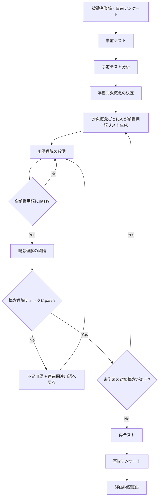
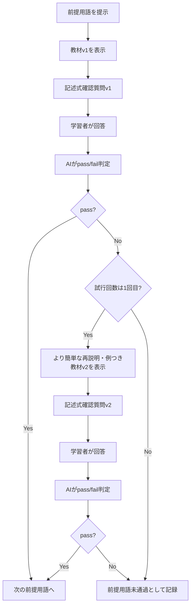
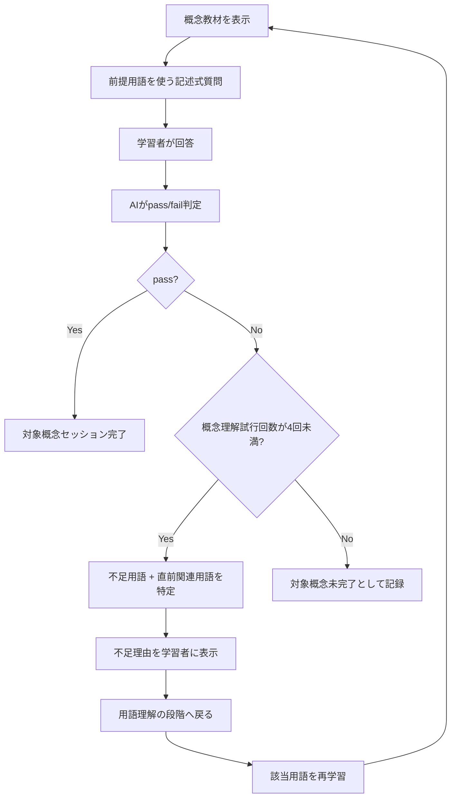

# 確定版：前提用語ゲート型AIチューターの実験フロー

## 0. 本資料の位置づけ

本資料は、従来案である「学習セッション内で誤概念タイプを毎回判定し、L3〜L1の足場掛けレベルを動的に更新する」設計を見直し、**前提用語理解を保証してから対象概念理解へ進む段階型の学習セッション**として再設計したものである。

今回の確定方針では、学習セッション内で **M1〜M4の誤概念タイプ判定は行わない**。また、学習セッション内で **L3〜L1のような足場掛けレベル更新も行わない**。

その代わりに、学習セッションは以下の2段階で構成する。

1. **用語理解の段階**  
   対象概念を理解するために必要な前提用語をAIが生成し、1つずつ教材提示と記述式確認を行う段階。

2. **概念理解の段階**  
   すべての前提用語を通過した後、対象概念そのものの教材を提示し、前提用語を用いて対象概念を説明させる段階。

この設計では、足場掛けを「L3、L2、L1のようなヒント量の段階」として扱うのではなく、**用語理解 → 概念理解 → 再テスト**という段階的な支援減少として扱う。

具体的には、学習セッション中は教材・再説明・例示による支援があるが、最後の再テストでは教材・ヒント・チャットをすべて外し、**足場掛けなしで解けるか**を確認する。

---

## 1. 確定した設計判断

| 論点 | 確定方針 |
|---|---|
| 学習対象になる対象概念 | 研究者側で固定リストを用意する |
| 前提用語リスト | 実験中にAIが対象概念ごとに生成する |
| 用語理解チェック | 記述式のみ |
| 用語理解チェックの最大試行回数 | 最大2回 |
| 用語理解で不正解だった場合 | より簡単な再説明・例つき教材を提示する |
| 概念理解へ進む条件 | すべての前提用語にpassすることが必須 |
| 前提用語ごとの期待回答 | AIが毎回生成する |
| 用語理解チェックのpass基準 | 中程度。中核要素が含まれ、重大な誤りがなければpass |
| 概念理解質問 | 前提用語を必ず使って説明させる |
| 概念理解でfailした場合 | 不足用語 + その直前の関連用語に戻る |
| 概念理解チェックの最大試行回数 | 最大4回 |
| 概念理解fail理由の表示 | 不足理由も自然文で表示する |
| 事前テストのM1〜M3選択肢 | 使用する |
| 事前テスト形式 | 選択式のみ。記述は行わない |
| 再テスト形式 | 事前テストと同型だが文面を変える。選択式のみ |
| 転移テスト | 設けない。再テストを最終テストとする |
| 統制群 | 現時点では設けない |
| 実装方針 | 新しく `term_understanding` と `concept_understanding` 用の画面・APIを作る |
| 教材生成 | 実験中にAIが生成する |
| 学習セッションの時間制限 | 設けない |

---

## 2. 研究課題の再整理

### 2.1 リサーチクエスチョン

本研究のリサーチクエスチョンは以下とする。

> **誤概念タイプ診断に基づいて、前提用語理解から概念理解へと段階的に足場掛けを減らすことで、学習者は最終的に足場掛けなしで対象概念を解けるようになるか。**

ここでいう「誤概念タイプ診断」は、主に事前テストで行う。事前テストは選択式であり、各誤答選択肢にM1〜M3を対応させることで、学習者の初期誤概念を記録する。

一方、学習セッション内ではM1〜M4の再判定は行わない。学習セッション内では、前提用語を理解できたか、対象概念を説明できたか、不足している前提用語は何かを判定する。

### 2.2 研究の主張

本研究の中心的な主張は以下である。

> 事前テストで学習者の初期理解状態および誤概念タイプを診断し、学習セッションでは対象概念を直接説明する前に、必要な前提用語をAIが抽出・教材化し、用語理解を確認する。前提用語を通過した後に対象概念理解へ進ませることで、最終的に支援なしの再テストで正答できるかを検証する。

### 2.3 旧設計からの変更点

旧設計では、学習セッション内でM1〜M4の誤概念判定とL3〜L1の足場掛けレベル更新を繰り返す想定だった。

新設計では、以下のように変更する。

| 項目 | 旧設計 | 新設計 |
|---|---|---|
| 学習セッション内の誤概念判定 | 毎回M1〜M4を判定 | 行わない |
| 学習セッション内の足場掛けレベル | L3〜L1で更新 | レベル更新は行わない |
| 支援の中心 | 回答ごとにヒント量を調整 | 前提用語理解から概念理解へ進む段階構造 |
| 不正解時の処理 | 足場掛けレベルを維持または上げる | 該当する前提用語・関連用語へ戻る |
| 最終評価 | 再テスト・転移テスト | 再テストのみ |

---

## 3. 先行研究上の位置づけ

本研究の新設計は、以下の先行研究上の考え方と接続できる。

| 先行研究の考え方 | 本研究での対応 |
|---|---|
| scaffolding questions | メイン概念を、前提用語と確認質問へ分解する |
| contingency | 学習者がpassできなければ次へ進まず、より簡単な再説明や関連用語へ戻す |
| fading | 学習中は教材・再説明があるが、最終再テストでは支援を外す |
| transfer of responsibility | 最終的に学習者が支援なしで選択式問題に答える |
| worked example fading | 最初は教材・例示で支援し、最後は自力解答へ移行する |

ASSISTmentsでは、学習者がメイン問題に誤答したとき、問題を下位ステップへ分解したscaffolding questionsやhintsを出し、支援しながら理解を確認する。本研究ではこの考え方を、AI専門用語の学習に置き換え、対象概念を理解するための前提用語と確認質問に分解する。

また、足場掛け研究では、支援は学習者の状態に応じて調整され、徐々に減り、最終的に学習者へ責任が移ることが重要とされる。本研究では、学習中に支援を細かくレベル更新するのではなく、**用語理解では教材と再説明あり、概念理解では前提用語を使った説明、再テストでは支援なし**という流れで足場掛けを段階的に減らす。

---

## 4. 実験全体フロー



### 4.1 実験全体の文章説明

本研究では、まず被験者登録と事前アンケートを行い、学習者の背景知識を把握する。次に、研究者が固定した対象概念リストに基づいて事前テストを実施する。事前テストは選択式のみで構成し、選択肢には正答、M1、M2、M3、「わからない」を対応させる。

事前テスト後、誤答または「わからない」と回答した対象概念を学習対象とする。学習対象となった各対象概念について、AIはその概念を理解するために必要な前提用語リスト、各前提用語の教材、確認質問、期待回答を生成する。

学習セッションでは、まず用語理解の段階を行う。学習者は前提用語を1つずつ学習し、各用語について記述式の確認質問に答える。1回目で不正解だった場合、AIは同じ教材をそのまま繰り返すのではなく、より簡単な再説明と具体例を提示し、2回目の確認質問を行う。2回目でも不正解だった場合、その対象概念は前提用語未通過として記録し、その対象概念の概念理解段階には進めない。

すべての前提用語にpassした場合のみ、概念理解の段階に進む。概念理解の段階では、AIが前提用語を使って対象概念を説明する教材を提示し、学習者に前提用語を必ず使って対象概念を説明させる。概念理解チェックは最大4回まで行う。failした場合、AIは不足している前提用語と、その直前の関連用語を特定し、学習者を用語理解の段階へ戻す。

すべての学習対象概念について学習セッションを終えた後、再テストを実施する。再テストは事前テストと同型だが、問題文や選択肢の表現を変更する。再テストでは教材・ヒント・チャットなどの支援を提示せず、足場掛けなしで正答できるかを確認する。転移テストは設けず、再テストを最終テストとする。

---

## 5. Phase 0：被験者登録・事前アンケート

### 5.1 目的

被験者の背景知識を把握し、後の分析で学習効果やつまずき傾向と対応づけられるようにする。

### 5.2 取得項目

| 項目 | 形式 | 用途 |
|---|---|---|
| 被験者ID | 自動発行 | 個人を匿名化して管理する |
| AI・機械学習の学習経験 | 1〜5 | 背景知識の把握 |
| プログラミング経験 | 1〜5 | 技術的背景の把握 |
| ChatGPT等の利用経験 | 1〜5 | 生成AIへの慣れの把握 |
| AI専門用語への自信度 | 1〜5 | 主観的知識レベルの把握 |

### 5.3 保存ログ例

```json
{
  "participant_id": "P001",
  "ai_experience": 2,
  "programming_experience": 1,
  "llm_usage": 4,
  "self_rated_ai_knowledge": 2
}
```

---

## 6. Phase 1：事前テスト

### 6.1 目的

事前テストの目的は、学習者がどの対象概念を理解していないかを判定し、学習対象を決定することである。

同時に、誤答選択肢にM1〜M3を対応させることで、学習者の初期誤概念タイプを評価用ログとして保存する。

### 6.2 対象概念リスト

対象概念リストは、研究者側で固定する。

初期実装では、以下のようなAI・情報系専門用語を対象候補とする。

| ID | 対象概念 |
|---:|---|
| 1 | Token |
| 2 | Embedding |
| 3 | Attention |
| 4 | Transformer |
| 5 | Prompt |
| 6 | RAG |
| 7 | Fine-tuning |
| 8 | 事前学習 |
| 9 | 事後学習 |
| 10 | 報酬モデル |
| 11 | 過学習 |
| 12 | 汎化 |

実験時間や被験者負荷を考慮し、実際に事前テストで扱う用語数は研究実施時に調整してよい。

### 6.3 事前テストの形式

事前テストは **選択式のみ** とする。記述式の理由説明は行わない。

| 項目 | 内容 |
|---|---|
| 問題文 | 対象概念の定義・役割を問う |
| 選択肢 | 正答、M1、M2、M3、わからない |
| 理由記述 | 行わない |
| 自信度 | 原則不要。必要に応じて事前アンケートで全体的自信度を取得する |

### 6.4 選択肢と誤概念タイプ

| 選択肢タイプ | 意味 | 用途 |
|---|---|---|
| 正答 | 対象概念の定義・役割を正しく表す | 正答判定 |
| M1 | カテゴリー誤分類型 | 初期誤概念タイプとして記録 |
| M2 | 類似概念境界混同型 | 初期誤概念タイプとして記録 |
| M3 | 表層特徴・キーワード反応型 | 初期誤概念タイプとして記録 |
| わからない | 未知・未学習 | 学習対象として扱う |

### 6.5 事前テスト例：Transformer

```text
Transformerの説明として、最も適切なものはどれか。

A. Token同士の関係をAttentionで扱い、層を重ねて文脈を考慮した表現を作るモデル構造。
B. AIが人間のように文章を読むための意識や理解力そのもの。
C. EmbeddingやAttentionと同じ意味で、単語を数値に変換する処理。
D. 「変換」という言葉があるので、文章を別の文章に置き換える処理全般。
E. わからない。
```

| 選択肢 | 判定 |
|---|---|
| A | 正答 |
| B | M1：カテゴリー誤分類型 |
| C | M2：類似概念境界混同型 |
| D | M3：表層特徴・キーワード反応型 |
| E | unknown |

### 6.6 学習対象の決定ルール

原則として、以下を学習対象にする。

```text
学習対象 = 事前テストで不正解だった対象概念 + 「わからない」と回答した対象概念
```

事前テストで正答した対象概念は、原則として学習対象から外す。

ただし、実験上の対象数が不足する場合や、研究者が重点概念として扱いたい場合は、正答した用語を学習対象に含めるかどうかを別途ルール化する。

### 6.7 事前テストログ例

```json
{
  "participant_id": "P001",
  "phase": "pretest",
  "target_concept": "Transformer",
  "selected_option": "C",
  "is_correct": false,
  "initial_misconception_type": "M2",
  "learning_target": true
}
```

---

## 7. Phase 2：前提用語リスト・教材・期待回答のAI生成

### 7.1 目的

対象概念の教材を提示する前に、その教材を理解するために必要な前提用語を洗い出す。

これにより、学習者が対象概念を学ぶ前に、教材中の専門用語でつまずくことを防ぐ。

### 7.2 生成タイミング

前提用語リスト、各前提用語の教材、確認質問、期待回答は、**実験中にAIが生成する**。

生成は、事前テスト後に学習対象概念が決まったタイミングで行う。

```text
事前テスト結果
  ↓
学習対象概念の決定
  ↓
対象概念ごとにAIが前提用語リストを生成
  ↓
各前提用語について教材・確認質問・期待回答を生成
```

### 7.3 AIが生成する項目

| 項目 | 内容 |
|---|---|
| prerequisite_terms | 対象概念を理解するための前提用語リスト |
| order | 学習順序 |
| reason | なぜその前提用語が必要か |
| term_material_v1 | 1回目に提示する前提用語教材 |
| term_check_question_v1 | 1回目の記述式確認質問 |
| expected_answer | pass/fail判定の基準となる期待回答 |
| term_material_v2 | 1回目fail時に提示する、より簡単な再説明・例つき教材 |
| term_check_question_v2 | 2回目の記述式確認質問 |

### 7.4 前提用語生成ルール

AIは以下のルールに従う。

1. 対象概念を理解するために必要な前提用語を抽出する。
2. 前提用語は、学習者が初学者であることを前提に選ぶ。
3. 前提用語は原則3〜6語に絞る。
4. 前提用語は、簡単なものから難しいものへ並べる。
5. 対象概念の説明で使う専門用語は、前提用語として扱うか、教材内で短く定義する。
6. 前提用語教材では、未定義の専門用語をできるだけ使わない。
7. 用語理解確認は記述式のみとする。
8. 期待回答もAIが生成するが、pass基準は中程度とする。

### 7.5 例：Transformerの前提用語

対象概念が `Transformer` の場合、AIは以下のような前提用語を生成する。

| 学習順 | 前提用語 | なぜ必要か |
|---:|---|---|
| 1 | Token | 入力文をモデルが扱う単位として理解するため |
| 2 | Embedding | Tokenを数値表現に変換することを理解するため |
| 3 | Attention | Token同士の関係を重み付けする仕組みを理解するため |
| 4 | FFN / Feed-Forward Network | 各層で表現を変換する処理を理解するため |
| 5 | Layer | 同じ処理ブロックを重ねる構造を理解するため |

### 7.6 例：事後学習の前提用語

対象概念が `事後学習` の場合、AIは以下のような前提用語を生成する。

| 学習順 | 前提用語 | なぜ必要か |
|---:|---|---|
| 1 | 事前学習 | まず大量データで基本能力を獲得する段階を理解するため |
| 2 | Fine-tuning | 目的に合わせて追加学習する考え方を理解するため |
| 3 | 報酬モデル | 出力の良さを評価する仕組みを理解するため |
| 4 | 人間のフィードバック | 人間の評価を学習に使う流れを理解するため |
| 5 | 安全性・有用性の調整 | なぜ事後学習が必要なのかを理解するため |

---

## 8. Phase 3：学習セッション全体

### 8.1 学習セッションの基本構造

学習セッションは、学習対象概念ごとに以下の2段階で行う。

```text
対象概念セッション開始
  ↓
用語理解の段階
  ↓
概念理解の段階
  ↓
対象概念セッション完了
```

### 8.2 学習セッション内で行わないこと

新設計では、学習セッション内で以下は行わない。

- M1〜M4の誤概念タイプ判定
- L3〜L1の足場掛けレベル更新
- 同種誤答再発フラグの判定

### 8.3 学習セッション内で行うこと

代わりに、以下を行う。

- 前提用語を順番に学習する
- 各前提用語について記述式の確認質問を出す
- 各前提用語を最大2回まで確認する
- 1回目で不正解なら、より簡単な再説明・例つき教材を提示する
- すべての前提用語にpassした場合のみ概念理解へ進む
- 概念理解では、前提用語を必ず使って対象概念を説明させる
- 概念理解でfailした場合、不足用語 + その直前の関連用語に戻る
- 概念理解チェックは最大4回まで行う

---

## 9. Phase 3-A：用語理解の段階

### 9.1 目的

対象概念を理解する前に、必要な前提用語を1つずつ理解する。

### 9.2 画面構成

```text
対象概念：Transformer
段階：用語理解
前提用語 3 / 5：Attention
試行回数：1 / 2

[教材]
Attentionとは、入力されたToken同士の関係の強さを計算し、
どの情報をどの程度重視するかを決める仕組みです。

[確認質問]
Attentionは、Token同士の何を計算する仕組みですか？

[記述欄]
学習者が回答する

[回答を確認]
```

### 9.3 用語理解の処理フロー



### 9.4 用語理解の判定

用語理解の段階では、M1〜M4は判定しない。

判定は以下のみとする。

| 判定 | 意味 | 次の処理 |
|---|---|---|
| pass | 前提用語を最低限説明できた | 次の前提用語へ |
| fail_attempt_1 | 1回目では理解不十分 | より簡単な再説明・例つき教材へ |
| fail_attempt_2 | 2回目でも理解不十分 | 前提用語未通過として記録 |

### 9.5 2回目でもfailした場合の扱い

用語理解チェックは最大2回までとする。全前提用語passが概念理解へ進む条件であるため、2回目でもfailした場合、その対象概念は概念理解の段階へ進めない。

この場合は以下のように処理する。

```text
対象概念セッション状態：incomplete_due_to_prerequisite_failure
未通過前提用語：Attention
次の処理：次の学習対象概念へ進む、または学習セッションを終了する
```

この処理により、無限ループを避けつつ、「全前提用語pass必須」という条件も維持する。

### 9.6 用語理解のpass基準

pass基準は中程度とする。

以下を満たす場合、passとする。

1. 用語の役割を大きく外していない。
2. 期待回答に含まれる中核要素が1つ以上含まれている。
3. 対象概念理解を妨げる重大な誤りがない。
4. 完全な専門的説明でなくても、初学者として最低限の理解が確認できる。

### 9.7 用語理解の判定例：Attention

#### 確認質問

```text
Attentionは、Token同士の何を計算する仕組みですか？
```

#### 期待回答

```text
Token同士の関係の強さを計算し、どの情報を重視するかを決める仕組み。
```

#### pass例

```text
Token同士の関係を見て、どの情報を重視するか決める仕組み。
```

この回答は「重み付け」という語はないが、「Token同士の関係」と「重視する情報」が含まれているため、中程度基準ではpassとする。

#### fail例

```text
重要な単語を探すこと。
```

この回答は、Token同士の関係や重み付けが説明されておらず、表面的な理解にとどまるためfailとする。

### 9.8 fail時の再説明例

#### 1回目教材

```text
Attentionとは、入力されたToken同士の関係の強さを計算し、
どの情報をどの程度重視するかを決める仕組みです。
```

#### 1回目fail後の再説明・例つき教材

```text
もう一度、より簡単に確認しましょう。

Attentionは「重要な単語を1つ探す処理」ではありません。
文の中のToken同士が、どれくらい関係しているかを見る仕組みです。

たとえば「太郎はりんごを食べた。それは甘かった」という文では、
「それ」が「りんご」と関係していることが重要です。
Attentionは、このようなToken同士の関係の強さを計算します。

確認質問：
Attentionは、Token同士の何を計算する仕組みですか？
```

---

## 10. Phase 3-B：概念理解の段階

### 10.1 目的

前提用語をすべて理解したうえで、対象概念そのものを理解する。

### 10.2 概念理解へ進む条件

用語理解の段階で、すべての前提用語の確認質問にpassした場合のみ、概念理解の段階へ進む。

```text
Token pass
Embedding pass
Attention pass
FFN pass
Layer pass
  ↓
Transformerの概念理解へ
```

### 10.3 画面構成

```text
対象概念：Transformer
段階：概念理解
概念理解試行回数：1 / 4

ここまでに学んだ前提用語：
Token / Embedding / Attention / FFN / Layer

[概念教材]
Transformerは、文章をTokenに分け、それぞれをEmbeddingによって数値表現に変換します。
その後、AttentionによってToken同士の関係の強さを計算し、どの情報を重視するかを決めます。
さらにFFNによって各Tokenの表現を変換し、この処理をLayerとして重ねることで、文脈を考慮した表現を作ります。

[概念理解質問]
Token、Embedding、Attention、FFN、Layerという語を必ず使って、
Transformerが文章を処理する流れを説明してください。

[記述欄]
学習者が回答する

[回答を確認]
```

### 10.4 概念理解の処理フロー



### 10.5 概念理解の判定

概念理解の段階でも、M1〜M4の誤概念分類は行わない。

判定は以下のみとする。

| 判定 | 意味 | 次の処理 |
|---|---|---|
| pass | 対象概念を前提用語を使って説明できた | 対象概念セッション完了 |
| fail | 対象概念理解が不十分 | 不足用語 + 直前関連用語へ戻る |
| max_fail | 4回目でも不十分 | 対象概念未完了として記録 |

### 10.6 概念理解のpass基準

概念理解チェックでは、以下を満たせばpassとする。

1. 指定された前提用語をすべて、または主要な前提用語を意味のある形で使っている。
2. 対象概念の処理の流れや役割を大きく外していない。
3. 前提用語同士の関係が説明されている。
4. 対象概念を単なる日常語や表面的な意味に置き換えていない。
5. 研究者が設定した期待回答の中核要素を満たしている。

### 10.7 概念理解でfailした場合の戻り方

概念理解でfailした場合、AIは不足している前提用語を判定する。

ただし、戻る対象は不足用語だけではなく、**不足用語 + その直前の関連用語** とする。

#### 直前の関連用語の定義

直前の関連用語とは、前提用語リスト上で不足用語の直前に位置する用語、または不足用語を理解するために直接必要な用語である。

例：Transformerの前提用語順序が以下の場合。

```text
1. Token
2. Embedding
3. Attention
4. FFN
5. Layer
```

もし不足用語が `Attention` であれば、直前の関連用語として `Embedding` または `Token` を含める。実装上は、まずリスト上の直前用語を採用する。

```text
不足用語：Attention
戻る用語：Embedding + Attention
```

もし不足用語が複数ある場合は、それぞれについて直前関連用語を追加し、重複を除く。

```text
不足用語：Attention, Layer
戻る用語：Embedding, Attention, FFN, Layer
```

### 10.8 fail理由の表示

概念理解でfailした場合、学習者には不足用語だけでなく、不足理由も自然文で表示する。

#### 表示例

```text
Transformerを説明するには、AttentionとLayerの理解がもう少し必要です。
今回の回答では、AttentionによってToken同士の関係を重み付けする点と、
Layerを重ねることで文脈を扱う点が説明されていませんでした。

次に、AttentionとLayerに加えて、それぞれの直前に関係する用語ももう一度確認します。
```

M1、M2、M3などの内部ラベルは表示しない。

### 10.9 概念理解の例：Transformer

#### 概念理解質問

```text
Token、Embedding、Attention、FFN、Layerという語を必ず使って、
Transformerが文章を処理する流れを説明してください。
```

#### pass例

```text
Transformerでは、まず文章をTokenに分け、それをEmbeddingで数値表現にします。
次にAttentionでToken同士の関係の強さを計算し、重要な情報を重み付けします。
その後FFNで各Tokenの表現を変換し、この処理をLayerとして重ねることで文脈を扱います。
```

#### fail例

```text
Transformerは文章を別の文章に変換するAIです。
```

#### fail時の不足用語判定例

```json
{
  "concept_check_result": "fail",
  "missing_or_weak_terms": ["Token", "Attention", "Layer"],
  "related_previous_terms": ["Embedding", "FFN"],
  "return_terms": ["Token", "Embedding", "Attention", "FFN", "Layer"],
  "learner_visible_reason": "Transformerを説明するには、Tokenに分けること、AttentionでToken同士の関係を扱うこと、Layerを重ねることの説明が必要です。今回の回答では、これらの処理の流れが説明されていませんでした。",
  "next_stage": "term_understanding"
}
```

---

## 11. 対象概念セッションの完了・未完了条件

### 11.1 完了条件

対象概念セッションは、以下を満たしたときに完了とする。

1. すべての前提用語チェックにpassしている。
2. 概念理解チェックにpassしている。
3. 概念理解回答で、指定された前提用語を使って対象概念を説明できている。

### 11.2 未完了条件

以下の場合は、対象概念セッションを未完了として記録する。

| 未完了理由 | 内容 |
|---|---|
| prerequisite_failure | 前提用語チェックで2回failした |
| concept_max_fail | 概念理解チェックで4回failした |
| user_exit | 学習者が途中で離脱した |
| system_error | AI生成や判定に失敗した |

### 11.3 完了ログ例

```json
{
  "participant_id": "P001",
  "target_concept": "Transformer",
  "session_status": "completed",
  "prerequisite_terms_passed": ["Token", "Embedding", "Attention", "FFN", "Layer"],
  "concept_check_result": "pass",
  "total_term_attempts": 8,
  "total_concept_attempts": 2
}
```

### 11.4 未完了ログ例

```json
{
  "participant_id": "P001",
  "target_concept": "Transformer",
  "session_status": "incomplete",
  "incomplete_reason": "prerequisite_failure",
  "failed_term": "Attention",
  "term_attempts": 2,
  "concept_check_attempts": 0
}
```

---

## 12. 複数対象概念がある場合の流れ

事前テストで複数の対象概念が学習対象になった場合、対象概念ごとに同じ流れを繰り返す。

```text
対象概念1：Transformer
  ↓
用語理解
  ↓
概念理解
  ↓
完了または未完了

対象概念2：RAG
  ↓
用語理解
  ↓
概念理解
  ↓
完了または未完了

対象概念3：Fine-tuning
  ↓
用語理解
  ↓
概念理解
  ↓
完了または未完了
```

### 12.1 学習対象が多すぎる場合

時間制限は設けないが、学習者負荷が過度に大きくなる可能性を避けるため、学習対象数には上限を設けてもよい。

推奨上限は3〜4概念である。

ただし、最終的に時間制限を設けない方針であるため、上限は実験実施時に調整可能とする。

### 12.2 学習対象の優先順位

学習対象が多い場合の優先順位は以下とする。

1. 「わからない」と回答した対象概念
2. M1またはM2に該当した対象概念
3. M3に該当した対象概念
4. 研究者が重点的に扱いたい対象概念

---

## 13. Phase 4：再テスト

### 13.1 目的

学習セッション後に、学習者が支援なしで対象概念を解けるようになったかを確認する。

再テストは本研究における最終テストであり、転移テストは設けない。

### 13.2 再テストの条件

| 条件 | 内容 |
|---|---|
| 支援 | なし |
| 教材 | 表示しない |
| ヒント | 出さない |
| チャット | 使わない |
| 回答形式 | 選択式のみ |
| 問題形式 | 事前テストと同型だが文面を変える |
| 誤概念判定 | 選択肢ラベルに基づいてM1〜M3を判定する |

### 13.3 再テストの問題設計

再テストでは、事前テストと同じ対象概念を扱うが、問題文と選択肢の表現を変える。

目的は、事前テストの選択肢を記憶して答えることを避け、学習後に概念を理解して選べるかを確認することである。

### 13.4 再テスト例：Transformer

#### 事前テスト

```text
Transformerの説明として、最も適切なものはどれか。

A. Token同士の関係をAttentionで扱い、層を重ねて文脈を考慮した表現を作るモデル構造。
B. AIが人間のように文章を読むための意識や理解力そのもの。
C. EmbeddingやAttentionと同じ意味で、単語を数値に変換する処理。
D. 「変換」という言葉があるので、文章を別の文章に置き換える処理全般。
E. わからない。
```

#### 再テスト

```text
Transformerの特徴として、最も適切なものはどれか。

A. 入力をTokenとして扱い、AttentionでToken間の関係を利用しながら、複数の層で表現を更新する構造。
B. AIが文章の意味を人間の意識のように感じ取る能力そのもの。
C. 単語を数値ベクトルへ変換する処理だけを指す用語。
D. 文章を別の文章へ変換するすべての処理をまとめた呼び方。
E. わからない。
```

| 選択肢 | 判定 |
|---|---|
| A | 正答 |
| B | M1 |
| C | M2 |
| D | M3 |
| E | unknown |

### 13.5 再テストで判定すること

| 判定項目 | 内容 |
|---|---|
| 正誤 | 学習後に正答できたか |
| 誤概念タイプ | M1〜M3またはunknown |
| 同種誤答再発 | 事前テストと同じMタイプが再テストで出たか |
| 支援なし正答 | 教材・ヒントなしで正答できたか |

### 13.6 再テストログ例

```json
{
  "participant_id": "P001",
  "phase": "retest",
  "target_concept": "Transformer",
  "selected_option": "A",
  "is_correct": true,
  "misconception_type": null,
  "same_misconception_recurrence": false,
  "answered_without_scaffold": true
}
```

---

## 14. Phase 5：事後アンケート

### 14.1 目的

システムの分かりやすさ、学習負荷、前提用語から学ぶ流れの有用性を確認する。

### 14.2 質問項目

| 項目 | 形式 |
|---|---|
| 用語を順番に学ぶ流れは分かりやすかったか | 1〜5 |
| いきなり概念説明を読むより理解しやすかったか | 1〜5 |
| 前提用語の確認質問は適切だったか | 1〜5 |
| 概念理解質問は適切だったか | 1〜5 |
| 教材内の専門用語は理解しやすかったか | 1〜5 |
| 学習量は多すぎなかったか | 1〜5 |
| 自由記述 | テキスト |

---

## 15. Phase 6：評価指標算出

### 15.1 主評価指標

| 指標 | 定義 | 意味 |
|---|---|---|
| 正答率向上 | 事前テストから再テストで正答率が上がったか | 学習効果の基本指標 |
| 同種誤答再発率 | 事前テストと同じ誤概念タイプが再テストで出た割合 | 誤概念再発の抑制を測る |
| 足場掛けなし正答率 | 再テストで支援なしに正答できた割合 | RQの中心指標 |
| 学習対象完了率 | 学習対象概念のうち、概念理解まで完了した割合 | 学習セッション達成度 |

### 15.2 補助指標

| 指標 | 定義 | 意味 |
|---|---|---|
| 前提用語通過率 | passした前提用語数 / 出題された前提用語数 | 用語理解段階の達成度 |
| 平均用語理解試行回数 | 用語チェックにpassするまでの平均回数 | どの前提用語でつまずいたか |
| 概念理解試行回数 | 概念理解にpassするまでの回数 | 対象概念の難易度 |
| 戻り回数 | 概念理解から用語理解へ戻った回数 | 前提用語不足の程度 |
| 不足用語頻度 | 不足と判定された用語の回数 | 教材改善に使える |
| 未完了率 | 最大試行回数内に完了できなかった割合 | 学習負荷・教材難度の指標 |

### 15.3 削除した評価指標

転移テストを設けないため、以下の指標は本設計では扱わない。

| 削除指標 | 理由 |
|---|---|
| 支援なし転移率 | 転移テストを実施しないため |
| M4文脈転移失敗率 | 転移テストを実施しないため |

---

## 16. ログ設計

### 16.1 事前テストログ

```json
{
  "phase": "pretest",
  "target_concept": "Transformer",
  "selected_option": "C",
  "is_correct": false,
  "initial_misconception_type": "M2",
  "learning_target": true
}
```

### 16.2 前提用語生成ログ

```json
{
  "phase": "prerequisite_generation",
  "target_concept": "Transformer",
  "generated_by_ai": true,
  "prerequisite_terms": [
    {"term": "Token", "order": 1, "reason": "入力文をモデルが扱う単位として理解するため"},
    {"term": "Embedding", "order": 2, "reason": "Tokenを数値表現に変換することを理解するため"},
    {"term": "Attention", "order": 3, "reason": "Token同士の関係を重み付けする仕組みを理解するため"},
    {"term": "FFN", "order": 4, "reason": "各層で表現を変換する処理を理解するため"},
    {"term": "Layer", "order": 5, "reason": "同じ処理ブロックを重ねる構造を理解するため"}
  ]
}
```

### 16.3 用語教材ログ

```json
{
  "phase": "term_material_generation",
  "target_concept": "Transformer",
  "term": "Attention",
  "material_v1": "Attentionとは、入力されたToken同士の関係の強さを計算し...",
  "check_question_v1": "Attentionは、Token同士の何を計算する仕組みですか？",
  "expected_answer": "Token同士の関係の強さを計算し、どの情報を重視するかを決める仕組み。",
  "material_v2": "もう一度、より簡単に確認しましょう...",
  "check_question_v2": "Attentionは、Token同士の何を計算しますか？"
}
```

### 16.4 用語理解ログ

```json
{
  "phase": "term_understanding",
  "target_concept": "Transformer",
  "term": "Attention",
  "attempt_index": 1,
  "material_version": 1,
  "question": "Attentionでは、Token同士の何を計算しますか？",
  "learner_answer": "重要な単語を探す",
  "result": "fail_attempt_1",
  "feedback": "重要語を1つ探すのではなく、Token同士の関係の強さを計算します。"
}
```

### 16.5 用語理解2回失敗ログ

```json
{
  "phase": "term_understanding",
  "target_concept": "Transformer",
  "term": "Attention",
  "attempt_index": 2,
  "material_version": 2,
  "learner_answer": "大事な単語を選ぶこと",
  "result": "fail_attempt_2",
  "term_status": "not_passed_after_max_attempts",
  "target_concept_session_status": "incomplete_due_to_prerequisite_failure"
}
```

### 16.6 概念理解ログ

```json
{
  "phase": "concept_understanding",
  "target_concept": "Transformer",
  "attempt_index": 1,
  "required_terms": ["Token", "Embedding", "Attention", "FFN", "Layer"],
  "question": "Token、Embedding、Attention、FFN、Layerを使ってTransformerを説明してください。",
  "learner_answer": "文章を別の文章に変換するAIです。",
  "result": "fail",
  "missing_or_weak_terms": ["Token", "Attention", "Layer"],
  "related_previous_terms": ["Embedding", "FFN"],
  "return_terms": ["Token", "Embedding", "Attention", "FFN", "Layer"],
  "learner_visible_reason": "Transformerを説明するには、Tokenに分けること、Attentionで関係を扱うこと、Layerを重ねることの説明が必要です。",
  "next_stage": "term_understanding"
}
```

### 16.7 再テストログ

```json
{
  "phase": "retest",
  "target_concept": "Transformer",
  "selected_option": "A",
  "is_correct": true,
  "misconception_type": null,
  "same_misconception_recurrence": false,
  "answered_without_scaffold": true
}
```

---

## 17. AIプロンプト設計

### 17.1 前提用語リスト生成プロンプト

```text
あなたは教育実験用AIチューターです。
対象概念を理解するために必要な前提用語を、初学者向けに3〜6個抽出してください。

重要条件：
- 対象概念の教材を読む前に知っておくべき用語だけを選ぶ。
- 用語は簡単な順に並べる。
- 学習者は事前テストでこの対象概念に不正解または「わからない」と回答している。
- 教材内で使う専門用語は、前提用語に含めるか、その場で短く定義できるものに限る。
- 出力はJSONのみ。

対象概念：{target_concept}
事前テスト選択肢：{selected_option}
初期誤概念タイプ：{initial_misconception_type}
```

### 17.2 用語教材・確認質問・期待回答生成プロンプト

```text
次の前提用語について、初学者向けの教材、記述式確認質問、期待回答を生成してください。

重要条件：
- 未定義の専門用語をできるだけ使わない。
- どうしてこの用語が対象概念の理解に必要なのかを書く。
- 1回目教材は150〜250字程度で説明する。
- 1回目確認質問は記述式にする。
- 期待回答はpass/fail判定に使えるように、中核要素を含める。
- 2回目教材は、1回目で不正解だった学習者向けに、より簡単な再説明と具体例を含める。
- 2回目確認質問も記述式にする。
- 出力はJSONのみ。

対象概念：{target_concept}
前提用語：{term}
既に学習済みの用語：{learned_terms}
```

### 17.3 用語理解判定プロンプト

```text
学習者の回答が、前提用語を最低限理解しているか判定してください。

重要条件：
- M1〜M4の誤概念タイプ分類は行わない。
- pass / fail のみ判定する。
- pass基準は中程度とする。
- 完全な専門的説明でなくても、中核要素が含まれ、対象概念理解を妨げる重大な誤りがなければpassとする。
- failの場合、学習者に見せる短いフィードバックを書く。
- 出力はJSONのみ。

前提用語：{term}
期待回答：{expected_answer}
確認質問：{question}
学習者回答：{learner_answer}
試行回数：{attempt_index}
```

出力例：

```json
{
  "result": "fail",
  "feedback": "重要な単語を1つ探すのではなく、Token同士の関係の強さを計算する点が重要です。",
  "can_retry": true
}
```

### 17.4 概念教材生成プロンプト

```text
前提用語をすべてpassした学習者に対して、対象概念の教材を作成してください。

重要条件：
- 学習済みの前提用語を使って説明する。
- 学習済みでない専門用語は使わない。
- 対象概念の構造や役割が分かるように説明する。
- 最後に、指定された前提用語を必ず使って説明させる記述問題を1つ出す。
- 出力はJSONのみ。

対象概念：{target_concept}
学習済み前提用語：{passed_terms}
```

### 17.5 概念理解判定プロンプト

```text
学習者が対象概念を理解しているか判定してください。

重要条件：
- M1〜M4の誤概念タイプ分類は行わない。
- pass / fail のみ判定する。
- 学習者は、指定された前提用語を使って対象概念を説明する必要がある。
- failの場合、どの前提用語の理解が不足しているかを missing_or_weak_terms として返す。
- failの場合、不足用語に加えて、その直前の関連用語も related_previous_terms として返す。
- 学習者に見せる不足理由を learner_visible_reason として自然文で返す。
- 概念理解チェックは最大4回である。
- 出力はJSONのみ。

対象概念：{target_concept}
必要な前提用語：{required_terms}
期待回答：{expected_answer}
概念理解質問：{question}
学習者回答：{learner_answer}
概念理解試行回数：{concept_attempt_index}
```

出力例：

```json
{
  "result": "fail",
  "missing_or_weak_terms": ["Attention", "Layer"],
  "related_previous_terms": ["Embedding", "FFN"],
  "return_terms": ["Embedding", "Attention", "FFN", "Layer"],
  "learner_visible_reason": "Transformerを説明するには、AttentionでToken同士の関係を重み付けする点と、Layerを重ねる点の説明が必要です。",
  "next_stage": "term_understanding"
}
```

---

## 18. UI設計

### 18.1 学習対象一覧画面

```text
今回学習する用語

1. Transformer
2. RAG
3. Fine-tuning

各用語について、まず前提用語を確認してから概念説明に進みます。
```

### 18.2 前提用語生成中画面

```text
対象概念を理解するために必要な前提用語を準備しています。

対象概念：Transformer
```

### 18.3 用語理解画面

```text
対象概念：Transformer
段階：用語理解
前提用語 3 / 5：Attention
試行回数：1 / 2

[教材]
...

[確認質問]
...

[回答欄]
...

[回答を確認]
```

### 18.4 用語理解1回目fail画面

```text
もう一度、より簡単に確認しましょう。

今回の回答では、Attentionを「重要な単語を探す処理」として説明していました。
ここでは、Token同士の関係の強さを計算する点が重要です。

[より簡単な再説明・例]
...

[もう一度確認質問]
...
```

### 18.5 用語理解2回目fail画面

```text
この前提用語の理解がまだ十分に確認できませんでした。
この対象概念は、今回は未完了として記録します。
次の対象概念に進みます。
```

### 18.6 概念理解画面

```text
対象概念：Transformer
段階：概念理解
概念理解試行回数：1 / 4

ここまでに学んだ用語：
Token / Embedding / Attention / FFN / Layer

[概念教材]
...

[概念理解質問]
Token、Embedding、Attention、FFN、Layerを必ず使って、Transformerを説明してください。

[回答欄]
...
```

### 18.7 概念理解fail画面

```text
Transformerを説明するには、AttentionとLayerの理解がもう少し必要です。
今回の回答では、AttentionでToken同士の関係を重み付けする点と、Layerを重ねる点が説明されていませんでした。

次に、AttentionとLayerに加えて、それぞれの直前に関係する用語ももう一度確認します。
```

---

## 19. API設計

新設計では、既存のtutor_turnベースの学習セッションではなく、新しく `term_understanding` と `concept_understanding` 用の画面・APIを作る。

### 19.1 対象概念・前提用語生成

```text
POST /api/participants/{participant_id}/learning-targets/generate-prerequisites
```

役割：事前テスト結果に基づいて、学習対象概念ごとに前提用語リストをAI生成する。

### 19.2 用語理解教材取得

```text
GET /api/learning-sessions/{session_id}/term-understanding/current
```

役割：現在学習すべき前提用語、教材、確認質問を返す。

### 19.3 用語理解回答送信

```text
POST /api/learning-sessions/{session_id}/term-understanding/respond
```

役割：学習者の記述回答を保存し、AIがpass/fail判定する。

### 19.4 概念理解教材取得

```text
GET /api/learning-sessions/{session_id}/concept-understanding
```

役割：すべての前提用語にpassした対象概念について、概念教材と概念理解質問を返す。

### 19.5 概念理解回答送信

```text
POST /api/learning-sessions/{session_id}/concept-understanding/respond
```

役割：学習者の概念説明回答を保存し、pass/fail判定、不足用語、戻るべき関連用語を決定する。

### 19.6 再テスト

```text
GET /api/participants/{participant_id}/retest
POST /api/participants/{participant_id}/retest/submit
```

役割：同型別文面の選択式再テストを出題し、正誤・誤概念タイプ・同種誤答再発を判定する。

---

## 20. データモデル案

### 20.1 target_concept_sessions

```sql
id UUID PRIMARY KEY
participant_id UUID NOT NULL
target_concept TEXT NOT NULL
initial_misconception_type TEXT NULL
session_status TEXT NOT NULL
incomplete_reason TEXT NULL
created_at TIMESTAMP NOT NULL
completed_at TIMESTAMP NULL
```

### 20.2 prerequisite_terms

```sql
id UUID PRIMARY KEY
session_id UUID NOT NULL
term TEXT NOT NULL
display_order INT NOT NULL
reason TEXT NULL
expected_answer TEXT NOT NULL
status TEXT NOT NULL
attempt_count INT DEFAULT 0
created_by_ai BOOLEAN DEFAULT TRUE
```

### 20.3 term_materials

```sql
id UUID PRIMARY KEY
prerequisite_term_id UUID NOT NULL
version INT NOT NULL
material_text TEXT NOT NULL
check_question TEXT NOT NULL
created_at TIMESTAMP NOT NULL
```

### 20.4 term_understanding_attempts

```sql
id UUID PRIMARY KEY
prerequisite_term_id UUID NOT NULL
attempt_index INT NOT NULL
material_version INT NOT NULL
learner_answer TEXT NOT NULL
result TEXT NOT NULL
feedback TEXT NULL
created_at TIMESTAMP NOT NULL
```

### 20.5 concept_understanding_attempts

```sql
id UUID PRIMARY KEY
session_id UUID NOT NULL
attempt_index INT NOT NULL
concept_material TEXT NOT NULL
question TEXT NOT NULL
learner_answer TEXT NOT NULL
result TEXT NOT NULL
missing_or_weak_terms JSONB NULL
related_previous_terms JSONB NULL
return_terms JSONB NULL
learner_visible_reason TEXT NULL
created_at TIMESTAMP NOT NULL
```

### 20.6 retest_attempts

```sql
id UUID PRIMARY KEY
participant_id UUID NOT NULL
target_concept TEXT NOT NULL
selected_option TEXT NOT NULL
is_correct BOOLEAN NOT NULL
misconception_type TEXT NULL
same_misconception_recurrence BOOLEAN NOT NULL
answered_without_scaffold BOOLEAN NOT NULL DEFAULT TRUE
created_at TIMESTAMP NOT NULL
```

---

## 21. 最終的な実験フロー文章

本研究では、まず被験者登録と事前アンケートを行い、学習者のAI・機械学習に関する背景知識を把握する。次に、研究者が固定したAI・情報系専門用語リストに基づいて事前テストを行う。事前テストは選択式のみで構成し、各問題には正答選択肢、M1カテゴリー誤分類型、M2類似概念境界混同型、M3表層特徴・キーワード反応型、「わからない」の選択肢を用意する。これにより、事前テスト段階で学習者の初期理解状態と誤概念タイプを評価用ログとして記録する。

事前テストで誤答または「わからない」と回答した対象概念を学習対象とする。学習対象概念が決定した後、AIは各対象概念について、その概念を理解するために必要な前提用語リストを生成する。さらに、各前提用語について、初学者向け教材、記述式確認質問、期待回答、1回目不正解時に提示するより簡単な再説明・例つき教材を生成する。

学習セッションでは、各対象概念について、まず用語理解の段階を行う。この段階では、前提用語を1つずつ提示し、教材を読ませた後、記述式の確認質問に答えさせる。用語理解チェックは最大2回までとする。1回目で不正解だった場合、AIは同じ教材をそのまま繰り返すのではなく、より簡単な再説明と具体例を提示し、再度確認質問を行う。2回目でも不正解だった場合、その対象概念は前提用語未通過として記録し、概念理解の段階には進めない。

すべての前提用語にpassした場合のみ、学習者は概念理解の段階へ進む。概念理解の段階では、AIが学習済みの前提用語を使って対象概念を説明する教材を提示し、その後、学習者に指定された前提用語を必ず使って対象概念を説明させる。概念理解チェックは最大4回まで行う。概念理解で不正解だった場合、AIは回答に不足している前提用語と、その直前の関連用語を特定し、不足理由を自然文で学習者に表示する。その後、学習者は該当する用語理解の段階へ戻る。

この流れを、事前テストで学習対象となったすべての対象概念について行う。すべての学習セッション終了後、再テストを行う。再テストは、事前テストと同型だが文面を変更した選択式問題とし、教材・ヒント・チャットなどの支援は提示しない。再テストでは、学習者が足場掛けなしで正答できるかを判定するとともに、事前テストと同じ誤概念タイプが再発したかを分析する。本研究では転移テストは設けず、再テストを最終テストとする。

---

## 22. 参考文献・根拠

- van de Pol, J., Volman, M., & Beishuizen, J. (2010). Scaffolding in Teacher–Student Interaction: A Decade of Research. Educational Psychology Review.  
  https://link.springer.com/article/10.1007/s10648-010-9127-6

- Feng, M., Heffernan, N. T., & Koedinger, K. R. Student Modeling in an Intelligent Tutoring System.  
  https://www.sri.com/wp-content/uploads/2021/12/feng_student_modeling_in_an_intelligent_tutoring_system.pdf

- Feng, M., Heffernan, N. T., & Koedinger, K. R. Addressing the assessment challenge in an Intelligent Tutoring System that tutors as it assesses.  
  https://link.springer.com/article/10.1007/s11257-009-9063-7

- Atkinson, R. K., Renkl, A., & Merrill, M. M. (2003). Transitioning From Studying Examples to Solving Problems: Effects of Self-Explanation Prompts and Fading Worked-Out Steps.  
  https://asu.elsevierpure.com/en/publications/transitioning-from-studying-examples-to-solving-problems-effects-

- Wood, D., Bruner, J. S., & Ross, G. (1976). The Role of Tutoring in Problem Solving.
